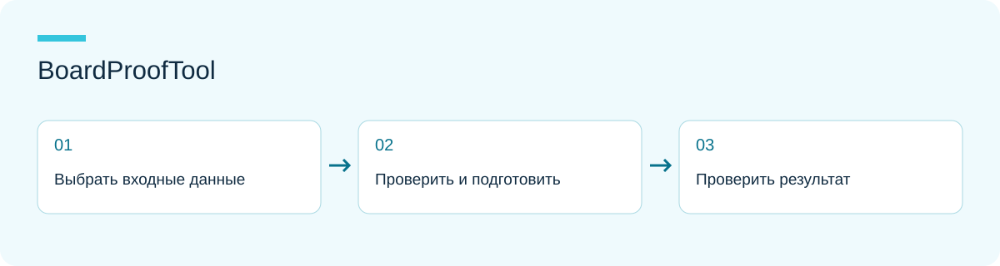



Windows-пакет BoardProofTool содержит `ProofDll.dll`, `RKUpgrade_DLL.dll` и Qt. История 1.01 исправляет потерю последнего байта CPU ID. Полного PDF с алгоритмом защиты или протоколом provisioning в пакете нет.

## Состав пакета

Распакуйте все зависимости, включая `platforms/qwindows.dll`. Один executable может не запуститься из-за Qt-плагина. `config.json` задаёт `DLL=ProofDll.dll` и журналирование. `APP_VERSION` остаётся `v1.0`, хотя архив обозначен 1.01; фиксируйте это различие.

## Эталон идентификатора

До интеграции записи считайте ID способом, документированным SDK платы. Сохраните длину, представление, ведущие нули и последний байт; сравните с результатом инструмента на образце. CPU ID не следует автоматически считать серийным номером или секретным ключом.

Для использования нужны сведения BSP о входах, выходном формате, SoC, режиме связи и критериях успеха. Нужно установить, формируется ли только файл на хосте или изменяется устройство. Из имени программы это не следует, поэтому универсальный процесс с кнопкой Run не выдумывается.

Сохраните хеш пакета, DLL, ревизию платы, SDK и сравнение полного ID. Журналы с идентификаторами храните закрыто. Здесь подтверждены пакет и подготовка; конкретный процесс записи требует дополнительной документации и проверки.

## Применимость и проверка

Руководство составлено по документации этой коллекции. Проверьте плату, SoC, плату-носитель, SDK/BSP и архитектуру хоста. Прошивка, provisioning, запись регистров и аппаратные испытания не выполнялись. Наличие пакета не подтверждает поддержку всех изделий ArmSoM.

## Каталог GitHub, версии и SHA-256

Откройте соответствующий каталог GitHub, выберите платформу и версию, проверьте хеш и распакуйте весь каталог. Ссылки ниже ведут в каталоги репозитория.

[Открыть каталог инструмента на GitHub](https://github.com/ArmSoM/rockchip-tools/tree/main/downloads/board-proof)

| Платформа / версия | Файл | SHA-256 |
|---|---|---|
| Windows / 1.01 | `BoardProofTool_v1.01_20240823_02.zip` | `72c732d7c91ba7742c4c36d2a549171f9289d820c3d50aad468e38cdd7806029` |

[GitHub · catalog.json](https://github.com/ArmSoM/rockchip-tools/blob/main/catalog.json) · [SHA256SUMS](https://github.com/ArmSoM/rockchip-tools/blob/main/SHA256SUMS)

## Документы и исходные иллюстрации

- BoardProofTool_v1.01_20240823_02.zip: config.json, revision.log and executable/dependency inventory

## Связанные рабочие процессы

- [RKDevInfoWriteTool: серийные номера и MAC без дублирования](/ru/articles/rockchip-tool-devinfo-write/)
- [EfuseTool 1.42: подготовка станции Secure Boot provisioning](/ru/articles/rockchip-tool-efuse-tool/)
- [Каталог инструментов Rockchip и руководств](/ru/articles/rockchip-tools-download-guide/)

## Документация плат ArmSoM

Требования платы и носителя проверяйте по руководству изделия. Эти ссылки — платформенные материалы, а не подтверждение проверки данного инструмента на изделиях.

[ArmSoM Docs](https://docs.armsom.org/) · [Sige7](https://www.armsom.org/sige7) / [Docs](https://docs.armsom.org/armsom-sige7) · [CM5](https://www.armsom.org/cm5) / [Docs](https://docs.armsom.org/armsom-cm5)


