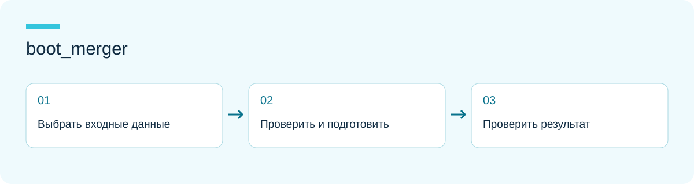



`boot_merger` объединяет компоненты ранней загрузки в Loader; создание файла само по себе не прошивает плату. Пакеты содержат программу и историю изменений, но не полное отдельное руководство.

## Подберите согласованные входные файлы

Loader объединяет инициализацию DDR, USB-компонент загрузки и загрузочный код. Официальная конфигурация RK3588 в `rkbin` показывает секции `[CODE471_OPTION]`, `[CODE472_OPTION]`, `[LOADER_OPTION]`, `[OUTPUT]` и разные файлы `FlashData`/`FlashBoot`. Используйте конфигурацию SDK платы, а не случайную комбинацию файлов с одинаковым названием SoC.

## Рабочий процесс

1. Уточните ревизию платы, тип и объём памяти, SoC и накопитель. Сохраните рабочий Loader.
2. Скопируйте конфигурацию SDK и все её компоненты в отдельный каталог; проверьте относительные пути.
3. Выберите пакет для хоста и способ запуска из SDK. Linux имеет журнал до 1.35, macOS обозначен 1.3, Windows — 1.32; это не синхронные версии.
4. Проверьте код возврата, имя, размер и хеш результата. Сохраните версии входных файлов вместе с конфигурацией.
5. Проверяйте на восстанавливаемой отладочной плате, различая загрузку в RAM и запись IDBlock в накопитель.

## Формат и диагностика

История Linux упоминает выравнивание IDBlock, чередование 2K и параметры CRC. Это изменения формата загрузки: нельзя переносить флаги в другой BSP без проверки требований.

Отсутствующий файл означает проблему путей; сбой DDR после успешной сборки — повод проверить компоненты памяти. Успех упаковки не доказывает работоспособность Loader. В статье намеренно нет выдуманных ключей командной строки: ориентируйтесь на документацию конкретного SDK.

## Применимость и проверка

Руководство составлено по документации этой коллекции. Проверьте плату, SoC, плату-носитель, SDK/BSP и архитектуру хоста. Прошивка, provisioning, запись регистров и аппаратные испытания не выполнялись. Наличие пакета не подтверждает поддержку всех изделий ArmSoM.

## Каталог GitHub, версии и SHA-256

Откройте соответствующий каталог GitHub, выберите платформу и версию, проверьте хеш и распакуйте весь каталог. Ссылки ниже ведут в каталоги репозитория.

[Открыть каталог инструмента на GitHub](https://github.com/ArmSoM/rockchip-tools/tree/main/downloads/boot-merger)

| Платформа / версия | Файл | SHA-256 |
|---|---|---|
| Linux / 1.35 release notes | `boot_merger-linux-directory-snapshot.zip` | `185fb0b12c95317f70a683919f36486153e7219a60c30bd3c9ef0a5019783bbb` |
| macOS / 1.3 | `boot_merger_v1.3_mac.zip` | `c9427f5e6448c610dae2e450ad1e245d03c39fd36756bbb02b78f20a0228f64f` |
| Windows / 1.32 | `boot_merger_v1.32.zip` | `00e12d8683c73c62df0d10102d284407721ab90310d10da23e8e090cdac124f9` |

[GitHub · catalog.json](https://github.com/ArmSoM/rockchip-tools/blob/main/catalog.json) · [SHA256SUMS](https://github.com/ArmSoM/rockchip-tools/blob/main/SHA256SUMS)

## Документы и исходные иллюстрации

- boot_merger Linux revison.log through 1.35; macOS 1.3 and Windows 1.32 package notes
- [https://github.com/rockchip-linux/rkbin/blob/master/RKBOOT/RK3588MINIALL.ini](https://github.com/rockchip-linux/rkbin/blob/master/RKBOOT/RK3588MINIALL.ini)

## Связанные рабочие процессы

- [rk_ddrbin_tool: параметры ранней инициализации DDR](/ru/articles/rockchip-tool-ddrbin-tool/)
- [RKDevTool: загрузка, Loader, разделы и прошивка update.img](/ru/articles/rockchip-tool-rkdevtool/)
- [afptool и rkImageMaker: создание и проверка update.img](/ru/articles/rockchip-tool-firmware-pack-tools/)
- [Каталог инструментов Rockchip и руководств](/ru/articles/rockchip-tools-download-guide/)

## Документация плат ArmSoM

Требования платы и носителя проверяйте по руководству изделия. Эти ссылки — платформенные материалы, а не подтверждение проверки данного инструмента на изделиях.

[ArmSoM Docs](https://docs.armsom.org/) · [Sige7](https://www.armsom.org/sige7) / [Docs](https://docs.armsom.org/armsom-sige7) · [CM5](https://www.armsom.org/cm5) / [Docs](https://docs.armsom.org/armsom-cm5)


