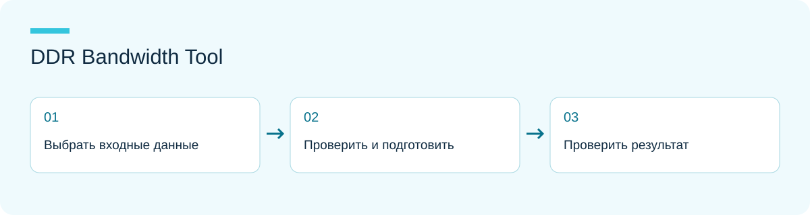





## Полное руководство измерения DDR V1.4.1

Monitor в оригинале означает наблюдение и подсчёт команд DDR. Таблица заявляет все чипы/ядра, но технический текст требует проверки платформ в справке конкретного инструмента. Это не доказательство поддержки всех ArmSoM. Ниже все шесть разделов: термин, платформы, параметры, условия, вывод и FAQ.

### 1–3. Платформы и параметры

```text
rk-msch-probe_vx.xx -h

Usage: [-c chip_name -d msecs -f freq -h help]
-c chip_name:
'rk312x' include rk3126,rk3128 and px3se
'rk322x' include rk3128h,rk3228a,rk3228b and rk3229
...
[option] -d msecs for sampling interval
[option] -f freq mean current ddr frequency unit MHz
-h for help
```

`-c` выбирает платформу, например `rk3326`; `-d` — интервал в миллисекундах, по умолчанию 1000 мс; `-f` — текущая частота DDR в МГц, если автоматическое определение за период не удалось; `-h` — справка. Перед измерением зафиксируйте частоту. В справке `rk3128h` указан под `rk322x`; исходная запись сохранена без замены другим чипом.

### 4. Условия и единицы частоты

```text
echo userspace > /sys/class/devfreq/dmc/governor
echo 780000000 > /sys/class/devfreq/dmc/userspace/set_freq
```

Регулятор DDR не должен быть `dmc_ondemand`; рекомендован `userspace`. Вторая строка — пример 780 МГц, записанный в sysfs в Гц, в отличие от МГц для `-f`. Путь и частота доступны не на каждой плате. При ошибке ниже отбросьте результат периода. В исходной диагностике отсутствует `/` перед `sys`; вывод сохранён, для проверки используйте абсолютный путь выше.

```text
Error: The DDR monitor time gets error!!!
Please check the devfreq governor is not 'dmc_ondemand'!!!
For example:
# cat sys/class/devfreq/dmc/governor
# dmc_ondemand
Please switch the devfreq governor to others, such as 'userspace'.
For example:
# echo userspace > /sys/class/devfreq/dmc/governor
Delete the result of this time!
```

### 5. Примеры вывода и все показатели

Это вывод оригинала производителя, не измерения ArmSoM. Обычные платформы выводят каналы отдельно, RK3588 — ALL и CH0–CH3.

```text
V1.06_20200629
ddr freq: 928Mhz
CH0:
ddr monitor statistics:
ddr load = 3251.23MB/s(43.76%) [RD:1859.93MB/s(25.03%), WR:1391.30MB/s(18.72%), ACT(access : active): 3.34, srex:0.54%, pdex:1.27%, clkstp:0.00%, lp:1.81%]

ddr freq: 2133Mhz
===========ALL=============CH0===============CH1==============CH2===============CH3========
LOAD:  4.51MB/s(0.03%),  1.23MB/s(0.04%),  1.13MB/s(0.03%),  1.16MB/s(0.04%),  1.00MB/s(0.03%)
RD:    2.57MB/s(0.02%),  0.74MB/s(0.02%),  0.65MB/s(0.02%),  0.67MB/s(0.02%),  0.51MB/s(0.02%)
WR:    1.94MB/s(0.01%),  0.49MB/s(0.02%),  0.48MB/s(0.02%),  0.49MB/s(0.02%),  0.48MB/s(0.01%)
===========================================================================================
```

| Показатель | Значение |
|---|---|
| `ALL` | Сумма всех каналов |
| `CHx` | Канал x |
| `load / LOAD` | Полоса/нагрузка всех банков канала |
| `RD / WR` | Полоса чтения/записи и доля всех банков |
| `PRE` | Доля precharge; парная с active, использует счётчик active, а не отдельный аппаратный |
| `ACT(access : active)` | Среднее чтений/записей на active; больше означает более последовательный доступ |
| `srex` | Доля времени self-refresh |
| `pdex` | Доля времени power down |
| `clkstp` | Доля времени clock stop |
| `srpdex` | Доля времени self-refresh power down |
| `dsmex` | Доля времени Deep Sleep Mode |
| `lp / LOW POWER` | Доля времени низкого потребления: self-refresh, power down, clock stop и др. |

### 6. Отсутствует /dev/mem

```text
rk3568:/ # rk-msch-probe_vx.xx -c rk356x
open /dev/mem error: No such file or directory
```

Причина — отсутствие `CONFIG_DEVMEM`, необходимого для доступа к регистрам. Способ 1: добавить `CONFIG_DEVMEM=y` в используемый конфиг (пример `android-11.config`) и пересобрать прошивку. Способ 2: найти DEVMEM в `make menuconfig`, включить и пересобрать ядро, не затерев настройки. Интерфейс даёт доступ к физической памяти; учитывайте права и условия эксплуатации.

```text
Symbol: DEVMEM [=y]
Type  : bool
Prompt: /dev/mem virtual device support
Location:
    -> Device Drivers
(1)   -> Character devices
  Defined at drivers/char/Kconfig:10

[*] /dev/mem virtual device support
```

## Применимость и проверка

Руководство составлено по документации этой коллекции. Проверьте плату, SoC, плату-носитель, SDK/BSP и архитектуру хоста. Прошивка, provisioning, запись регистров и аппаратные испытания не выполнялись. Наличие пакета не подтверждает поддержку всех изделий ArmSoM.

## Каталог GitHub, версии и SHA-256

Откройте соответствующий каталог GitHub, выберите платформу и версию, проверьте хеш и распакуйте весь каталог. Ссылки ниже ведут в каталоги репозитория.

[Открыть каталог инструмента на GitHub](https://github.com/ArmSoM/rockchip-tools/tree/main/downloads/ddr-bandwidth)

| Платформа / версия | Файл | SHA-256 |
|---|---|---|
| Linux target / manual 1.4.1 | `ddr-bandwidth-linux-directory-snapshot.zip` | `198ec5ad23aedee97518936fb4c2810f3d92c415269fad56788e833811af612d` |

[GitHub · catalog.json](https://github.com/ArmSoM/rockchip-tools/blob/main/catalog.json) · [SHA256SUMS](https://github.com/ArmSoM/rockchip-tools/blob/main/SHA256SUMS)

## Документы и исходные иллюстрации

- Rockchip_Introduction_DDR_Bandwidth_Tool_CN.pdf

## Связанные рабочие процессы

- [Руководство Rockchip DDR: частота, ёмкость, проверка, глазковые диаграммы и ECC](/ru/articles/037-rockchip-ddr/)
- [DDR_UserTool 1.41: выбор конфигурации тестирования DDR](/ru/articles/rockchip-tool-ddr-user-tool/)
- [Каталог инструментов Rockchip и руководств](/ru/articles/rockchip-tools-download-guide/)

## Документация плат ArmSoM

Требования платы и носителя проверяйте по руководству изделия. Эти ссылки — платформенные материалы, а не подтверждение проверки данного инструмента на изделиях.

[ArmSoM Docs](https://docs.armsom.org/) · [Sige7](https://www.armsom.org/sige7) / [Docs](https://docs.armsom.org/armsom-sige7) · [CM5](https://www.armsom.org/cm5) / [Docs](https://docs.armsom.org/armsom-cm5)


