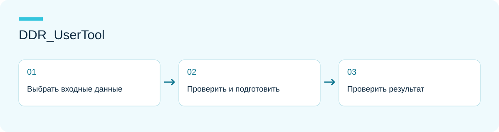



DDR_UserTool относится к запуску и тестированию памяти. Архив содержит большой каталог конфигураций `TestFile` по платформам. Это другой инструмент, чем измеритель пропускной способности или редактор DDR binary.

## Топология памяти

Запишите SoC, поколение DDR, организацию и число микросхем, ширину шины, rank/chip-select и ревизию платы. Имена конфигураций отражают эти сочетания. Совпадения общей ёмкости недостаточно: разводка может отличаться.

## Контролируемый тест

1. Сохраните исходный DDR binary SDK и рабочий Loader.
2. Выберите конфигурацию по платформе и фактической установке памяти, сверив её со схемой и DDR-руководством SDK.
3. Работайте с копией; фиксируйте каждое изменение и причину.
4. Используйте способ загрузки из соответствующего SDK на восстанавливаемой плате. Каталог сам по себе не задаёт универсальной команды.
5. Запишите тест, частоту, температуру, длительность и ошибки; повторите при рабочих условиях изделия.

Проверка пайки, стресс-тест частоты и измерение полосы отвечают на разные вопросы. Успешный тест одной конфигурации не подтверждает все частоты и партии. При сбое до начала теста проверяйте топологию, Loader и питание, а не меняйте всё одновременно.

Отдельного полного PDF в пакете не найдено. Здесь описаны выбор конфигурации и фиксация результатов; общая методика дана в связанном DDR-руководстве. Совместимость всех конфигураций 1.41 с ArmSoM не заявляется.

## Применимость и проверка

Руководство составлено по документации этой коллекции. Проверьте плату, SoC, плату-носитель, SDK/BSP и архитектуру хоста. Прошивка, provisioning, запись регистров и аппаратные испытания не выполнялись. Наличие пакета не подтверждает поддержку всех изделий ArmSoM.

## Каталог GitHub, версии и SHA-256

Откройте соответствующий каталог GitHub, выберите платформу и версию, проверьте хеш и распакуйте весь каталог. Ссылки ниже ведут в каталоги репозитория.

[Открыть каталог инструмента на GitHub](https://github.com/ArmSoM/rockchip-tools/tree/main/downloads/ddr-user-tool)

| Платформа / версия | Файл | SHA-256 |
|---|---|---|
| Windows / 1.41 | `DDR_UserTool_v1.41.7z` | `f53d06ad782e9fa85f5f098572fc20bd82945886936b1df5faf6ebf6ea892416` |

[GitHub · catalog.json](https://github.com/ArmSoM/rockchip-tools/blob/main/catalog.json) · [SHA256SUMS](https://github.com/ArmSoM/rockchip-tools/blob/main/SHA256SUMS)

## Документы и исходные иллюстрации

- DDR_UserTool_v1.41.7z: per-platform TestFile configuration tree; existing Rockchip DDR guide

## Связанные рабочие процессы

- [Руководство Rockchip DDR: частота, ёмкость, проверка, глазковые диаграммы и ECC](/ru/articles/037-rockchip-ddr/)
- [DDR Bandwidth Tool: измерение трафика памяти Rockchip](/ru/articles/rockchip-tool-ddr-bandwidth/)
- [rk_ddrbin_tool: параметры ранней инициализации DDR](/ru/articles/rockchip-tool-ddrbin-tool/)
- [Каталог инструментов Rockchip и руководств](/ru/articles/rockchip-tools-download-guide/)

## Документация плат ArmSoM

Требования платы и носителя проверяйте по руководству изделия. Эти ссылки — платформенные материалы, а не подтверждение проверки данного инструмента на изделиях.

[ArmSoM Docs](https://docs.armsom.org/) · [Sige7](https://www.armsom.org/sige7) / [Docs](https://docs.armsom.org/armsom-sige7) · [CM5](https://www.armsom.org/cm5) / [Docs](https://docs.armsom.org/armsom-cm5)


