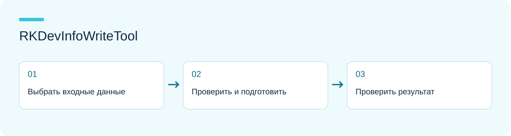



Интерфейс RKDevInfoWriteTool содержит SN, Wi-Fi, LAN, Bluetooth и защитные поля. Наличие поля не подтверждает его поддержку платой. Назначение идентификаторов и security provisioning следует разделять.

## Чистый пакет

Из перепакованной версии удалены старые журналы, конфигурация и `DEVNAME.bin`; исполняемые файлы не изменены. Создайте новую конфигурацию станции. Ресурсы подтверждают Read, Write, Single, Loader, Test и Reboot, но полного PDF нет; поведение хранилища определяется BSP.

## Учёт значений

Задайте владельца диапазона, разрешённые SN/MAC и проверку дубликатов. Используйте надлежащим образом выделенные адреса. Клиентские идентификаторы и таблицы распределения храните приватно; не повторяйте примерные значения на серии.

Подтвердите плату и firmware, включите только нужные поддерживаемые поля и проверьте один образец до автоматизации. Выполните readback, если он поддерживается, затем проверку через ОС или API и после перезагрузки.

## Ошибки

Запишите израсходованные ID, статус и прочитанный результат. После тайм-аута выясните, состоялась ли запись, прежде чем назначать новый ID. `ForceWrite`, erase, RPMB и lock не являются стандартным решением ошибки SN. Для них нужен отдельный процесс. Клиентские данные и лицензионные ключи не распространяются.

## Применимость и проверка

Руководство составлено по документации этой коллекции. Проверьте плату, SoC, плату-носитель, SDK/BSP и архитектуру хоста. Прошивка, provisioning, запись регистров и аппаратные испытания не выполнялись. Наличие пакета не подтверждает поддержку всех изделий ArmSoM.

## Каталог GitHub, версии и SHA-256

Откройте соответствующий каталог GitHub, выберите платформу и версию, проверьте хеш и распакуйте весь каталог. Ссылки ниже ведут в каталоги репозитория.

[Открыть каталог инструмента на GitHub](https://github.com/ArmSoM/rockchip-tools/tree/main/downloads/devinfo-write)

| Платформа / версия | Файл | SHA-256 |
|---|---|---|
| Windows / 1.3.7 | `RKDevInfoWriteTool-v1.3.7-clean.zip` | `66a3a94142470356adc8c7e3a2b9ba2deee60fd3bb7bcbba9c196c2534eb6f3a` |

[GitHub · catalog.json](https://github.com/ArmSoM/rockchip-tools/blob/main/catalog.json) · [SHA256SUMS](https://github.com/ArmSoM/rockchip-tools/blob/main/SHA256SUMS)

## Документы и исходные иллюстрации

- RKDevInfoWriteTool-v1.3.7.zip: English.ini, configuration UI resources and packaging inventory

## Связанные рабочие процессы

- [HDCP Key Writer: упаковка разрешённых ключей и provisioning](/ru/articles/rockchip-tool-hdcp-key-writer/)
- [RKPCBATool 1.2.1: функциональные тесты Linux-платы и ручная оценка](/ru/articles/rockchip-tool-pcba-tool/)
- [EfuseTool 1.42: подготовка станции Secure Boot provisioning](/ru/articles/rockchip-tool-efuse-tool/)
- [Каталог инструментов Rockchip и руководств](/ru/articles/rockchip-tools-download-guide/)

## Документация плат ArmSoM

Требования платы и носителя проверяйте по руководству изделия. Эти ссылки — платформенные материалы, а не подтверждение проверки данного инструмента на изделиях.

[ArmSoM Docs](https://docs.armsom.org/) · [Sige7](https://www.armsom.org/sige7) / [Docs](https://docs.armsom.org/armsom-sige7) · [CM5](https://www.armsom.org/cm5) / [Docs](https://docs.armsom.org/armsom-cm5)


