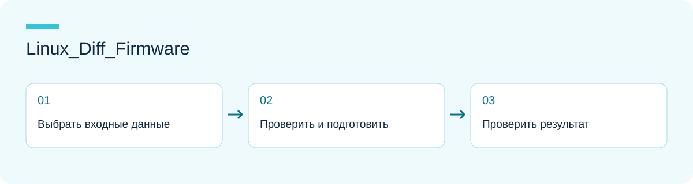





Дифференциальный пакет описывает переход между конкретными старой и новой прошивками. Он может уменьшить объём передачи, но универсального коэффициента уменьшения нет.

## Исходная версия

Сохраните неизменные `old.img`, `new.img` и их хеши. На устройстве должна быть ожидаемая старая версия. Проверьте изделие, разметку и механизм обновления: маленький пакет не делает разные прошивки совместимыми.

## Подготовка и запуск

Скрипт проверяет `bsdiff`, `rkImageMaker`, `afptool`, `md5sum`, распознаёт Squashfs/ext4 и создаёт временные каталоги OLD/NEW/DIFF рядом с собой. Используйте копии и оставьте место для двух распакованных прошивок и результата.

```text
./mk-diff-ota.sh old.img new.img diff.img
```

Порядок: старая версия, новая, выходной файл. Проверьте карту чипов в скрипте. Поддержка A/B помечена TODO, поэтому наличие A/B-разделов не подтверждает пригодность этого инструмента.

## Проверка результата

Сначала проверьте самостоятельную загрузку обеих полных прошивок, затем обновление с точной старой базы. Проверьте версию ОС, файлы и службы. Испытайте неверную базу и прерывание согласно проекту восстановления; сохраните полный recovery-образ.

Неподдерживаемая файловая система требует другого подтверждённого процесса, а не переименования. Отсутствующие программы нужно установить для хоста. Несовпадение базы исправляется управлением версиями. Сохраняйте журнал и код возврата; созданный пакет ещё не означает успешного обновления устройства.

## Применимость и проверка

Руководство составлено по документации этой коллекции. Проверьте плату, SoC, плату-носитель, SDK/BSP и архитектуру хоста. Прошивка, provisioning, запись регистров и аппаратные испытания не выполнялись. Наличие пакета не подтверждает поддержку всех изделий ArmSoM.

## Загрузка, версии и SHA-256

Выберите архив, проверьте хеш и распакуйте весь каталог. Разделённый Linux PinDebug сначала восстановите по инструкции; его указанный хеш относится к целому файлу.

| Хост / версия | Пакет |
|---|---|
| Linux / directory snapshot | [linux-diff-firmware-directory-snapshot.zip](https://raw.githubusercontent.com/ArmSoM/rockchip-tools/main/downloads/diff-firmware/linux-diff-firmware-directory-snapshot.zip) |

**linux-diff-firmware-directory-snapshot.zip — SHA-256**

```text
e13711865267ea4ee1f71c048d356bc5dff2de0f24e3d1b71dcd4cfb159b45b9
```

[GitHub · catalog.json](https://github.com/ArmSoM/rockchip-tools/blob/main/catalog.json) · [SHA256SUMS](https://github.com/ArmSoM/rockchip-tools/blob/main/SHA256SUMS)

## Документы и исходные иллюстрации

- Linux_Diff_Firmware/mk-diff-ota.sh and bundled packaging utilities

## Связанные рабочие процессы

- [afptool и rkImageMaker: создание и проверка update.img](/ru/articles/rockchip-tool-firmware-pack-tools/)
- [Производственная прошивка Rockchip: USB, SD, программаторы и диагностика](/ru/articles/147-rockchip-firmware-production/)
- [Каталог инструментов Rockchip и руководств](/ru/articles/rockchip-tools-download-guide/)

## Документация плат ArmSoM

Требования платы и носителя проверяйте по руководству изделия. Эти ссылки — платформенные материалы, а не подтверждение проверки данного инструмента на изделиях.

[ArmSoM Docs](https://docs.armsom.org/) · [Sige7](https://www.armsom.org/sige7) / [Docs](https://docs.armsom.org/armsom-sige7) · [CM5](https://www.armsom.org/cm5) / [Docs](https://docs.armsom.org/armsom-cm5)


