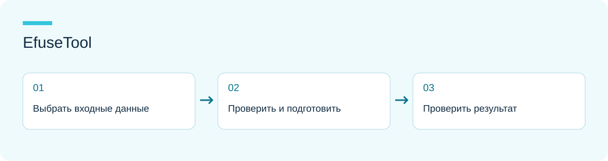



EfuseTool связан с записью защитной информации, включая хеш открытого ключа. Состояние eFuse/OTP может быть необратимым; нужен процесс конкретной платы, а не обычная инструкция восстановления.

## Подтверждённые сведения

История 1.42 добавляет 356X; прежние записи исправляют ошибки хеша RK3288/RK3399 и RK3229P. Поддержка всех новых SoC отсюда не следует. Полного PDF нет. Языковые ресурсы описывают загрузку прошивки, ID устройств, статусы и ошибки записи/чтения/сравнения key hash.

## Подготовка

Проверьте утверждённую прошивку и идентичность ключа. Запишите версии Loader, firmware, инструмента, USB-топологию и плату. Пометьте физические USB-порты согласно ID в интерфейсе, как требует встроенная подсказка. Сначала проверьте процесс на инженерном образце.

Разделите подпись, проверку и provisioning в производственной процедуре. Не переносите адреса или длину ключа с другого чипа. Ошибки “firmware is unsigned” и “creating publickey hash failed” требуют исправления входов, а не обхода проверки.

## Учёт результата

Сохраните ID устройства, отпечаток ожидаемого ключа, статус и результат последующей загрузки/recovery. После тайм-аута сначала выясните текущее состояние; слепой повтор недопустим. Текст интерфейса не заменяет подтверждённую процедуру конкретной платы. Предохранители при подготовке не программировались.

## Применимость и проверка

Руководство составлено по документации этой коллекции. Проверьте плату, SoC, плату-носитель, SDK/BSP и архитектуру хоста. Прошивка, provisioning, запись регистров и аппаратные испытания не выполнялись. Наличие пакета не подтверждает поддержку всех изделий ArmSoM.

## Каталог GitHub, версии и SHA-256

Откройте соответствующий каталог GitHub, выберите платформу и версию, проверьте хеш и распакуйте весь каталог. Ссылки ниже ведут в каталоги репозитория.

[Открыть каталог инструмента на GitHub](https://github.com/ArmSoM/rockchip-tools/tree/main/downloads/efuse-tool)

| Платформа / версия | Файл | SHA-256 |
|---|---|---|
| Windows / 1.42 | `EfuseTool_v1.42.zip` | `abb81d072ad6a7cec31d7a7c5a3f72d9bfe57544ee4d8715e4c031b4bd780fc9` |

[GitHub · catalog.json](https://github.com/ArmSoM/rockchip-tools/blob/main/catalog.json) · [SHA256SUMS](https://github.com/ArmSoM/rockchip-tools/blob/main/SHA256SUMS)

## Документы и исходные иллюстрации

- EfuseTool_v1.42.zip: revision.txt and Language/English.ini

## Связанные рабочие процессы

- [rk_sign_tool и sign_tool: подпись и проверка прошивки Rockchip](/ru/articles/rockchip-tool-rk-sign-tool/)
- [SecureBootTool 1.85: границы исторической схемы Secure Boot](/ru/articles/rockchip-tool-secureboot-tool/)
- [Полное руководство Rockchip Secure Boot: подпись, eFuse, OTP и проверка](/ru/articles/105-rockchip-secure-boot/)
- [Каталог инструментов Rockchip и руководств](/ru/articles/rockchip-tools-download-guide/)

## Документация плат ArmSoM

Требования платы и носителя проверяйте по руководству изделия. Эти ссылки — платформенные материалы, а не подтверждение проверки данного инструмента на изделиях.

[ArmSoM Docs](https://docs.armsom.org/) · [Sige7](https://www.armsom.org/sige7) / [Docs](https://docs.armsom.org/armsom-sige7) · [CM5](https://www.armsom.org/cm5) / [Docs](https://docs.armsom.org/armsom-cm5)


