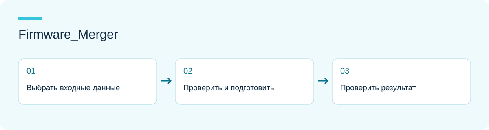





Firmware_Merger формирует файл по `setting.ini` для производственного процесса с заданной разметкой накопителя. Сначала выберите формат, затем средство записи.

## Три формата

Пустое `Gpt_Enable` означает Flat RK для RK miniloader, `0` — Flat GPT для U-Boot SPL, `1` — Compact GPT. Эта необычная схема сохранена из руководства. Компактный образ требует производственного инструмента; его нельзя записывать как плоский через `wl`. `Backup_Partition_Enable=1` включает резервный заголовок, пустое значение соответствует стандартному режиму, в том числе при неизвестном размере flash.

## Разметка

IDBlock должен быть первым разделом. Пример источника:

```text
Name=IDBlock
Type=0x2
PartOffset=0x40
PartSize=0x400
Flag=
File=Image/FlashData.bin,Image/FlashBoot.bin
```

Руководство требует размер меньше 2M. Не считайте шестнадцатеричные смещения байтами без проверки единиц формата. Для других разделов пустой `Flag` записывает файл с заполнением раздела; `0x2` заполняет без файла; `0x1` пропускает; `0x4` расширяет последний раздел на оставшееся место. `Type_Guid` ссылается на ключ секции `[PARTITION_TYPE_GUID]`.

## Создание и проверка

Скопируйте подходящую конфигурацию, проверьте пути, границы и ёмкость, затем используйте команду README:

```text
./firmware_merger -P setting.ini ./
```

Она создаёт файл; запись устройства выполняется отдельно. Проверьте размер, хеш и разметку соответствующими средствами SDK. Убедитесь, что производственный программатор поддерживает выбранный формат.

Отсутствующие входные файлы, пересекающиеся разделы и путаница Compact/Flat не исправляются заменой USB-кабеля. Храните конфигурацию и образы как один комплект. Пример не является проверенной разметкой платы ArmSoM.

## Применимость и проверка

Руководство составлено по документации этой коллекции. Проверьте плату, SoC, плату-носитель, SDK/BSP и архитектуру хоста. Прошивка, provisioning, запись регистров и аппаратные испытания не выполнялись. Наличие пакета не подтверждает поддержку всех изделий ArmSoM.

## Загрузка, версии и SHA-256

Выберите архив, проверьте хеш и распакуйте весь каталог. Разделённый Linux PinDebug сначала восстановите по инструкции; его указанный хеш относится к целому файлу.

| Хост / версия | Пакет |
|---|---|
| Linux / directory snapshot | [firmware-merger-linux-directory-snapshot.zip](https://raw.githubusercontent.com/ArmSoM/rockchip-tools/main/downloads/firmware-merger/firmware-merger-linux-directory-snapshot.zip) |

**firmware-merger-linux-directory-snapshot.zip — SHA-256**

```text
798ce66df5ee1f22cd96f811bf9140e5e9f4f0f3977a4ef37acd54554d6992ea
```

[GitHub · catalog.json](https://github.com/ArmSoM/rockchip-tools/blob/main/catalog.json) · [SHA256SUMS](https://github.com/ArmSoM/rockchip-tools/blob/main/SHA256SUMS)

## Документы и исходные иллюстрации

- Firmware_Merger/Readme.txt; user_manual.txt; setting examples

## Связанные рабочие процессы

- [afptool и rkImageMaker: создание и проверка update.img](/ru/articles/rockchip-tool-firmware-pack-tools/)
- [programmer_image_tool: образы для eMMC, SPI NOR и NAND-программаторов](/ru/articles/rockchip-tool-programmer-image-tool/)
- [Каталог инструментов Rockchip и руководств](/ru/articles/rockchip-tools-download-guide/)

## Документация плат ArmSoM

Требования платы и носителя проверяйте по руководству изделия. Эти ссылки — платформенные материалы, а не подтверждение проверки данного инструмента на изделиях.

[ArmSoM Docs](https://docs.armsom.org/) · [Sige7](https://www.armsom.org/sige7) / [Docs](https://docs.armsom.org/armsom-sige7) · [CM5](https://www.armsom.org/cm5) / [Docs](https://docs.armsom.org/armsom-cm5)


