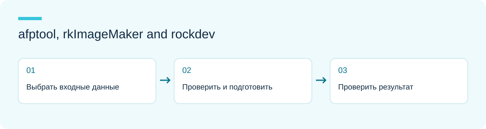





В каталоге rockdev `afptool` упаковывает файлы из `package-file`, а `rkImageMaker` добавляет Loader и сведения о чипе. Такой контейнер прошивки не равен сырому образу диска.

## Входные данные

Поместите согласованные образы и Loader в `Image/`, добавьте `Image/parameter` либо `Image/parameter.txt` и проверьте верхнеуровневый `package-file`. Все пути должны существовать, а назначение файлов соответствовать разделам одной сборки платы.

## Пример RK3588

Пакет содержит следующий двухэтапный сценарий:

```text
./afptool -pack ./ Image/update.img
./rkImageMaker -RK3588 Image/MiniLoaderAll.bin Image/update.img update.img -os_type:androidos
```

Сохранённый `-os_type:androidos` показывает, что это конкретный исходный пример, а не универсальный рецепт Linux. `Image/update.img` — промежуточный пакет, верхнеуровневый `update.img` — конечный контейнер. Рабочий каталог должен соответствовать скрипту; для другого SoC/ОС нужен сценарий своего SDK.

## Обратная проверка

README описывает `unpack.sh` с результатом в `output`. Работайте в новом каталоге, чтобы не спутать старые файлы с новой распаковкой. Сопоставьте Loader, названия разделов, длины файлов и исходный список; сохраните SHA-256 результата.

Отсутствующие parameter/package-file проверяются скриптом. Неверные пути и слишком большие образы исправляются до прошивки. Ошибка идентификатора чипа может проявиться только на устройстве, поэтому проверяйте её заранее.

Linux-снимок, macOS rockdev 2.1 и Windows-пакет с датой сохранены отдельно: флаги могут отличаться. Успешная упаковка не заменяет проверку загрузки, накопителя, восстановления и обновления платы.

## Применимость и проверка

Руководство составлено по документации этой коллекции. Проверьте плату, SoC, плату-носитель, SDK/BSP и архитектуру хоста. Прошивка, provisioning, запись регистров и аппаратные испытания не выполнялись. Наличие пакета не подтверждает поддержку всех изделий ArmSoM.

## Загрузка, версии и SHA-256

Выберите архив, проверьте хеш и распакуйте весь каталог. Разделённый Linux PinDebug сначала восстановите по инструкции; его указанный хеш относится к целому файлу.

| Хост / версия | Пакет |
|---|---|
| Linux / directory snapshot | [rockdev-linux-directory-snapshot.zip](https://raw.githubusercontent.com/ArmSoM/rockchip-tools/main/downloads/firmware-pack-tools/rockdev-linux-directory-snapshot.zip) |
| macOS / 2.1 | [rockdev_v2.1_mac.zip](https://raw.githubusercontent.com/ArmSoM/rockchip-tools/main/downloads/firmware-pack-tools/rockdev_v2.1_mac.zip) |
| Windows / 20230109 | [RKImageMaker_20230109.zip](https://raw.githubusercontent.com/ArmSoM/rockchip-tools/main/downloads/firmware-pack-tools/RKImageMaker_20230109.zip) |

**rockdev-linux-directory-snapshot.zip — SHA-256**

```text
06049f3eb612de5d1a3866bffe4b1d8d7dabaef4fd38b07decd79380f5af5a36
```

**rockdev_v2.1_mac.zip — SHA-256**

```text
af29d720edba7a0f082f984d57adf5a09b81a8df6deebf7f158aeedabd4018e7
```

**RKImageMaker_20230109.zip — SHA-256**

```text
887863bb2563ba0ab9c77b846a26f47fe7774f95152d66253c4de910419591cd
```

[GitHub · catalog.json](https://github.com/ArmSoM/rockchip-tools/blob/main/catalog.json) · [SHA256SUMS](https://github.com/ArmSoM/rockchip-tools/blob/main/SHA256SUMS)

## Документы и исходные иллюстрации

- Linux_Pack_Firmware/rockdev/readme.txt; rk3588-mkupdate.sh; unpack.sh
- rockdev_v2.1_mac.zip; RKImageMaker_20230109.zip

## Связанные рабочие процессы

- [Firmware_Merger: образы Flat RK, Flat GPT и Compact GPT](/ru/articles/rockchip-tool-firmware-merger/)
- [upgrade_tool: команды прошивки Rockchip и выбор устройства](/ru/articles/rockchip-tool-upgrade-tool/)
- [Производственная прошивка Rockchip: USB, SD, программаторы и диагностика](/ru/articles/147-rockchip-firmware-production/)
- [Каталог инструментов Rockchip и руководств](/ru/articles/rockchip-tools-download-guide/)

## Документация плат ArmSoM

Требования платы и носителя проверяйте по руководству изделия. Эти ссылки — платформенные материалы, а не подтверждение проверки данного инструмента на изделиях.

[ArmSoM Docs](https://docs.armsom.org/) · [Sige7](https://www.armsom.org/sige7) / [Docs](https://docs.armsom.org/armsom-sige7) · [CM5](https://www.armsom.org/cm5) / [Docs](https://docs.armsom.org/armsom-cm5)


