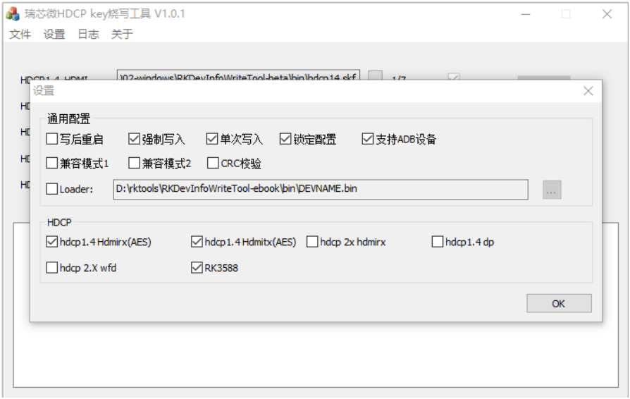
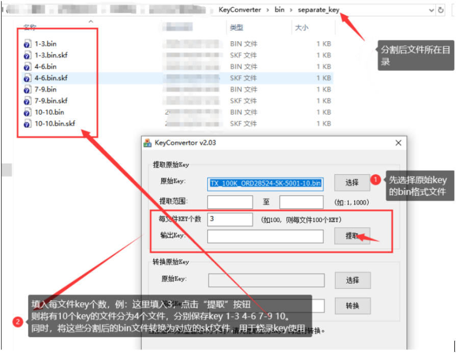




## HDCP Key Writer V1.0.1: настройки и упаковка

Инструмент записывает лицензированные HDCP-ключи из специального `.skf`. Руководство V1.0.1 отличается от пакета 1.0.5. Сохранены все настройки, пример HdcpKeyPack и схема KeyConvertor. Показаны имена файлов и пример журнала, не реальные ключи.

### 1. Общие настройки и HDCP

| Настройка | Значение |
|---|---|
| 写后重启 / Reboot | Перезагрузка после записи |
| 强制写入 / Force write | Обычно проверяется прежняя запись и устройство пропускается; руководство требует флаг, так как чтение HDCP удалено. Это поведение указанной версии. |
| 单次写入 / Single write | Включено: каждый раз нажать Write. Выключено: запись при подключении |
| 锁定配置 / Lock configuration | Запрещает включать пункты записи в главном окне |
| 支持 ADB / ADB support | Выполняет `adb reboot loader` перед записью |
| 兼容模式 1 / 2 | Режимы старых платформ; при ошибке источник предлагает попробовать один |
| RK3588 | Явный выбор RK3588 из-за другого контроллера и шифрования |
| HDCP / AES | Включить пункты HDCP отдельно; для RK3588 AES передачи настраивается для каждого ключа |

### 2. HdcpKeyPack

Скрипт извлечения создаёт один HDCP2.3-ключ на файл. В примере десять файлов по 1000 байт. Поместите их в `hdcpkeys` и упакуйте в skf. `--pack` — упаковка, `--in` — входной каталог, `--out` — выходной файл. Существующий результат перезаписывается; сохраните производственную партию.

```text
HdcpKeyPack.exe --pack --in .\hdcpkeys --out .\hdcp.skf
```

```text
Current dir is D:\rktools\002-windows\003-hdcp\RKDevInfoTool\bin\
output filename is .\hdcp.skf
dest file exist, will be overwrite
file D:\rktools\002-windows\003-hdcp\RKDevInfoTool\bin\.\hdcpkeys\fw_hdcp_receivers_0737C22DEC.bin size is 1000
file D:\rktools\002-windows\003-hdcp\RKDevInfoTool\bin\.\hdcpkeys\fw_hdcp_receivers_32DC5BF80C.bin size is 1000
file D:\rktools\002-windows\003-hdcp\RKDevInfoTool\bin\.\hdcpkeys\fw_hdcp_receivers_4D64BA99B4.bin size is 1000
file D:\rktools\002-windows\003-hdcp\RKDevInfoTool\bin\.\hdcpkeys\fw_hdcp_receivers_55EEC3E501.bin size is 1000
file D:\rktools\002-windows\003-hdcp\RKDevInfoTool\bin\.\hdcpkeys\fw_hdcp_receivers_62CCAA07DB.bin size is 1000
file D:\rktools\002-windows\003-hdcp\RKDevInfoTool\bin\.\hdcpkeys\fw_hdcp_receivers_9D3355F824.bin size is 1000
file D:\rktools\002-windows\003-hdcp\RKDevInfoTool\bin\.\hdcpkeys\fw_hdcp_receivers_AA113C1AFE.bin size is 1000
file D:\rktools\002-windows\003-hdcp\RKDevInfoTool\bin\.\hdcpkeys\fw_hdcp_receivers_B29B45664B.bin size is 1000
file D:\rktools\002-windows\003-hdcp\RKDevInfoTool\bin\.\hdcpkeys\fw_hdcp_receivers_CD23A407F3.bin size is 1000
file D:\rktools\002-windows\003-hdcp\RKDevInfoTool\bin\.\hdcpkeys\fw_hdcp_receivers_F8C83DD213.bin size is 1000
10 file packed to .\hdcp.skf[CRC: 0xC75F3091]
```

### 3. KeyConvertor

Последняя страница показывает выбор файлов и настройку KeyConvertor на аннотированном снимке без отдельных параметров командной строки. Оригинал приведён ниже. Выбирайте преобразование по лицензированному формату; не смешивайте версии HDCP, роли приёмника/передатчика и чипы.

На схеме KeyConvertor выбирается исходный `.bin`, диапазон и число KEY на файл, затем Extract. Десять ключей по три разбиваются на `1-3`, `4-6`, `7-9`, `10-10`; каждый bin преобразуется в skf в `separate_key`. Количества — пример, не производственная квота.

## Применимость и проверка

Руководство составлено по документации этой коллекции. Проверьте плату, SoC, плату-носитель, SDK/BSP и архитектуру хоста. Прошивка, provisioning, запись регистров и аппаратные испытания не выполнялись. Наличие пакета не подтверждает поддержку всех изделий ArmSoM.

## Каталог GitHub, версии и SHA-256

Откройте соответствующий каталог GitHub, выберите платформу и версию, проверьте хеш и распакуйте весь каталог. Ссылки ниже ведут в каталоги репозитория.

[Открыть каталог инструмента на GitHub](https://github.com/ArmSoM/rockchip-tools/tree/main/downloads/hdcp-key-writer)

| Платформа / версия | Файл | SHA-256 |
|---|---|---|
| Windows / 1.0.5 | `Rockchip_HdcpKey_Writer_V1.0.5-clean.zip` | `39291cd73a8b979de8e70c0109cffecd40f72e26788951a72296449de67c6e3b` |

[GitHub · catalog.json](https://github.com/ArmSoM/rockchip-tools/blob/main/catalog.json) · [SHA256SUMS](https://github.com/ArmSoM/rockchip-tools/blob/main/SHA256SUMS)

## Документы и исходные иллюстрации

- Rockchip_User_Guide_HDCP_Key_Flash.pdf

### Исходные интерфейсы и схемы руководства

Сохранён язык исходных интерфейсов. При наличии используются английские рисунки; дополнительные без английского оригинала остаются китайскими. Значения — примеры руководства, не измерения платы.


Rockchip_User_Guide_HDCP_Key_Flash.pdf · p. 2



Rockchip_User_Guide_HDCP_Key_Flash.pdf · p. 2


Rockchip_User_Guide_HDCP_Key_Flash.pdf · p. 3



Rockchip_User_Guide_HDCP_Key_Flash.pdf · p. 5

## Связанные рабочие процессы

- [RKDevInfoWriteTool: серийные номера и MAC без дублирования](/ru/articles/rockchip-tool-devinfo-write/)
- [Руководство RK3588 HDCP: ключи, прошивка, настройка HDMI/DP и диагностика](/ru/articles/046-rockchip-rk3588-hdcp/)
- [Каталог инструментов Rockchip и руководств](/ru/articles/rockchip-tools-download-guide/)

## Документация плат ArmSoM

Требования платы и носителя проверяйте по руководству изделия. Эти ссылки — платформенные материалы, а не подтверждение проверки данного инструмента на изделиях.

[ArmSoM Docs](https://docs.armsom.org/) · [Sige7](https://www.armsom.org/sige7) / [Docs](https://docs.armsom.org/armsom-sige7) · [CM5](https://www.armsom.org/cm5) / [Docs](https://docs.armsom.org/armsom-cm5)


