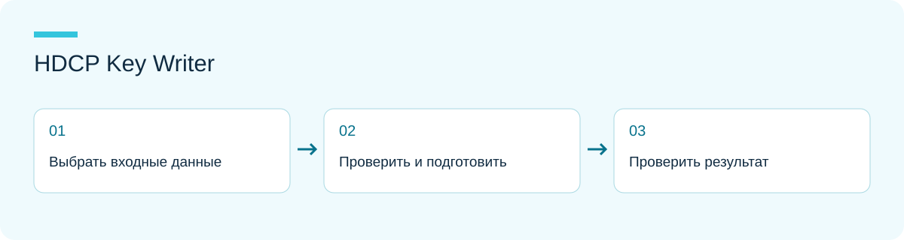
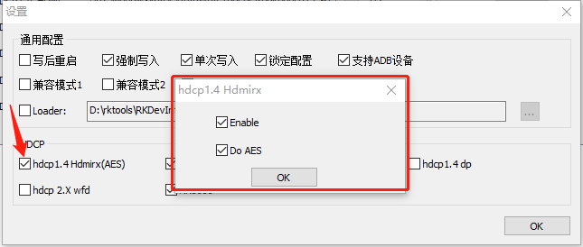





HDCP Key Writer записывает разрешённые ключи в формате Rockchip `.skf`. Загрузка программы не предоставляет ключей или лицензии HDCP. Версия программы — 1.0.5, PDF — V1.0.1.

## Хранение и упаковка

Лицензионные ключи остаются в контролируемой среде. В чистом пакете нет старых журналов и конфигурации; создайте собственную станцию и учёт ключей без публикации содержимого.

Пример объединения разрешённых файлов:

```text
HdcpKeyPack.exe --pack --in .\hdcpkeys --out .\hdcp.skf
```

Существующий выходной файл перезаписывается. Проверьте каталог, имя и количество. Успешная упаковка не подтверждает лицензию или запись устройства.

## Настройки записи

Single требует ручного запуска на каждой плате; без него руководство описывает автоматическую запись при подключении. Отдельно задаётся перезапуск. Поддержка ADB сначала вызывает `adb reboot loader`. Требование Force Write связано с отсутствием HDCP-readback в этой версии и не означает произвольную перезапись идентификаторов.

RK3588 имеет отдельный выбор контроллера/шифрования и настройки AES для отдельных ключей. Compatibility modes относятся к старым платформам. Следуйте своему BSP и проверьте один образец до автоматизации.

Запишите выделенный ключ, устройство и результат, затем проверьте разрешённый тракт защиты контента. Количество упакованных ключей не доказывает совместимость HDCP. После неопределённого результата сверяйте учёт до расходования нового ключа. Ключи здесь не предоставлялись и не записывались.

## Применимость и проверка

Руководство составлено по документации этой коллекции. Проверьте плату, SoC, плату-носитель, SDK/BSP и архитектуру хоста. Прошивка, provisioning, запись регистров и аппаратные испытания не выполнялись. Наличие пакета не подтверждает поддержку всех изделий ArmSoM.

## Загрузка, версии и SHA-256

Выберите архив, проверьте хеш и распакуйте весь каталог. Разделённый Linux PinDebug сначала восстановите по инструкции; его указанный хеш относится к целому файлу.

| Хост / версия | Пакет |
|---|---|
| Windows / 1.0.5 | [Rockchip_HdcpKey_Writer_V1.0.5-clean.zip](https://raw.githubusercontent.com/ArmSoM/rockchip-tools/main/downloads/hdcp-key-writer/Rockchip_HdcpKey_Writer_V1.0.5-clean.zip) |

**Rockchip_HdcpKey_Writer_V1.0.5-clean.zip — SHA-256**

```text
39291cd73a8b979de8e70c0109cffecd40f72e26788951a72296449de67c6e3b
```

[GitHub · catalog.json](https://github.com/ArmSoM/rockchip-tools/blob/main/catalog.json) · [SHA256SUMS](https://github.com/ArmSoM/rockchip-tools/blob/main/SHA256SUMS)

## Документы и исходные иллюстрации

- Rockchip_User_Guide_HDCP_Key_Flash.pdf V1.0.1; HDCP Key Writer 1.0.5 package
- [Исходный PDF: Rockchip_User_Guide_HDCP_Key_Flash.pdf](https://raw.githubusercontent.com/ArmSoM/rockchip-tools/main/manuals/e1ef88b767b1.pdf)

Иллюстрации извлечены из указанных PDF. При наличии только китайского оригинала текст интерфейса сохранён; подписи переведены. Это исторические примеры, не результаты тестов ArmSoM.



Rockchip_User_Guide_HDCP_Key_Flash.pdf · p. 3

## Связанные рабочие процессы

- [RKDevInfoWriteTool: серийные номера и MAC без дублирования](/ru/articles/rockchip-tool-devinfo-write/)
- [Руководство RK3588 HDCP: ключи, прошивка, настройка HDMI/DP и диагностика](/ru/articles/046-rockchip-rk3588-hdcp/)
- [Каталог инструментов Rockchip и руководств](/ru/articles/rockchip-tools-download-guide/)

## Документация плат ArmSoM

Требования платы и носителя проверяйте по руководству изделия. Эти ссылки — платформенные материалы, а не подтверждение проверки данного инструмента на изделиях.

[ArmSoM Docs](https://docs.armsom.org/) · [Sige7](https://www.armsom.org/sige7) / [Docs](https://docs.armsom.org/armsom-sige7) · [CM5](https://www.armsom.org/cm5) / [Docs](https://docs.armsom.org/armsom-cm5)


