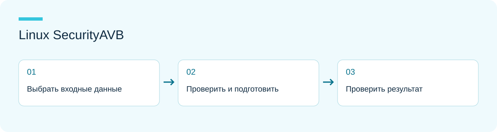





## Полное техническое руководство Linux AVB V2.2.5

AVB продолжает аппаратный корень доверия через U-Boot к boot, recovery и другим разделам, проверяя недоверенный или повреждённый код. Ниже сохранены платформы и разметка руководства V2.2.5 2020 года без подмешивания новых SDK.

| Chip | Security storage | Kernel | U-Boot | RKBin |
|---|---|---|---|---|
| RK3308 | OTP | ALL | d3a731e | e00dab6 |
| RK3326 | OTP | 4.4 | d3a731e | 20af526 |
| PX30 | OTP | 4.4 | d3a731e | 20af526 |
| RK3328 | OTP | 4.4 | d3a731e | 158ccc6 |
| RK3399 | eFuse | 4.4 | d3a731e | 158ccc6 |
| RK3288 | eFuse | 4.4 | d3a731e | c021945 |
| RK1808 | eFuse | 4.4 | d3a731e | 890556f |

### 1. Предварительные условия

Разблокированное устройство проверяет boot.img и сообщает ошибки, но продолжает загрузку; заблокированное останавливается при неверном образе. Сжатые образы ядра не поддерживаются. Чипам с eFuse требуется Base SecureBoot.

### 2. Trust и U-Boot

Включите secure для trust.img. В `rkbin/RKTRUST/RK3308TRUST.ini`, выбираемом make.sh U-Boot, измените BL32 SEC с 0 на 1. Формат TOS, например RK3288TOS.ini, включает secure по умолчанию.

```diff
diff --git a/RKTRUST/RK3308TRUST.ini b/RKTRUST/RK3308TRUST.ini
index 0b2839d..51ec627 100644
--- a/RKTRUST/RK3308TRUST.ini
+++ b/RKTRUST/RK3308TRUST.ini
@@ -8,7 +8,7 @@ SEC=1
 PATH=bin/rk33/rk3308_bl31_v2.21.elf
 ADDR=0x00010000
 [BL32_OPTION]
-SEC=0
+SEC=1
 PATH=bin/rk33/rk3308_bl32_v1.12.bin
 ADDR=0x00200000
 [BL33_OPTION]
```

Список нельзя включать целиком без выбора. OPTEE V1 — rk3288/rk3328/rk3399, V2 — rk3308/rk3326/px30/rk1808; варианты взаимоисключающие. CRYPTO_V1 — eFuse-чипы rk3399/rk3288, V2 — rk1808. `CONFIG_ANDROID_AB` необязателен. Без RPMB включается хранение в security. Адрес и размер fastboot — изменяемые примеры.

```text
# OPTEE support
CONFIG_OPTEE_CLIENT=y
CONFIG_OPTEE_V1=y
CONFIG_OPTEE_V2=y
# CRYPTO support
CONFIG_DM_CRYPTO=y
CONFIG_ROCKCHIP_CRYPTO_V1=y
CONFIG_ROCKCHIP_CRYPTO_V2=y
# AVB support
CONFIG_AVB_LIBAVB=y
CONFIG_AVB_LIBAVB_AB=y
CONFIG_AVB_LIBAVB_ATX=y
CONFIG_AVB_LIBAVB_USER=y
CONFIG_RK_AVB_LIBAVB_USER=y
CONFIG_AVB_VBMETA_PUBLIC_KEY_VALIDATE=y
CONFIG_ANDROID_AVB=y
CONFIG_ANDROID_AB=y
CONFIG_OPTEE_ALWAYS_USE_SECURITY_PARTITION=y
CONFIG_ROCKCHIP_PRELOADER_PUB_KEY=y
CONFIG_RK_AVB_LIBAVB_ENABLE_ATH_UNLOCK=y
# fastboot support
CONFIG_FASTBOOT=y
CONFIG_FASTBOOT_BUF_ADDR=0x2000000
CONFIG_FASTBOOT_BUF_SIZE=0x08000000
CONFIG_FASTBOOT_FLASH=y
CONFIG_FASTBOOT_FLASH_MMC_DEV=0
```

`CONFIG_ROCKCHIP_PRELOADER_PUB_KEY` и DM_CRYPTO относятся к eFuse. Для старого U-Boot без ATH_UNLOCK приведён патч к `46a8a26905fc68e6683b93c97adae0dd9a4e37ba`, обеспечивающий вызов `rk_auth_unlock()`. Сверьте исторический патч с текущим деревом. Второй патч удаляет skip_initramfs, если A/B нужен Ramdisk; источник отмечает конфликт с Android и невозможность слияния в master.

```diff
diff --git a/drivers/usb/gadget/f_fastboot.c b/drivers/usb/gadget/f_fastboot.c
index 99d62a6..fec465e 100755
--- a/drivers/usb/gadget/f_fastboot.c
+++ b/drivers/usb/gadget/f_fastboot.c
@@ -1370,7 +1370,7 @@ static void cb_oem(struct usb_ep *ep, struct usb_request *req)
                         fastboot_tx_write_str("FAILThe vboot is disable!");
                 } else {
                         lock_state = 1;
-#ifdef CONFIG_RK_AVB_LIBAVB_ENABLE_ATH_UNLOCK
+#if 1
                         if (rk_auth_unlock((void *)CONFIG_FASTBOOT_BUF_ADDR,
                                            &out_is_trusted)) {
                                 printf("rk_auth_unlock ops error!\n");

diff --git a/common/android_bootloader.c b/common/android_bootloader.c
index 230bf0e..e5c81e6 100644
--- a/common/android_bootloader.c
+++ b/common/android_bootloader.c
@@ -1061,9 +1061,6 @@ int android_bootloader_boot_flow(struct blk_desc *dev_desc,
                  * "skip_initramfs" to the cmdline to make it ignore the
                  * recovery initramfs in the boot partition.
                  */
-#ifdef CONFIG_ANDROID_AB
-               mode_cmdline = "skip_initramfs";
-#endif
                 break;
         case ANDROID_BOOT_MODE_RECOVERY:
                 /* In recovery mode we still boot the kernel from "boot" but
```

Выполните `./make.sh xxx` для uboot.img, trust.img и loader.bin; `xxx` обозначает платформу.

### 3. Parameter и расхождения источника

Нужны vbmeta 1M и system. Переименуйте Buildroot rootfs в system, включая имя в uuid. Без eMMC RPMB раздел security хранит зашифрованные данные AVB; текст указывает 4M. Сохранены `0x00002000` для security (4 МиБ при секторе 512 байт) и `0x00000800` для vbmeta (1 МиБ). Адрес userdata A/B записан `0x0065f00`, что не согласуется с концом предыдущего раздела; он не исправлен догадкой. Перед использованием проверьте разметку.

```text
# AVB parameter:
0x00002000@0x00004000(uboot),0x00002000@0x00006000(trust),0x00002000@0x00008000(misc),0x00010000@0x0000a000(boot),0x00010000@0x0001a000(recovery),0x00010000@0x0002a000(backup),0x00020000@0x0003a000(oem),0x00300000@0x0005a000(system),0x00000800@0x0035a000(vbmeta),0x00002000@0x0035a800(security),-@0x0035c800(userdata:grow)
uuid:system=614e0000-0000-4b53-8000-1d28000054a9

# AVB and A/B parameter:
0x00002000@0x00004000(uboot),0x00002000@0x00006000(trust),0x00004000@0x00008000(misc),0x00010000@0x0000c000(boot_a),0x00010000@0x0001c000(boot_b),0x00010000@0x0002c000(backup),0x00020000@0x0003c000(oem),0x00300000@0x0005c000(system_a),0x00300000@0x0035c000(system_b),0x00000800@0x0065c000(vbmeta_a),0x00000800@0x0065c800(vbmeta_b),0x00002000@0x0065d000(security),-@0x0065f00(userdata:grow)
```

### 4. Четыре роли ключей AVB

PRK — корневой ключ: на eFuse сведения проверяются Base SecureBoot Key, на OTP используется заранее записанный PRK-Hash. PIK — промежуточный, PSK подписывает прошивку, PUK разблокирует. Оригинал содержит тестовые ключи; из текущего пакета они исключены. Храните производственные ключи проекта. `-n` удаляет avb_keys перед созданием; Product ID — 16 байт. Угловые скобки обозначают подстановки, их не вводят буквально в shell.

```text
./avb_user_tool.sh -n <Product ID>
./avb_user_tool.sh -f < /Path/to/PrivateKey.pem >
```

Вторая команда нужна только eFuse для permanent_attributes_cer.bin с PrivateKey.pem Base SecureBoot. Она создаёт `.setting` и выбирает eFuse; при смене устройства проверьте `efuse`/`otp`. Потеря файлов может сделать разблокировку и обновление невозможными.

### 5. Подпись, упаковка и настройка записи

```text
./avb_user_tool.sh -s -b < /path/to/boot.img > -r < /path/to/recovery.img >
```

Без recovery уберите `-r`. Подписанные образы и vbmeta.img попадают в `out`. Упакуйте uboot/trust/loader с AVB, avb_keys и out. При Base SecureBoot подпишите update.img с `exclude_boot_sign = True`. В RKDevTool добавьте vbmeta и при необходимости security, очистите адреса и перечитайте parameter. Security инициализирует U-Boot, образ туда не записывается. Начальное состояние unlock не доказывает блокировку неверных образов.

### 6. Блокировка, разблокировка и журнал

Войдите в fastboot кнопкой при старте, `reboot fastboot` в ОС либо `fastboot usb 0` в U-Boot. CONFIG_BOOTDELAY оставляет время для Ctrl-C. Оригинал предлагает сохранение sudo-пароля; заранее проверьте способ хранения. Сначала `-d` для корневых данных, затем `-l`/`-u` и перезагрузка. Пароль и пути — подстановки.

```text
./avb_user_tool.sh --su_pswd < /user/password >
./avb_user_tool.sh -d
./avb_user_tool.sh -l
./avb_user_tool.sh -u

ANDROID: reboot reason: "(none)"
Could not find security partition
read_is_device_unlocked() ops returned that device is LOCKED
```

Последние три строки — исходный пример Verity. В нём всё ещё нет security; одна строка LOCKED не доказывает полную проверку. Нужны анализ RPMB/security и испытание неверной подписи. Здесь операции не выполнялись.

## Применимость и проверка

Руководство составлено по документации этой коллекции. Проверьте плату, SoC, плату-носитель, SDK/BSP и архитектуру хоста. Прошивка, provisioning, запись регистров и аппаратные испытания не выполнялись. Наличие пакета не подтверждает поддержку всех изделий ArmSoM.

## Каталог GitHub, версии и SHA-256

Откройте соответствующий каталог GitHub, выберите платформу и версию, проверьте хеш и распакуйте весь каталог. Ссылки ниже ведут в каталоги репозитория.

[Открыть каталог инструмента на GitHub](https://github.com/ArmSoM/rockchip-tools/tree/main/downloads/linux-avb)

| Платформа / версия | Файл | SHA-256 |
|---|---|---|
| Linux / manual 2.2.5 | `linux-security-avb-without-keys.zip` | `fc7eae22caeadd51d85723b65451c70e88475a2c9ba7e7f5394ca1314688d17d` |

[GitHub · catalog.json](https://github.com/ArmSoM/rockchip-tools/blob/main/catalog.json) · [SHA256SUMS](https://github.com/ArmSoM/rockchip-tools/blob/main/SHA256SUMS)

## Документы и исходные иллюстрации

- Rockchip_User_Manual_Linux_AVB_EN.pdf

## Связанные рабочие процессы

- [Руководство разработчика Rockchip Linux Secure Boot](/ru/articles/203-rockchip-linux-secure-boot/)
- [Rockchip U-Boot Nextdev: загрузка, драйверы, SPL/TPL, FIT и проверка безопасности](/ru/articles/157-rockchip-uboot-nextdev/)
- [rk_sign_tool и sign_tool: подпись и проверка прошивки Rockchip](/ru/articles/rockchip-tool-rk-sign-tool/)
- [Каталог инструментов Rockchip и руководств](/ru/articles/rockchip-tools-download-guide/)

## Документация плат ArmSoM

Требования платы и носителя проверяйте по руководству изделия. Эти ссылки — платформенные материалы, а не подтверждение проверки данного инструмента на изделиях.

[ArmSoM Docs](https://docs.armsom.org/) · [Sige7](https://www.armsom.org/sige7) / [Docs](https://docs.armsom.org/armsom-sige7) · [CM5](https://www.armsom.org/cm5) / [Docs](https://docs.armsom.org/armsom-cm5)


