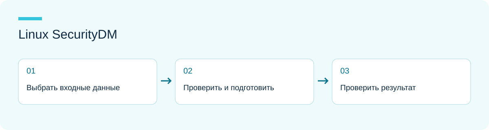





Linux SecurityDM 1.01 содержит старый `mkdm.sh`, конфигурацию, средства boot-image и вложенный ramdisk. Режимы `dmv`, `fde`, `fde-s`, `ramdisk` решают разные задачи целостности, шифрования и подготовки образов.

## Изучение интерфейса

До работы с реальными образами прочитайте скрипт, ramdisk и справку:

```text
./mkdm.sh --help
```

`-d` задаёт корневой раздел, `-s` — read-only system image, `-k` — kernel, `-r` — resource, `-c` — конфигурацию, `-m` — режим. Длинные параметры управляют путями, типом ФС и размером. Используйте значения своего BSP.

Сохраните копии rootfs, kernel и resource. Определите, нужна ли проверка целостности или шифрование. `dmv` требует read-only ФС; для шифрования нельзя автоматически предполагать поддержку сжатого ввода.

Скрипт может выполнять привилегированные mount, loop и `dmsetup`, а также печатать параметры ключа. Используйте контролируемый build-host, тестовые значения и очищенные журналы.

## Проверка загрузки

Ядро, ramdisk/init, параметры отображения и rootfs должны соответствовать друг другу. Проверьте нормальный старт, повреждённые данные, восстановление и обновление на непроизводственных материалах. Создание файла не доказывает включение защиты на плате. Сохраните входы и хеши.

## Применимость и проверка

Руководство составлено по документации этой коллекции. Проверьте плату, SoC, плату-носитель, SDK/BSP и архитектуру хоста. Прошивка, provisioning, запись регистров и аппаратные испытания не выполнялись. Наличие пакета не подтверждает поддержку всех изделий ArmSoM.

## Каталог GitHub, версии и SHA-256

Откройте соответствующий каталог GitHub, выберите платформу и версию, проверьте хеш и распакуйте весь каталог. Ссылки ниже ведут в каталоги репозитория.

[Открыть каталог инструмента на GitHub](https://github.com/ArmSoM/rockchip-tools/tree/main/downloads/linux-dm)

| Платформа / версия | Файл | SHA-256 |
|---|---|---|
| Linux / 1.01 | `Linux_SecurityDM_v1_01.tar.gz` | `2db8bc9618a326f624e5bc519f95ac00ec33df6db47ba82ab446367fa4de5912` |

[GitHub · catalog.json](https://github.com/ArmSoM/rockchip-tools/blob/main/catalog.json) · [SHA256SUMS](https://github.com/ArmSoM/rockchip-tools/blob/main/SHA256SUMS)

## Документы и исходные иллюстрации

- Linux_SecurityDM_v1_01.tar.gz: mkdm.sh, configuration and nested ramdisk archive

## Связанные рабочие процессы

- [Linux SecurityAVB: ключи, подпись boot и границы версий](/ru/articles/rockchip-tool-linux-avb/)
- [Руководство разработчика Rockchip Linux Secure Boot](/ru/articles/203-rockchip-linux-secure-boot/)
- [Каталог инструментов Rockchip и руководств](/ru/articles/rockchip-tools-download-guide/)

## Документация плат ArmSoM

Требования платы и носителя проверяйте по руководству изделия. Эти ссылки — платформенные материалы, а не подтверждение проверки данного инструмента на изделиях.

[ArmSoM Docs](https://docs.armsom.org/) · [Sige7](https://www.armsom.org/sige7) / [Docs](https://docs.armsom.org/armsom-sige7) · [CM5](https://www.armsom.org/cm5) / [Docs](https://docs.armsom.org/armsom-cm5)


