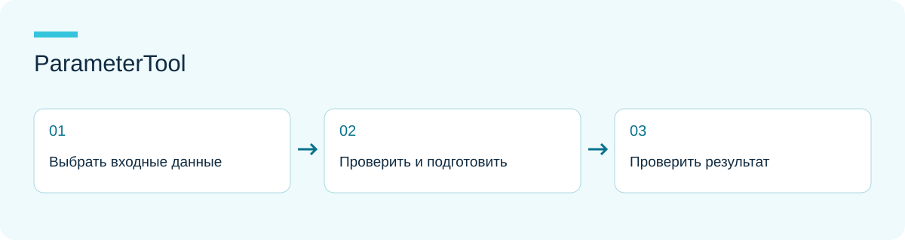



Параметры разделов связывают упаковку образов с адресами записи. Пакет содержит `parameter_tool.exe`, конфигурацию и вложенный boot_merger ZIP, но не отдельное PDF-руководство. Поэтому здесь описана проверка данных, а не неподтверждённые кнопки.

## Исходная разметка

Работайте с копией parameter своего SDK. Запишите ёмкость, порядок, имена, смещения, размеры и расширяемый последний раздел. Перед переводом hex проверьте единицы формата: шестнадцатеричное число не обязательно означает байты.

Сравните конечный размер каждого образа, включая метаданные, с выделенным разделом. Проверьте начало следующего и общую ёмкость. Согласуйте имена с `package-file`, строками RKDevTool и boot arguments. A/B требует правильных имён слотов и логики обновления, а не только дублирования разделов.

## Проверка результата

Сравните исходный и сохранённый текст, заново упакуйте и распакуйте прошивку средствами SDK. Импортируйте parameter в RKDevTool для просмотра строк без немедленной записи. Испытайте разметку на восстанавливаемом устройстве с резервной копией.

Вложенный boot_merger — дубликат инструмента, не новый самостоятельный документ. Его старый формат не подтверждает поддержку новых SoC. Универсальной таблицы разделов ArmSoM этот пакет не задаёт.

## Применимость и проверка

Руководство составлено по документации этой коллекции. Проверьте плату, SoC, плату-носитель, SDK/BSP и архитектуру хоста. Прошивка, provisioning, запись регистров и аппаратные испытания не выполнялись. Наличие пакета не подтверждает поддержку всех изделий ArmSoM.

## Каталог GitHub, версии и SHA-256

Откройте соответствующий каталог GitHub, выберите платформу и версию, проверьте хеш и распакуйте весь каталог. Ссылки ниже ведут в каталоги репозитория.

[Открыть каталог инструмента на GitHub](https://github.com/ArmSoM/rockchip-tools/tree/main/downloads/parameter-tool)

| Платформа / версия | Файл | SHA-256 |
|---|---|---|
| Windows / 1.2 | `ParameterTool_v1.2.zip` | `46e4cda5ca71bd12444fc75c517753fe0f3fda9db1ce3917d1a5a3f48e92a6f2` |

[GitHub · catalog.json](https://github.com/ArmSoM/rockchip-tools/blob/main/catalog.json) · [SHA256SUMS](https://github.com/ArmSoM/rockchip-tools/blob/main/SHA256SUMS)

## Документы и исходные иллюстрации

- ParameterTool_v1.2.zip: parameter_tool.exe, config.json, nested boot_merger_v1.32_win.zip; existing storage guide

## Связанные рабочие процессы

- [Полное руководство по накопителям Rockchip: flash, загрузка, разделы, запись и Vendor Storage](/ru/articles/099-rockchip-storage-application/)
- [RKDevTool: загрузка, Loader, разделы и прошивка update.img](/ru/articles/rockchip-tool-rkdevtool/)
- [afptool и rkImageMaker: создание и проверка update.img](/ru/articles/rockchip-tool-firmware-pack-tools/)
- [Каталог инструментов Rockchip и руководств](/ru/articles/rockchip-tools-download-guide/)

## Документация плат ArmSoM

Требования платы и носителя проверяйте по руководству изделия. Эти ссылки — платформенные материалы, а не подтверждение проверки данного инструмента на изделиях.

[ArmSoM Docs](https://docs.armsom.org/) · [Sige7](https://www.armsom.org/sige7) / [Docs](https://docs.armsom.org/armsom-sige7) · [CM5](https://www.armsom.org/cm5) / [Docs](https://docs.armsom.org/armsom-cm5)


