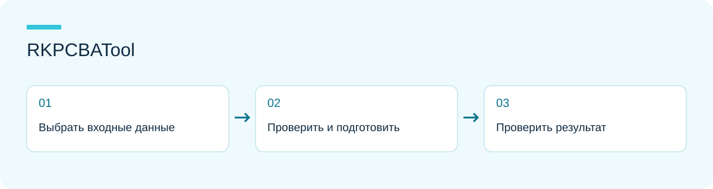



## Руководство PCBA уже доступно в четырёх языковых статьях

В пакете китайское руководство на 37 страницах и английское на 43, RK-KF-YF-301 V1.2.0 — те же основные источники опубликованного Linux PCBA Developer Guide. Используется полный технический текст существующей статьи без второй копии 80 исходных страниц. Ссылки открывают текст статьи, не PDF.

Полное руководство охватывает установку и ADB, JSON-пункты теста, автоматическую/ручную оценку, перезагрузку, разработку и упаковку, архитектуру, все девять таблиц протокола, код устройства и сборку rootfs/recovery, тесты с экраном и ошибки установки, ADB forward, Windows 10, upload file fail.

[Полное руководство Linux PCBA](/ru/articles/197-rockchip-linux-pcba/)

- 1. Инструмент PCBA
- 2. Проектирование ПО PCBA
- 3. Архитектура тестового кода
- 4. PCBA с экраном
- 5. Приложение

### Различайте версии пакета и руководства

Пакет V1.2.1, документ V1.2.0 и V1.7 в таблице — разные идентификаторы. Китайский текст удалил старый camera-раздел, английский сохранил; полная статья помечает его историческим отдельно от автоматического теста. RK3358, TPYE/TYPE, CMD/RES и различия путей отмечены как расхождения оригинала, а не исправлены догадками.

## Применимость и проверка

Руководство составлено по документации этой коллекции. Проверьте плату, SoC, плату-носитель, SDK/BSP и архитектуру хоста. Прошивка, provisioning, запись регистров и аппаратные испытания не выполнялись. Наличие пакета не подтверждает поддержку всех изделий ArmSoM.

## Каталог GitHub, версии и SHA-256

Откройте соответствующий каталог GitHub, выберите платформу и версию, проверьте хеш и распакуйте весь каталог. Ссылки ниже ведут в каталоги репозитория.

[Открыть каталог инструмента на GitHub](https://github.com/ArmSoM/rockchip-tools/tree/main/downloads/pcba-tool)

| Платформа / версия | Файл | SHA-256 |
|---|---|---|
| Windows host + Linux target / 1.2.1 | `RKPCBATool_v1.2.1_20251226.zip` | `ec3747fa2360e8e1793920882d7ec51a4aa1087a4cfab5d3c218f677999440bc` |

[GitHub · catalog.json](https://github.com/ArmSoM/rockchip-tools/blob/main/catalog.json) · [SHA256SUMS](https://github.com/ArmSoM/rockchip-tools/blob/main/SHA256SUMS)

## Документы и исходные иллюстрации

- Rockchip_Developer_Guide_Linux_PCBA_CN.pdf
- Rockchip_Developer_Guide_Linux_PCBA_EN.pdf

## Связанные рабочие процессы

- [Руководство по разработке тестов Rockchip Linux PCBA](/ru/articles/197-rockchip-linux-pcba/)
- [Руководство разработчика инструмента PCBA Rockchip](/ru/articles/252-rockchip-pcba-test-tool/)
- [RKDevInfoWriteTool: серийные номера и MAC без дублирования](/ru/articles/rockchip-tool-devinfo-write/)
- [Каталог инструментов Rockchip и руководств](/ru/articles/rockchip-tools-download-guide/)

## Документация плат ArmSoM

Требования платы и носителя проверяйте по руководству изделия. Эти ссылки — платформенные материалы, а не подтверждение проверки данного инструмента на изделиях.

[ArmSoM Docs](https://docs.armsom.org/) · [Sige7](https://www.armsom.org/sige7) / [Docs](https://docs.armsom.org/armsom-sige7) · [CM5](https://www.armsom.org/cm5) / [Docs](https://docs.armsom.org/armsom-cm5)


