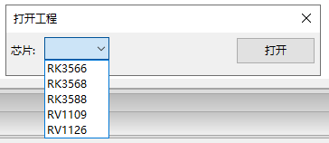
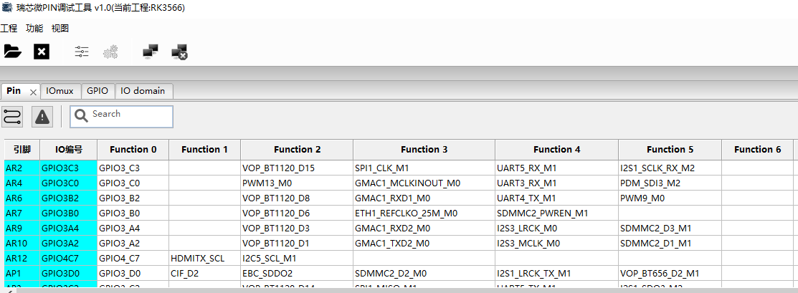
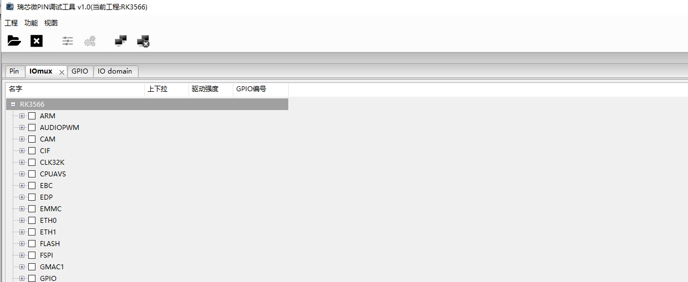




PinDebug сопоставляет назначение выводов с текущими регистрами платы. Это помогает найти контакт, оставшийся GPIO вместо нужного интерфейса. Руководство имеет V1.1, пакеты — Linux 1.11 и Windows 1.18.

## Сначала без подключения

Создайте проект правильного SoC. Руководство перечисляет RK3588, RK3566/3568, RV1126/1109, RV1106/1103, RK3528; это не подтверждает RK3576 или все платы ArmSoM. Виды Pin и IOMUX дают разные способы поиска. Правой кнопкой можно вывести соответствующую I/O-команду для проверки.

## Чтение платы

Нужен подходящий BSP с ADB/отладочным доступом. Прочитайте IOMUX и сравните со схемой и DTS, сохранив исходные значения. При подключении двойной щелчок может выполнить запись: это уже не безвредный просмотр.

## Поля GPIO

`ddr` здесь означает направление GPIO, а не память; `dr` — выходные данные, `ext_port` — наблюдаемый уровень. Также доступны подтяжки, сила драйвера и `vsel`. Перед электрическими изменениями проверьте домены питания и внешние цепи.

## Постоянное исправление

Перенесите найденную настройку в pinctrl/DTS или драйвер BSP. Изменение регистра может исчезнуть после перезапуска или быть перезаписано драйвером. Сохраните таблицу GPIO и сравнение, проверьте холодный старт, suspend/resume и периферию.

Linux-архив нужно восстановить из двух частей. При отсутствии английского оригинала сохранены китайские иллюстрации. Записи регистров и регулировки напряжения при подготовке не выполнялись.

## Применимость и проверка

Руководство составлено по документации этой коллекции. Проверьте плату, SoC, плату-носитель, SDK/BSP и архитектуру хоста. Прошивка, provisioning, запись регистров и аппаратные испытания не выполнялись. Наличие пакета не подтверждает поддержку всех изделий ArmSoM.

## Загрузка, версии и SHA-256

Выберите архив, проверьте хеш и распакуйте весь каталог. Разделённый Linux PinDebug сначала восстановите по инструкции; его указанный хеш относится к целому файлу.

| Хост / версия | Пакет |
|---|---|
| Linux / 1.11 | [pin_debug_tool_v1.11_for_linux.tar.gz](https://github.com/ArmSoM/rockchip-tools/blob/main/downloads/pin-debug/README.md) |
| Windows / 1.18 | [pin_debug_tool_v1.18_20250322_win.zip](https://raw.githubusercontent.com/ArmSoM/rockchip-tools/main/downloads/pin-debug/pin_debug_tool_v1.18_20250322_win.zip) |

**pin_debug_tool_v1.11_for_linux.tar.gz — SHA-256**

```text
16cb25b8fc2533e8f730a790c7486ab5042baa964b3bdb95a161ddce143c4a34
```

**pin_debug_tool_v1.18_20250322_win.zip — SHA-256**

```text
88c550ee9a578eaa451a9b8a05b3d088247dc63dd9bd426b832191994dc6a7d5
```

[GitHub · catalog.json](https://github.com/ArmSoM/rockchip-tools/blob/main/catalog.json) · [SHA256SUMS](https://github.com/ArmSoM/rockchip-tools/blob/main/SHA256SUMS)

## Документы и исходные иллюстрации

- PinDebug_UserManual.pdf V1.1; Linux 1.11 and Windows 1.18 packages
- [Исходный PDF: PinDebug_UserManual.pdf](https://raw.githubusercontent.com/ArmSoM/rockchip-tools/main/manuals/1cae2e2c0777.pdf)

Иллюстрации извлечены из указанных PDF. При наличии только китайского оригинала текст интерфейса сохранён; подписи переведены. Это исторические примеры, не результаты тестов ArmSoM.



PinDebug_UserManual.pdf · p. 2



PinDebug_UserManual.pdf · p. 2



PinDebug_UserManual.pdf · p. 3

## Связанные рабочие процессы

- [Rockchip Linux Pinctrl: полное руководство по GPIO, IOMUX, силе драйвера и DTS](/ru/articles/116-rockchip-linux-pinctrl/)
- [USB SQ Tool 1.5: глазковая диаграмма и настройки USB PHY](/ru/articles/rockchip-tool-usb-sq-tool/)
- [Каталог инструментов Rockchip и руководств](/ru/articles/rockchip-tools-download-guide/)

## Документация плат ArmSoM

Требования платы и носителя проверяйте по руководству изделия. Эти ссылки — платформенные материалы, а не подтверждение проверки данного инструмента на изделиях.

[ArmSoM Docs](https://docs.armsom.org/) · [Sige7](https://www.armsom.org/sige7) / [Docs](https://docs.armsom.org/armsom-sige7) · [CM5](https://www.armsom.org/cm5) / [Docs](https://docs.armsom.org/armsom-cm5)


