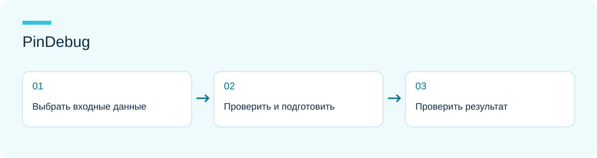
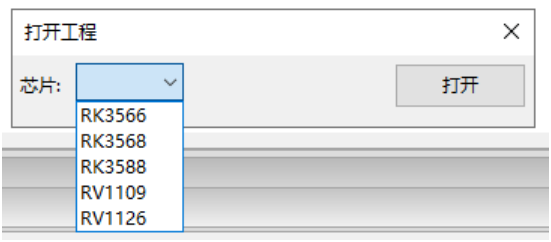
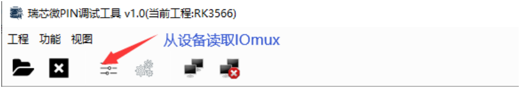
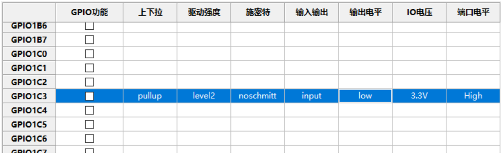
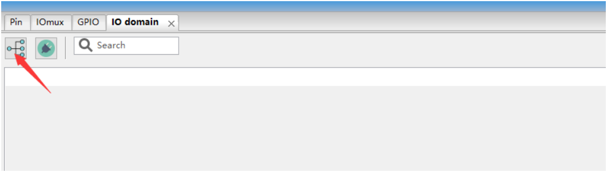
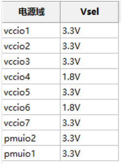





## Полное руководство PinDebug V1.1

В руководстве перечислены RK3588, RK3566, RK3568, RV1126, RV1109, RV1106, RV1103 и RK3528. PinDebug читает IOMUX и настраивает выводы; интерфейсы Windows 1.18 и Linux 1.11 могут отличаться. Ниже раскрыты разделы 1.1–1.11; рисунки сохраняют китайский интерфейс оригинала.

### 1.1 Открыть проект

Перед любыми действиями выберите SoC. Страница Pin показывает функции по выводам/GPIO: поиск по Function; правая кнопка выводит команду настройки; двойной щелчок при подключённой плате непосредственно меняет функцию. Столбцы выводов и номеров IO сортируются. IOmux группирует сигналы по модулям.

<figure style="margin:1.6rem 0">
<a href="/assets/rockchip-tools/manuals/1cae2e2c0777/p02-f01.png" target="_blank" rel="noopener" aria-label="Открыть изображение в полном размере"></a>
<figcaption style="margin-top:.6rem;font-size:.9em;line-height:1.55"><strong>Рисунок 1: Выбор чипа и открытие проекта</strong></figcaption>
</figure>

<figure style="margin:1.6rem 0">
<a href="/assets/rockchip-tools/manuals/1cae2e2c0777/p02-f02.png" target="_blank" rel="noopener" aria-label="Открыть изображение в полном размере"></a>
<figcaption style="margin-top:.6rem;font-size:.9em;line-height:1.55"><strong>Рисунок 2: Выводы и альтернативные функции в представлении Pin</strong></figcaption>
</figure>

<figure style="margin:1.6rem 0">
<a href="/assets/rockchip-tools/manuals/1cae2e2c0777/p03-f01.png" target="_blank" rel="noopener" aria-label="Открыть изображение в полном размере"></a>
<figcaption style="margin-top:.6rem;font-size:.9em;line-height:1.55"><strong>Рисунок 3: Просмотр IOmux по функциональным модулям</strong></figcaption>
</figure>

### 1.2 Подключить устройство

Обмен выполняется через ADB. Откройте проект, включите ADB на устройстве, подключите компьютер и нажмите значок соединения.

<figure style="margin:1.6rem 0">
<a href="/assets/rockchip-tools/manuals/1cae2e2c0777/p03-f02.png" target="_blank" rel="noopener" aria-label="Открыть изображение в полном размере"></a>
<figcaption style="margin-top:.6rem;font-size:.9em;line-height:1.55"><strong>Рисунок 4: Подключение устройства</strong></figcaption>
</figure>

### 1.3 Прочитать IOMUX

Чтение всех регистров IOMUX обновляет Pin и IOmux. Офлайн-описание не заменяет значения реального устройства.

<figure style="margin:1.6rem 0">
<a href="/assets/rockchip-tools/manuals/1cae2e2c0777/p03-f03.png" target="_blank" rel="noopener" aria-label="Открыть изображение в полном размере"></a>
<figcaption style="margin-top:.6rem;font-size:.9em;line-height:1.55"><strong>Рисунок 5: Чтение IOMUX с устройства</strong></figcaption>
</figure>

<figure style="margin:1.6rem 0">
<a href="/assets/rockchip-tools/manuals/1cae2e2c0777/p04-f01.png" target="_blank" rel="noopener" aria-label="Открыть изображение в полном размере"></a>
<figcaption style="margin-top:.6rem;font-size:.9em;line-height:1.55"><strong>Рисунок 6: Текущие функции в представлении IOmux</strong></figcaption>
</figure>

<figure style="margin:1.6rem 0">
<a href="/assets/rockchip-tools/manuals/1cae2e2c0777/p04-f02.png" target="_blank" rel="noopener" aria-label="Открыть изображение в полном размере"></a>
<figcaption style="margin-top:.6rem;font-size:.9em;line-height:1.55"><strong>Рисунок 7: Подсветка включённых функций в представлении Pin</strong></figcaption>
</figure>

### 1.4 Изменить IOMUX

Флажок функционального IO выбирает эту функцию; снятие переводит вывод в GPIO. При конфликте можно отменить или подтвердить изменение.

<figure style="margin:1.6rem 0">
<a href="/assets/rockchip-tools/manuals/1cae2e2c0777/p05-f01.png" target="_blank" rel="noopener" aria-label="Открыть изображение в полном размере"></a>
<figcaption style="margin-top:.6rem;font-size:.9em;line-height:1.55"><strong>Рисунок 8: Предупреждение о конфликте функций</strong></figcaption>
</figure>

### 1.5 Подтяжки и сила драйвера

Выберите активный функциональный IO и правой кнопкой прочитайте/измените подтяжки и силу драйвера. Пример — EMMC_CLKOUT; перед изменением проверьте использование контроллером памяти.

<figure style="margin:1.6rem 0">
<a href="/assets/rockchip-tools/manuals/1cae2e2c0777/p05-f02.png" target="_blank" rel="noopener" aria-label="Открыть изображение в полном размере"></a>
<figcaption style="margin-top:.6rem;font-size:.9em;line-height:1.55"><strong>Рисунок 9: Просмотр подтяжки и силы драйвера EMMC_CLKOUT</strong></figcaption>
</figure>

<figure style="margin:1.6rem 0">
<a href="/assets/rockchip-tools/manuals/1cae2e2c0777/p05-f03.png" target="_blank" rel="noopener" aria-label="Открыть изображение в полном размере"></a>
<figcaption style="margin-top:.6rem;font-size:.9em;line-height:1.55"><strong>Рисунок 10: Настройка свойств EMMC_CLKOUT</strong></figcaption>
</figure>

### 1.6 Чтение и изменение GPIO

Пример использует GPIO1C3. Флажок функции GPIO означает режим GPIO; направление берётся из `ddr`, выходной уровень из `dr`, напряжение IO из PMU `vsel`, уровень порта из `ext_port`. Здесь `ddr` — регистр направления, не память DDR.

<figure style="margin:1.6rem 0">
<a href="/assets/rockchip-tools/manuals/1cae2e2c0777/p06-f01.png" target="_blank" rel="noopener" aria-label="Открыть изображение в полном размере"></a>
<figcaption style="margin-top:.6rem;font-size:.9em;line-height:1.55"><strong>Рисунок 11: Состояние GPIO и уровни сигналов</strong></figcaption>
</figure>

<figure style="margin:1.6rem 0">
<a href="/assets/rockchip-tools/manuals/1cae2e2c0777/p06-f02.png" target="_blank" rel="noopener" aria-label="Открыть изображение в полном размере"></a>
<figcaption style="margin-top:.6rem;font-size:.9em;line-height:1.55"><strong>Рисунок 12: Настройка свойств GPIO1C3</strong></figcaption>
</figure>

### 1.7 Прочитать регуляторы

Инструмент читает узел regulator summary через `cat` и разбирает все домены. Полный путь узла в оригинале не указан.

<figure style="margin:1.6rem 0">
<a href="/assets/rockchip-tools/manuals/1cae2e2c0777/p06-f03.png" target="_blank" rel="noopener" aria-label="Открыть изображение в полном размере"></a>
<figcaption style="margin-top:.6rem;font-size:.9em;line-height:1.55"><strong>Рисунок 13: Чтение информации о регуляторах</strong></figcaption>
</figure>

<figure style="margin:1.6rem 0">
<a href="/assets/rockchip-tools/manuals/1cae2e2c0777/p07-f01.png" target="_blank" rel="noopener" aria-label="Открыть изображение в полном размере"></a>
<figcaption style="margin-top:.6rem;font-size:.9em;line-height:1.55"><strong>Рисунок 14: Информация о регуляторах и доменах питания</strong></figcaption>
</figure>

### 1.8 Прочитать выбор напряжения доменов

Регистр выбора напряжения преобразуется в список доменов. В разделе 1.8 написано `vesl`, в 1.6 — `vsel`; расхождение отмечено. Значение выбора не является измеренным напряжением.

<figure style="margin:1.6rem 0">
<a href="/assets/rockchip-tools/manuals/1cae2e2c0777/p07-f02.png" target="_blank" rel="noopener" aria-label="Открыть изображение в полном размере"></a>
<figcaption style="margin-top:.6rem;font-size:.9em;line-height:1.55"><strong>Рисунок 15: Чтение выбранного напряжения доменов</strong></figcaption>
</figure>

<figure style="margin:1.6rem 0">
<a href="/assets/rockchip-tools/manuals/1cae2e2c0777/p07-f03.png" target="_blank" rel="noopener" aria-label="Открыть изображение в полном размере"></a>
<figcaption style="margin-top:.6rem;font-size:.9em;line-height:1.55"><strong>Рисунок 16: Значения Vsel доменов питания</strong></figcaption>
</figure>

### 1.9 Проверить IOmux

Вывести выбранные IO по модулям, чтобы определить активную группу при нескольких mode.

<figure style="margin:1.6rem 0">
<a href="/assets/rockchip-tools/manuals/1cae2e2c0777/p07-f04.png" target="_blank" rel="noopener" aria-label="Открыть изображение в полном размере"></a>
<figcaption style="margin-top:.6rem;font-size:.9em;line-height:1.55"><strong>Рисунок 17: Проверка конфигурации IOmux</strong></figcaption>
</figure>

<figure style="margin:1.6rem 0">
<a href="/assets/rockchip-tools/manuals/1cae2e2c0777/p08-f01.png" target="_blank" rel="noopener" aria-label="Открыть изображение в полном размере"></a>
<figcaption style="margin-top:.6rem;font-size:.9em;line-height:1.55"><strong>Рисунок 18: Результаты проверки режимов IOmux по модулям</strong></figcaption>
</figure>

### 1.10 Экспортировать настройки GPIO

После открытия проекта экспортируйте конфигурацию GPIO в Excel. Укажите SoC и различайте статические определения и прочитанные данные устройства.

<figure style="margin:1.6rem 0">
<a href="/assets/rockchip-tools/manuals/1cae2e2c0777/p08-f02.png" target="_blank" rel="noopener" aria-label="Открыть изображение в полном размере"></a>
<figcaption style="margin-top:.6rem;font-size:.9em;line-height:1.55"><strong>Рисунок 19: Экспортированная таблица конфигурации GPIO</strong></figcaption>
</figure>

### 1.11 Офлайн-поиск команд GPIO

При открытом проекте можно без устройства искать команды IOMUX, подтяжек, силы драйвера и триггера Шмитта. Введите `help`; пример запроса — `gpio0a0`. Сгенерированная команда не подтверждает совместимость с электрической схемой платы.

<figure style="margin:1.6rem 0">
<a href="/assets/rockchip-tools/manuals/1cae2e2c0777/p09-f01.png" target="_blank" rel="noopener" aria-label="Открыть изображение в полном размере"></a>
<figcaption style="margin-top:.6rem;font-size:.9em;line-height:1.55"><strong>Рисунок 20: Справка по командам GPIO без подключения</strong></figcaption>
</figure>

<figure style="margin:1.6rem 0">
<a href="/assets/rockchip-tools/manuals/1cae2e2c0777/p09-f02.png" target="_blank" rel="noopener" aria-label="Открыть изображение в полном размере"></a>
<figcaption style="margin-top:.6rem;font-size:.9em;line-height:1.55"><strong>Рисунок 21: Поиск регистровых команд для выбранного GPIO</strong></figcaption>
</figure>

### Синтаксис офлайн-поиска со снимка

Вводите в поле поиска инструмента, не в shell. Поддерживаются регулярные выражения. Снимки экспорта и поиска показывают разные адреса регистров примерных проектов; не объединяйте их в одну конфигурацию платы.

```text
gpio [mux|pull|ds|smt|ddr|dr]
gpio0a0
gpio0a0 mux
gpio0a0 pull
gpio0a0 ds
gpio0a0 smt
gpio0a0 ddr
gpio0a0 dr
gpio0a0 ddr|dr
```

## Применимость и проверка

Руководство составлено по документации этой коллекции. Проверьте плату, SoC, плату-носитель, SDK/BSP и архитектуру хоста. Прошивка, provisioning, запись регистров и аппаратные испытания не выполнялись. Наличие пакета не подтверждает поддержку всех изделий ArmSoM.

## Каталог GitHub, версии и SHA-256

Откройте соответствующий каталог GitHub, выберите платформу и версию, проверьте хеш и распакуйте весь каталог. Ссылки ниже ведут в каталоги репозитория.

[Открыть каталог инструмента на GitHub](https://github.com/ArmSoM/rockchip-tools/tree/main/downloads/pin-debug)

| Платформа / версия | Файл | SHA-256 |
|---|---|---|
| Linux / 1.11 | `pin_debug_tool_v1.11_for_linux.tar.gz` | `16cb25b8fc2533e8f730a790c7486ab5042baa964b3bdb95a161ddce143c4a34` |
| Windows / 1.18 | `pin_debug_tool_v1.18_20250322_win.zip` | `88c550ee9a578eaa451a9b8a05b3d088247dc63dd9bd426b832191994dc6a7d5` |

[GitHub · catalog.json](https://github.com/ArmSoM/rockchip-tools/blob/main/catalog.json) · [SHA256SUMS](https://github.com/ArmSoM/rockchip-tools/blob/main/SHA256SUMS)

## Документы и исходные иллюстрации

- PinDebug_UserManual.pdf

## Связанные рабочие процессы

- [Rockchip Linux Pinctrl: полное руководство по GPIO, IOMUX, силе драйвера и DTS](/ru/articles/116-rockchip-linux-pinctrl/)
- [USB SQ Tool 1.5: глазковая диаграмма и настройки USB PHY](/ru/articles/rockchip-tool-usb-sq-tool/)
- [Каталог инструментов Rockchip и руководств](/ru/articles/rockchip-tools-download-guide/)

## Документация плат ArmSoM

Требования платы и носителя проверяйте по руководству изделия. Эти ссылки — платформенные материалы, а не подтверждение проверки данного инструмента на изделиях.

[ArmSoM Docs](https://docs.armsom.org/) · [Sige7](https://www.armsom.org/sige7) / [Docs](https://docs.armsom.org/armsom-sige7) · [CM5](https://www.armsom.org/cm5) / [Docs](https://docs.armsom.org/armsom-cm5)


