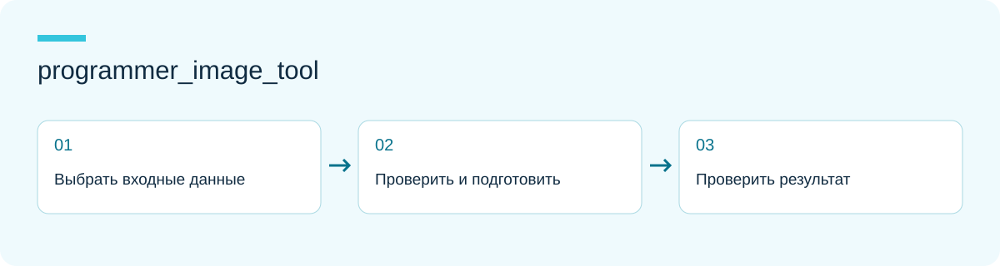





`programmer_image_tool` преобразует контейнер прошивки в файлы для производственного программатора. Он создаёт файлы на хосте, а не прошивает плату напрямую. Формат зависит от типа и геометрии памяти.

## eMMC и SPI NOR

Примеры руководства:

```text
./programmer_image_tool -i update.img -t emmc
```

```text
./programmer_image_tool -i update.img -t spinor
```

Для этих вариантов указан `out_image.bin`. Проверьте, что программатор принимает такой формат и прошивка соответствует изделию.

## SPI NAND

```text
./programmer_image_tool -i update.img -b 256 -p 4 -t spinand -o out
```

`-b 256` означает блок 256 KB, `-p 4` — страницу 4 KB. Это параметры геометрии, не настройки быстродействия. Результат формируется в каталоге и не взаимозаменяем с eMMC-файлом.

## SLC NAND

```text
./programmer_image_tool -i update.img -b 256 -p 4 -s 256 -t slc -2 -o rockdev
```

`-s 256` задаёт spare/OOB 256 байт. Флаг `-2` сохранён из источника, но короткое руководство не раскрывает его полностью; уточните значение по документации инструмента/программатора до производства.

Запишите хеш firmware, версию, маркировку flash, block/page/OOB и хеши результатов. Bad blocks, ECC/OOB и размещение загрузки проверяются по документации программатора. Затем запрограммируйте образец, выполните доступное чтение и холодную загрузку.

Linux 1.26 и Windows 1.28 разделены. В Linux-руководстве есть неработающая локальная ссылка на изображение; восстановление этой картинки не заявляется. Числа — примеры источника, не проверенные параметры ArmSoM.

## Применимость и проверка

Руководство составлено по документации этой коллекции. Проверьте плату, SoC, плату-носитель, SDK/BSP и архитектуру хоста. Прошивка, provisioning, запись регистров и аппаратные испытания не выполнялись. Наличие пакета не подтверждает поддержку всех изделий ArmSoM.

## Загрузка, версии и SHA-256

Выберите архив, проверьте хеш и распакуйте весь каталог. Разделённый Linux PinDebug сначала восстановите по инструкции; его указанный хеш относится к целому файлу.

| Хост / версия | Пакет |
|---|---|
| Linux / 1.26 | [programmer_image_tool_v1.26_linux.tar.gz](https://raw.githubusercontent.com/ArmSoM/rockchip-tools/main/downloads/programmer-image-tool/programmer_image_tool_v1.26_linux.tar.gz) |
| Windows / 1.28 | [programmer_image_tool_v1.28.zip](https://raw.githubusercontent.com/ArmSoM/rockchip-tools/main/downloads/programmer-image-tool/programmer_image_tool_v1.28.zip) |

**programmer_image_tool_v1.26_linux.tar.gz — SHA-256**

```text
ea38df34e97cd697aa53d09af06fa1ff2b0847fe2c9699c49d1890509cc5c0d0
```

**programmer_image_tool_v1.28.zip — SHA-256**

```text
696d07d8232a637ef59b724d0c0522e500fc9f26571c2633d96271ffce48e56f
```

[GitHub · catalog.json](https://github.com/ArmSoM/rockchip-tools/blob/main/catalog.json) · [SHA256SUMS](https://github.com/ArmSoM/rockchip-tools/blob/main/SHA256SUMS)

## Документы и исходные иллюстрации

- programmer_image_tool 1.26 Linux / 1.28 Windows; both bundled usage PDFs
- [Исходный PDF: user_manual.pdf](https://raw.githubusercontent.com/ArmSoM/rockchip-tools/main/manuals/454e7646c90d.pdf)
- [Исходный PDF: user_manual.pdf](https://raw.githubusercontent.com/ArmSoM/rockchip-tools/main/manuals/47ce51e919d3.pdf)

## Связанные рабочие процессы

- [Firmware_Merger: образы Flat RK, Flat GPT и Compact GPT](/ru/articles/rockchip-tool-firmware-merger/)
- [afptool и rkImageMaker: создание и проверка update.img](/ru/articles/rockchip-tool-firmware-pack-tools/)
- [Полное руководство по накопителям Rockchip: flash, загрузка, разделы, запись и Vendor Storage](/ru/articles/099-rockchip-storage-application/)
- [Каталог инструментов Rockchip и руководств](/ru/articles/rockchip-tools-download-guide/)

## Документация плат ArmSoM

Требования платы и носителя проверяйте по руководству изделия. Эти ссылки — платформенные материалы, а не подтверждение проверки данного инструмента на изделиях.

[ArmSoM Docs](https://docs.armsom.org/) · [Sige7](https://www.armsom.org/sige7) / [Docs](https://docs.armsom.org/armsom-sige7) · [CM5](https://www.armsom.org/cm5) / [Docs](https://docs.armsom.org/armsom-cm5)


