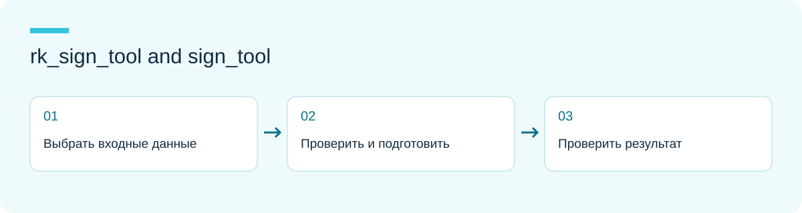





## sign_tool V1.0: подпись, проверка и внешнее подписание

Раздел полностью передаёт руководство командного подписания из пакета. Примеры используют `sign_tool`; это не утверждение об одинаковых параметрах всех версий `rk_sign_tool`. Подпись отличается от записи OTP/eFuse. Флаг `0x20` включает запись OTP через miniloader и требует проверки по конкретной схеме Secure Boot.

| SoC | Digest | Signature | Padding |
|---|---|---|---|
| 3229, 3228h, 3368, 3228, 3288, 3399, 3328 | SHA256 | RSA2048 | NOPADD |
| 3588, 3566, 3568, 3308, 3326, px30, 1808, 3228P, 1109, 1126, 2206 | SHA256 | RSA2048 | PSSPADD |

### 1. Подготовка

Создайте пару RSA2048 с `--bits=2048` либо исходным значением по умолчанию. Выберите чип, загрузите закрытый и открытый ключи. Выбор сохраняется и повторяется только при изменении. `1126` и имена файлов — примеры.

```text
sign_tool kk --bits=2048
sign_tool kk
sign_tool cc --chip=1126
sign_tool.exe lk --key private_key.pem --pubkey public_key.pem
```

Ниже необязательные флаги и каталог промежуточных данных, используемый также для внешнего подписания. Две команды `kk` — альтернативы, а не требование дважды создавать ключи.

```text
sign_tool ss --flag=0x20
sign_tool ss --out .\data_out
```

### 2. Подписать и проверить пять типов объектов

Полный update распаковывается, его loader/uboot/boot/trust подписываются и упаковываются заново, что занимает время. Для A/B инструмент не должен подписывать boot: установите `exclude_boot_sign=true` в `setting.ini`. При подписи Loader вставляются структуры безопасности. IDBlock создаётся mkimage и содержит загрузочные структуры, инициализацию DDR и Boot. Для тестовой конфигурации DDR и образов uboot/trust/boot предусмотрены отдельные команды.

```text
sign_tool sf --firmware update.img
sign_tool vf --firmware update.img

sign_tool sl --loader miniloader.bin
sign_tool vl --loader miniloader.bin

sign_tool sb --idb 1126_idblock.bin
sign_tool vb --idb 1126_idblock.bin

sign_tool sd --cfg 1126_ddr_test.cfg
sign_tool vd --cfg 1126_ddr_test.cfg

sign_tool si --img uboot.img
sign_tool vi --img uboot.img
```

### 3.1 Извлечь данные для подписи

Для извлечения достаточно открытого ключа. Установите extract и каталог, затем выполните любую операцию подписи раздела 2; пример — update.img.

```text
sign_tool ss --extract
sign_tool ss --out wait_sign_dir
sign_tool sf --firmware update.img
```

### 3.2 Внешнее подписание

Подпишите все файлы закрытым ключом и верните результаты в `wait_sign_dir` с исходными именами. PSS восстановлен в одну строку без изменения параметров. Для NOPADD создайте нулевой буфер 256 байт, скопируйте SHA256 в последние 32 байта и выполните вторую команду. Алгоритм выбирается по таблице чипов.

```text
openssl pkeyutl -sign -in to_sign.bin -inkey privatekey.pem -out signed.bin -pkeyopt digest:sha256 -pkeyopt rsa_padding_mode:pss -pkeyopt rsa_pss_saltlen:-1

openssl rsautl -sign -in to_sign.bin -inkey privatekey.pem -raw -out signed.bin
```

### 3.3 Вставить подписи

```text
sign_tool ss --inject
sign_tool sf --firmware update.img
```

Инструмент читает подписи из ранее настроенного каталога и вставляет в соответствующие места. Затем выполните подходящую проверку `v*`. Для статьи не выполнялись подпись, программирование OTP или прошивка устройства.

## Применимость и проверка

Руководство составлено по документации этой коллекции. Проверьте плату, SoC, плату-носитель, SDK/BSP и архитектуру хоста. Прошивка, provisioning, запись регистров и аппаратные испытания не выполнялись. Наличие пакета не подтверждает поддержку всех изделий ArmSoM.

## Каталог GitHub, версии и SHA-256

Откройте соответствующий каталог GitHub, выберите платформу и версию, проверьте хеш и распакуйте весь каталог. Ссылки ниже ведут в каталоги репозитория.

[Открыть каталог инструмента на GitHub](https://github.com/ArmSoM/rockchip-tools/tree/main/downloads/rk-sign-tool)

| Платформа / версия | Файл | SHA-256 |
|---|---|---|
| Linux / 1.42 | `rk_sign_tool_v1.42_linux.zip` | `799a0fad6e363b141e244580479ed8434e05c070d924db8a289e277e50a7ca1d` |
| Linux / directory snapshot | `rk_sign_tool-linux-directory-snapshot.zip` | `db3cd185e5e38b886be0a162a92d3400368acfb5684744b8e91af5ef9cdeb06e` |
| macOS / 1.2 | `sign_tool_v1.2_mac.zip` | `30ee08cb35681b735f1636bcc9215af64c4b6b5ca303a0889509be32209ea8ed` |

[GitHub · catalog.json](https://github.com/ArmSoM/rockchip-tools/blob/main/catalog.json) · [SHA256SUMS](https://github.com/ArmSoM/rockchip-tools/blob/main/SHA256SUMS)

## Документы и исходные иллюстрации

- sign_tool用户使用手册.pdf

## Связанные рабочие процессы

- [Полное руководство Rockchip Secure Boot: подпись, eFuse, OTP и проверка](/ru/articles/105-rockchip-secure-boot/)
- [Руководство разработчика Rockchip Linux Secure Boot](/ru/articles/203-rockchip-linux-secure-boot/)
- [EfuseTool 1.42: подготовка станции Secure Boot provisioning](/ru/articles/rockchip-tool-efuse-tool/)
- [Каталог инструментов Rockchip и руководств](/ru/articles/rockchip-tools-download-guide/)

## Документация плат ArmSoM

Требования платы и носителя проверяйте по руководству изделия. Эти ссылки — платформенные материалы, а не подтверждение проверки данного инструмента на изделиях.

[ArmSoM Docs](https://docs.armsom.org/) · [Sige7](https://www.armsom.org/sige7) / [Docs](https://docs.armsom.org/armsom-sige7) · [CM5](https://www.armsom.org/cm5) / [Docs](https://docs.armsom.org/armsom-cm5)


