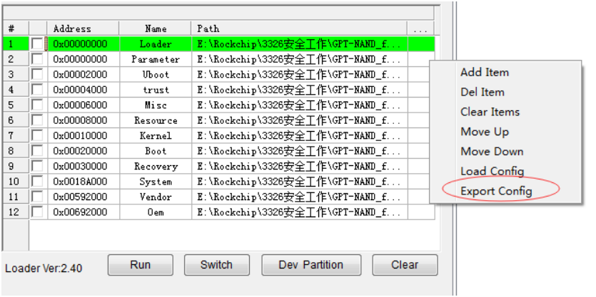
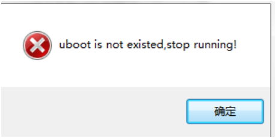
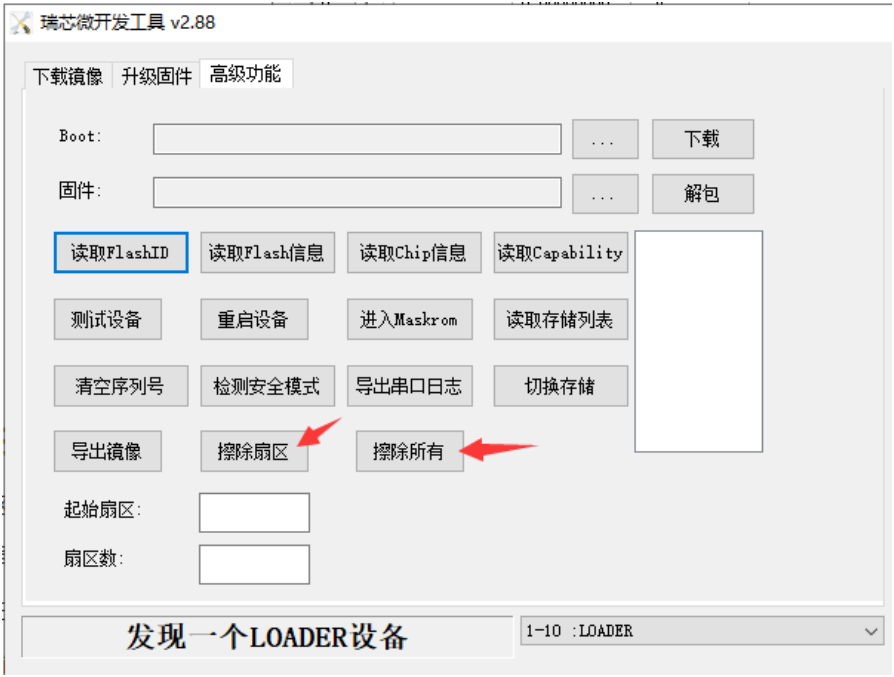



## Руководство RKDevTool: разделы, прошивка и расширенные функции

Объединены китайское/английское руководства V1.2 2018 года и китайское V1.0 2021 года для инструмента 2.88. Номера не отражают хронологию: V1.2 не новее. Пакет — снимок с release notes 3.37. Для китайской статьи используются китайские рисунки, для остальных — английские; новые экраны только из версии 2021 сохраняют китайские подписи. Ниже все технические функции двух редакций.

### 1. Создать, импортировать и экспортировать настройки

Правой кнопкой импортируйте `ParameterFile` в области загрузки для создания строк разделов. Удалите ненужные строки, назначьте образы и накопитель (для единственного необязательно). Экспортируйте `ConfigFile` для повторного использования. Стандартные настройки могут не подходить проекту. `DEFAULT_IMAGE_CONFIG` в `Config.ini` задаёт файл запуска; V1.2 также описывает замену `config.cfg`. После изменения перезапустите инструмент.

### 2. Загрузка Boot и запись Loader

Загрузка Boot в Maskrom запускает инициализацию DDR и usbplug в DDR без записи накопителя. Дважды щёлкните Loader первой строки, выберите `LoaderToDDR`, отметьте и выполните. Для постоянной записи выберите `Loader`: создаётся IDBlock и записывается память в Maskrom/Loader. При ошибках Boot проверьте пайку DDR, SoC, соответствие Loader и USB; перед повтором перезапустите устройство. Для записи также проверьте поддержку Flash, пайку и флаг чипа.

### 3. Образы и таблица разделов

Подключите Loader/Maskrom, отметив Loader для Maskrom. Выберите parameter для адресов/размеров, назначьте образы и накопитель, отметьте разделы и выполните. Нулевой адрес нельзя считать корректным. Функция Device partition table V1.2 читает и загружает существующую разметку. Отдельно устраните отсутствующие/занятые файлы, слишком большие образы и USB-ошибки.

### 4. Режимы и выбор устройства

При обнаружении ADB, MSC, MTP или UVC используйте Switch для Rockusb. Из Loader можно перейти через Enter Maskrom. При нескольких устройствах сначала выберите нужное в списке.

### 5. Полное обновление update.img

Выберите update.img, подключите Maskrom/Loader и нажмите Upgrade. V1.2 также допускает файл Loader. Проверьте доступность файла, формат/повреждение, хеш, версию упаковщика, размеры разделов, флаг чипа и обмен. Случайные ошибки требуют проверки кабеля, постоянные — устройства.

### 6. Принудительная запись по адресу

Включите Force write by address, выберите файл, введите адрес и выполните отмеченную строку. Обычная адресация разделов обходится; сверяйте реальную разметку, не обходите ошибку образа или размера.

### 7. Стереть накопитель

Версия 2021 требует Maskrom и успешной загрузки Boot перед стиранием. Посекторное стирание указано только для eMMC, полное — `emmc|nor|nand`. Версия 2018 включает все блоки, в том числе системные перед прошивкой. Это может помочь при повторных сбоях, но уничтожает данные. Не переносите поддержку SPI новых командных версий на старый GUI.

### 8. Прочитать Chip information

Прочитайте Chip information; `Image Chip Flag` должен совпадать с упаковкой Loader/прошивки. При несовпадении подготовьте файлы нужного чипа.

### 9. Несколько накопителей

В Maskrom загрузите Boot и прочитайте список: галочка — текущий накопитель, крест — не поддерживается, круг — поддерживается. Выберите строку с кругом и переключите накопитель.

### 10. Распаковать прошивку

Распаковка в `output`: `boot.bin` — Loader упаковки, `firmware.img` — внутренний образ afptool, `Android` — его распакованное содержимое. Имена оригинала сохранены.

### 11. GPT и расширенные возможности

V1.2 принимает parameter либо `partition_table.img` для GPT. Нужны `TYPE:GPT` и `grow` у последнего раздела для оставшегося места. `Read Capability` должен показывать включённый `DirectLBA`, иначе GPT не поддерживается.

### 12. Очистить серийный номер и устранить ошибки

V1.2 очищает серийные номера, записанные инструментом единой библиотеки. При отсутствующей строке загрузки проверьте путь образа. При сбоях обновите драйвер/инструмент, используйте экранированный кабель и задний порт ПК, проверьте пайку, исправность и поддержку Flash. При ошибках проверки исследуйте размеры разделов, отображение Flash и стабильность DDR; стирание перед повтором уничтожает данные. Для не-китайской ОС используйте английский путь; в Windows 7/Vista запускайте администратором, после Config.ini перезапускайте.

### Дополнительные различия V1.2

Английский текст стирания сначала выбирает update.img/loader.bin через Firmware, подключает Maskrom/Loader и нажимает EraseFlash; китайский 2021 требует Maskrom и Boot. Следуйте своей версии. Английский Clear sn указывает SN/MAC в IDBlock sector3, китайский — серийный номер единой библиотеки. При сбоях английский советует обновить инструмент и Loader, китайский — Rockusb и инструмент; проверяйте оба. Администратор требуется в английском вообще, в китайском особо названы Win7/Vista.

## Применимость и проверка

Руководство составлено по документации этой коллекции. Проверьте плату, SoC, плату-носитель, SDK/BSP и архитектуру хоста. Прошивка, provisioning, запись регистров и аппаратные испытания не выполнялись. Наличие пакета не подтверждает поддержку всех изделий ArmSoM.

## Каталог GitHub, версии и SHA-256

Откройте соответствующий каталог GitHub, выберите платформу и версию, проверьте хеш и распакуйте весь каталог. Ссылки ниже ведут в каталоги репозитория.

[Открыть каталог инструмента на GitHub](https://github.com/ArmSoM/rockchip-tools/tree/main/downloads/rkdevtool)

| Платформа / версия | Файл | SHA-256 |
|---|---|---|
| Windows / 3.37 release notes | `RKDevTool-windows-directory-snapshot.zip` | `d453bd22c00141f12ef39469629d478aa61304763bdb2977288d6f019a74f20c` |

[GitHub · catalog.json](https://github.com/ArmSoM/rockchip-tools/blob/main/catalog.json) · [SHA256SUMS](https://github.com/ArmSoM/rockchip-tools/blob/main/SHA256SUMS)

## Документы и исходные иллюстрации

- RKDevTool_manual_v1.2_cn.pdf
- RKDevTool_manual_v1.2_en.pdf
- 开发工具使用说明_v1.0.pdf

### Исходные интерфейсы и схемы руководства

Сохранён язык исходных интерфейсов. При наличии используются английские рисунки; дополнительные без английского оригинала остаются китайскими. Значения — примеры руководства, не измерения платы.

RKDevTool_manual_v1.2_en.pdf · p. 4

RKDevTool_manual_v1.2_en.pdf · p. 5

RKDevTool_manual_v1.2_en.pdf · p. 5

RKDevTool_manual_v1.2_en.pdf · p. 6

RKDevTool_manual_v1.2_en.pdf · p. 7

RKDevTool_manual_v1.2_en.pdf · p. 8

RKDevTool_manual_v1.2_en.pdf · p. 8

RKDevTool_manual_v1.2_en.pdf · p. 8

RKDevTool_manual_v1.2_en.pdf · p. 9

RKDevTool_manual_v1.2_en.pdf · p. 9

RKDevTool_manual_v1.2_en.pdf · p. 9

RKDevTool_manual_v1.2_en.pdf · p. 10

RKDevTool_manual_v1.2_en.pdf · p. 10

RKDevTool_manual_v1.2_en.pdf · p. 11

RKDevTool_manual_v1.2_en.pdf · p. 11

RKDevTool_manual_v1.2_en.pdf · p. 12

RKDevTool_manual_v1.2_en.pdf · p. 12

RKDevTool_manual_v1.2_en.pdf · p. 12

RKDevTool_manual_v1.2_en.pdf · p. 13

开发工具使用说明_v1.0.pdf · p. 2

开发工具使用说明_v1.0.pdf · p. 2

开发工具使用说明_v1.0.pdf · p. 3

开发工具使用说明_v1.0.pdf · p. 4

开发工具使用说明_v1.0.pdf · p. 5

开发工具使用说明_v1.0.pdf · p. 5

开发工具使用说明_v1.0.pdf · p. 6

开发工具使用说明_v1.0.pdf · p. 7

开发工具使用说明_v1.0.pdf · p. 8

开发工具使用说明_v1.0.pdf · p. 9

开发工具使用说明_v1.0.pdf · p. 9

开发工具使用说明_v1.0.pdf · p. 10

开发工具使用说明_v1.0.pdf · p. 11

开发工具使用说明_v1.0.pdf · p. 11

## Связанные рабочие процессы

- [Полное руководство по накопителям Rockchip: flash, загрузка, разделы, запись и Vendor Storage](/ru/articles/099-rockchip-storage-application/)
- [DriverAssitant 5.13: драйверы Rockusb и ADB в Windows](/ru/articles/rockchip-tool-driver-assistant/)
- [upgrade_tool: команды прошивки Rockchip и выбор устройства](/ru/articles/rockchip-tool-upgrade-tool/)
- [Каталог инструментов Rockchip и руководств](/ru/articles/rockchip-tools-download-guide/)

## Документация плат ArmSoM

Требования платы и носителя проверяйте по руководству изделия. Эти ссылки — платформенные материалы, а не подтверждение проверки данного инструмента на изделиях.

[ArmSoM Docs](https://docs.armsom.org/) · [Sige7](https://www.armsom.org/sige7) / [Docs](https://docs.armsom.org/armsom-sige7) · [CM5](https://www.armsom.org/cm5) / [Docs](https://docs.armsom.org/armsom-cm5)


