

## Руководство RKDevTool: разделы, прошивка и расширенные функции

Объединены китайское/английское руководства V1.2 2018 года и китайское V1.0 2021 года для инструмента 2.88. Номера не отражают хронологию: V1.2 не новее. Пакет — снимок с release notes 3.37. Для китайской статьи используются китайские рисунки, для остальных — английские; новые экраны только из версии 2021 сохраняют китайские подписи. Ниже все технические функции двух редакций.

### 1. Создать, импортировать и экспортировать настройки

#### 1.1 Создать настройки из parameter

Сначала проверьте, что parameter относится к текущему проекту. Щёлкните правой кнопкой в свободной области настроек загрузки и выберите импорт. Ниже показано меню версии 2.88.

<figure style="margin:1.6rem 0">

<figcaption style="margin-top:.6rem;font-size:.9em;line-height:1.55"><strong>Рисунок 1: Импорт настроек в контекстном меню</strong></figcaption>
</figure>

В диалоге открытия выберите тип `ParameterFile`, затем файл parameter проекта. Инструмент создаст строки загрузки по таблице разделов.

<figure style="margin:1.6rem 0">

<figcaption style="margin-top:.6rem;font-size:.9em;line-height:1.55"><strong>Рисунок 2: Выбор ParameterFile перед открытием разметки</strong></figcaption>
</figure>

После импорта удалите ненужные строки, назначьте образы оставшимся и выберите накопитель. При единственном типе памяти выбор можно пропустить. Стандартная конфигурация может не подходить проекту. Ниже — соответствующий пункт V1.2 2018 года с другими названиями интерфейса.

<figure style="margin:1.6rem 0">
<a href="/assets/rockchip-tools/manuals/6a8a5813c129/p04-f01.png" target="_blank" rel="noopener" aria-label="Открыть изображение в полном размере">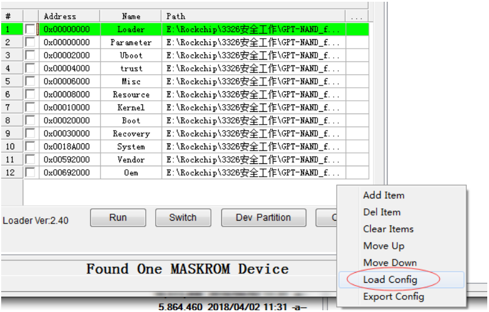</a>
<figcaption style="margin-top:.6rem;font-size:.9em;line-height:1.55"><strong>Рисунок 3: Меню импорта разделов в V1.2</strong></figcaption>
</figure>

#### 1.2 Экспортировать настройки для повторного использования

Закончив настройку, щёлкните правой кнопкой в области загрузки и экспортируйте `ConfigFile`. В следующий раз импортируйте сохранённый файл. V1.2 также позволяет заменить `config.cfg` в каталоге программы для загрузки настроек при запуске.

<figure style="margin:1.6rem 0">

<figcaption style="margin-top:.6rem;font-size:.9em;line-height:1.55"><strong>Рисунок 4: Экспорт текущей конфигурации разделов</strong></figcaption>
</figure>

#### 1.3 Задать конфигурацию при запуске

Параметр `DEFAULT_IMAGE_CONFIG` в `Config.ini` задаёт файл, загружаемый при запуске. После сохранения перезапустите программу. Путь на рисунке — пример оригинала; укажите конфигурацию своего проекта.

<figure style="margin:1.6rem 0">

<figcaption style="margin-top:.6rem;font-size:.9em;line-height:1.55"><strong>Рисунок 5: DEFAULT_IMAGE_CONFIG в Config.ini</strong></figcaption>
</figure>

### 2. Загрузка Boot и запись Loader

#### 2.1 Загрузить Boot только в память

Загрузка Boot в Maskrom запускает инициализацию DDR из Loader и usbplug в DDR без записи накопителя. Дважды щёлкните Loader в первой строке, выберите `LoaderToDDR`, отметьте строку и выполните операцию.

<figure style="margin:1.6rem 0">

<figcaption style="margin-top:.6rem;font-size:.9em;line-height:1.55"><strong>Рисунок 6: LoaderToDDR загружает код обновления в DDR без записи накопителя</strong></figcaption>
</figure>

В V1.2 2018 года есть и другой путь: в расширенных функциях выберите файл Boot и нажмите Download. Это также загрузка Boot в оперативную память.

<figure style="margin:1.6rem 0">
<a href="/assets/rockchip-tools/manuals/6a8a5813c129/p08-f02.png" target="_blank" rel="noopener" aria-label="Открыть изображение в полном размере">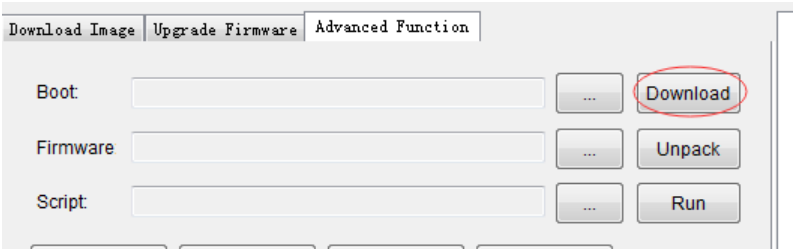</a>
<figcaption style="margin-top:.6rem;font-size:.9em;line-height:1.55"><strong>Рисунок 7: Загрузка Boot через расширенные функции V1.2</strong></figcaption>
</figure>

В списке загрузки V1.2 также доступен `LoaderToDDR`. Оба способа относятся к загрузке в оперативную память. Перед повтором перезапустите устройство, проверьте пайку DDR, SoC, соответствие Loader и USB-связь.

<figure style="margin:1.6rem 0">
<a href="/assets/rockchip-tools/manuals/6a8a5813c129/p08-f03.png" target="_blank" rel="noopener" aria-label="Открыть изображение в полном размере">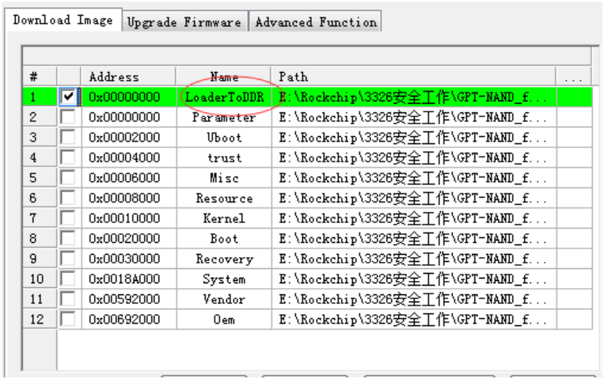</a>
<figcaption style="margin-top:.6rem;font-size:.9em;line-height:1.55"><strong>Рисунок 8: Пункт LoaderToDDR в списке загрузки V1.2</strong></figcaption>
</figure>

#### 2.2 Записать Loader в накопитель

Для постоянной записи выберите `Loader` в первой строке, отметьте её и выполните. Допустимы Maskrom и Loader; операция создаёт IDBlock и записывает накопитель. Помимо DDR, SoC и USB проверьте поддержку Flash, пайку и флаг чипа. При случайных сбоях связи сначала проверяйте USB, при постоянных — устройство.

<figure style="margin:1.6rem 0">

<figcaption style="margin-top:.6rem;font-size:.9em;line-height:1.55"><strong>Рисунок 9: Loader создаёт IDBlock и записывает накопитель</strong></figcaption>
</figure>

### 3. Образы и таблица разделов

Подключите Loader/Maskrom, отметив Loader для Maskrom. Выберите parameter для адресов/размеров, назначьте образы и накопитель, отметьте разделы и выполните. Нулевой адрес нельзя считать корректным. Функция Device partition table V1.2 читает и загружает существующую разметку. Отдельно устраните отсутствующие/занятые файлы, слишком большие образы и USB-ошибки.

<figure style="margin:1.6rem 0">

<figcaption style="margin-top:.6rem;font-size:.9em;line-height:1.55"><strong>Рисунок 10: Выполнение выбранных строк после проверки разделов, путей и накопителя</strong></figcaption>
</figure>

В V1.2 также нужно проверить адреса каждой строки. На рисунке показано устройство Maskrom. Если адреса не загрузились, выберите parameter проекта, не используйте нулевые адреса. Для существующей разметки используйте Device partition table: она читает, разбирает и загружает таблицу устройства.

<figure style="margin:1.6rem 0">
<a href="/assets/rockchip-tools/manuals/6a8a5813c129/p06-f01.png" target="_blank" rel="noopener" aria-label="Открыть изображение в полном размере">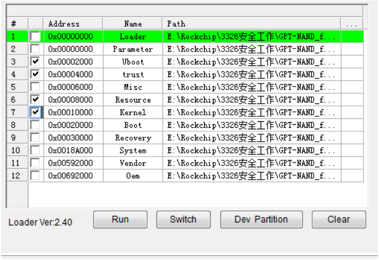</a>
<figcaption style="margin-top:.6rem;font-size:.9em;line-height:1.55"><strong>Рисунок 11: Список разделов и состояние устройства в V1.2</strong></figcaption>
</figure>

### 4. Режимы и выбор устройства

Если устройство определяется как ADB, MSC, MTP или UVC, перед прошивкой нажмите Switch для перехода в Rockusb Loader или Maskrom. На рисунке приведён пример ADB.

<figure style="margin:1.6rem 0">

<figcaption style="margin-top:.6rem;font-size:.9em;line-height:1.55"><strong>Рисунок 12: Переключение ADB-устройства в Rockusb</strong></figcaption>
</figure>

Если устройство уже в Loader, выберите Enter Maskrom в расширенных функциях. После переключения снова проверьте отображаемый режим.

<figure style="margin:1.6rem 0">

<figcaption style="margin-top:.6rem;font-size:.9em;line-height:1.55"><strong>Рисунок 13: Кнопка Enter Maskrom в версии 2.88</strong></figcaption>
</figure>

Ниже — соответствующий пункт V1.2 2018 года; он также требует режима Loader.

<figure style="margin:1.6rem 0">
<a href="/assets/rockchip-tools/manuals/6a8a5813c129/p10-f02.png" target="_blank" rel="noopener" aria-label="Открыть изображение в полном размере">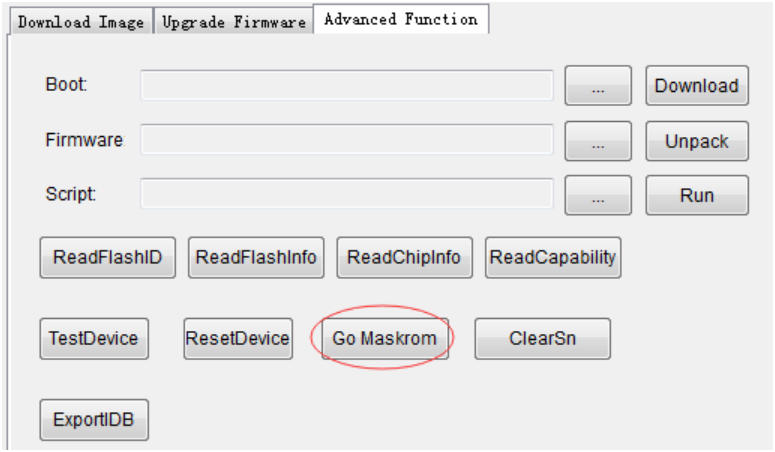</a>
<figcaption style="margin-top:.6rem;font-size:.9em;line-height:1.55"><strong>Рисунок 14: Переход Loader → Maskrom в V1.2</strong></figcaption>
</figure>

При подключении нескольких устройств сначала выберите целевое в списке, затем выполняйте операцию. Сообщение об обнаружении само по себе не определяет нужную цель записи.

<figure style="margin:1.6rem 0">
<a href="/assets/rockchip-tools/manuals/be6d064c5f70/p11-f02.png" target="_blank" rel="noopener" aria-label="Открыть изображение в полном размере">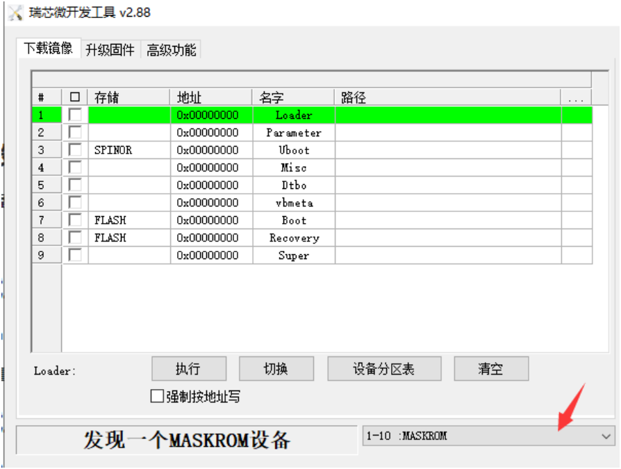</a>
<figcaption style="margin-top:.6rem;font-size:.9em;line-height:1.55"><strong>Рисунок 15: Выбор цели при нескольких подключённых устройствах</strong></figcaption>
</figure>

### 5. Полное обновление update.img

Выберите update.img, подключите Maskrom/Loader и нажмите Upgrade. V1.2 также допускает файл Loader. Проверьте доступность файла, формат/повреждение, хеш, версию упаковщика, размеры разделов, флаг чипа и обмен. Случайные ошибки требуют проверки кабеля, постоянные — устройства.

<figure style="margin:1.6rem 0">

<figcaption style="margin-top:.6rem;font-size:.9em;line-height:1.55"><strong>Рисунок 16: Выбор update.img, проверка режима и запуск обновления</strong></figcaption>
</figure>

Ниже интерфейс обновления V1.2 2018 года. Этот вариант Firmware также принимает Loader; заранее определите, нужен ли полный update.img или только Loader.

<figure style="margin:1.6rem 0">
<a href="/assets/rockchip-tools/manuals/6a8a5813c129/p07-f01.png" target="_blank" rel="noopener" aria-label="Открыть изображение в полном размере">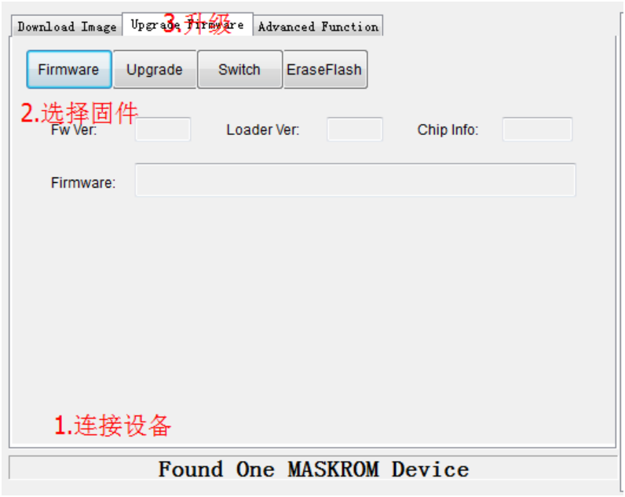</a>
<figcaption style="margin-top:.6rem;font-size:.9em;line-height:1.55"><strong>Рисунок 17: Выбор прошивки и кнопки Upgrade в V1.2</strong></figcaption>
</figure>

### 6. Принудительная запись по адресу

Включите Force write by address, выберите файл, введите адрес и выполните отмеченную строку. Обычная адресация разделов обходится; сверяйте реальную разметку, не обходите ошибку образа или размера.

<figure style="margin:1.6rem 0">

<figcaption style="margin-top:.6rem;font-size:.9em;line-height:1.55"><strong>Рисунок 18: При записи по адресу проверьте файл, адрес и выбранную строку</strong></figcaption>
</figure>

### 7. Стереть накопитель

Версия 2021 требует Maskrom и успешной загрузки Boot перед стиранием. Посекторное стирание указано только для eMMC, полное — `emmc|nor|nand`. Версия 2018 включает все блоки, в том числе системные перед прошивкой. Это может помочь при повторных сбоях, но уничтожает данные. Не переносите поддержку SPI новых командных версий на старый GUI.

<figure style="margin:1.6rem 0">

<figcaption style="margin-top:.6rem;font-size:.9em;line-height:1.55"><strong>Рисунок 19: Отдельные элементы управления для стирания секторов и всей памяти</strong></figcaption>
</figure>

### 8. Прочитать Chip information

Прочитайте Chip information; `Image Chip Flag` должен совпадать с упаковкой Loader/прошивки. При несовпадении подготовьте файлы нужного чипа.

<figure style="margin:1.6rem 0">

<figcaption style="margin-top:.6rem;font-size:.9em;line-height:1.55"><strong>Рисунок 20: Проверка Image Chip Flag в результате Read Chip</strong></figcaption>
</figure>

Вывод V1.2 также содержит флаг чипа. При ошибке его проверки сравните значение с настройками упаковки прошивки или Loader.

<figure style="margin:1.6rem 0">
<a href="/assets/rockchip-tools/manuals/6a8a5813c129/p12-f02.png" target="_blank" rel="noopener" aria-label="Открыть изображение в полном размере">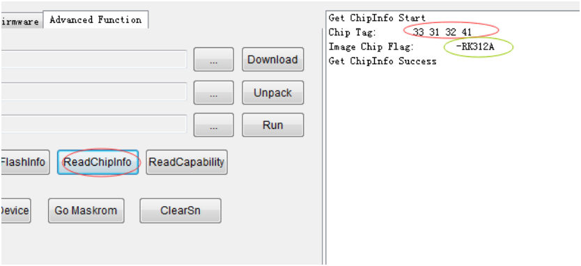</a>
<figcaption style="margin-top:.6rem;font-size:.9em;line-height:1.55"><strong>Рисунок 21: Чтение сведений о чипе и Image Chip Flag в V1.2</strong></figcaption>
</figure>

В примере упаковки ниже выделено поле чипа. Смысл примера — совпадение флага упаковки с прочитанным значением; переносить показанный чип на другую плату нельзя.

<figure style="margin:1.6rem 0">

<figcaption style="margin-top:.6rem;font-size:.9em;line-height:1.55"><strong>Рисунок 22: Пример поля чипа в конфигурации упаковки</strong></figcaption>
</figure>

### 9. Несколько накопителей

В Maskrom загрузите Boot и прочитайте список: галочка — текущий накопитель, крест — не поддерживается, круг — поддерживается. Выберите строку с кругом и переключите накопитель.

<figure style="margin:1.6rem 0">

<figcaption style="margin-top:.6rem;font-size:.9em;line-height:1.55"><strong>Рисунок 23: Чтение списка памяти и переключение на поддерживаемый накопитель</strong></figcaption>
</figure>

### 10. Распаковать прошивку

Распаковка в `output`: `boot.bin` — Loader упаковки, `firmware.img` — внутренний образ afptool, `Android` — его распакованное содержимое. Имена оригинала сохранены.

<figure style="margin:1.6rem 0">

<figcaption style="margin-top:.6rem;font-size:.9em;line-height:1.55"><strong>Рисунок 24: Извлечение образов из выбранной прошивки через Unpack</strong></figcaption>
</figure>

В V1.2 кнопка Unpack расположена в расширенных функциях. Результат нужен для просмотра содержимого прошивки; распаковка не прошивает устройство автоматически.

<figure style="margin:1.6rem 0">
<a href="/assets/rockchip-tools/manuals/6a8a5813c129/p08-f01.png" target="_blank" rel="noopener" aria-label="Открыть изображение в полном размере">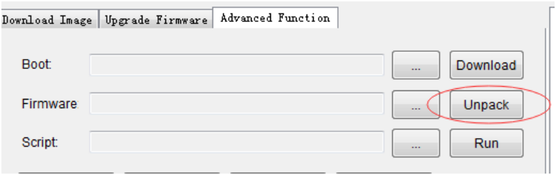</a>
<figcaption style="margin-top:.6rem;font-size:.9em;line-height:1.55"><strong>Рисунок 25: Распаковка прошивки в расширенных функциях V1.2</strong></figcaption>
</figure>

### 11. GPT и расширенные возможности

V1.2 принимает parameter или `partition_table.img` для GPT. При использовании parameter сначала проверьте наличие `TYPE:GPT`.

<figure style="margin:1.6rem 0">

<figcaption style="margin-top:.6rem;font-size:.9em;line-height:1.55"><strong>Рисунок 26: Атрибут TYPE:GPT в parameter</strong></figcaption>
</figure>

Последнему разделу нужен атрибут `grow`, чтобы получить оставшееся место. Используйте адреса и имена своего проекта, не копируйте разметку примера.

<figure style="margin:1.6rem 0">
<a href="/assets/rockchip-tools/manuals/6a8a5813c129/p09-f02.png" target="_blank" rel="noopener" aria-label="Открыть изображение в полном размере">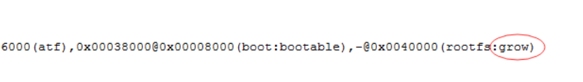</a>
<figcaption style="margin-top:.6rem;font-size:.9em;line-height:1.55"><strong>Рисунок 27: Атрибут grow последнего раздела</strong></figcaption>
</figure>

Проверив описание разделов, выберите parameter или образ GPT в области загрузки. На рисунке показан выбор в V1.2.

<figure style="margin:1.6rem 0">
<a href="/assets/rockchip-tools/manuals/6a8a5813c129/p09-f03.png" target="_blank" rel="noopener" aria-label="Открыть изображение в полном размере">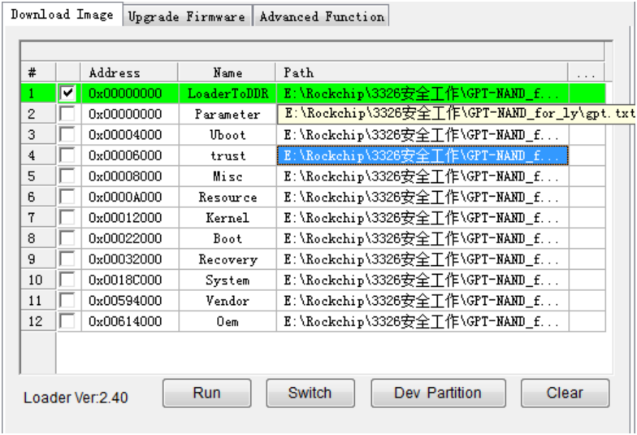</a>
<figcaption style="margin-top:.6rem;font-size:.9em;line-height:1.55"><strong>Рисунок 28: Выбор файла описания GPT в области загрузки</strong></figcaption>
</figure>

Перед загрузкой проверьте `Read Capability`. `DirectLBA` должен быть включён, иначе инструмент сообщает, что GPT не поддерживается. Принудительная запись по адресу не отменяет этого условия.

<figure style="margin:1.6rem 0">
<a href="/assets/rockchip-tools/manuals/6a8a5813c129/p10-f01.png" target="_blank" rel="noopener" aria-label="Открыть изображение в полном размере">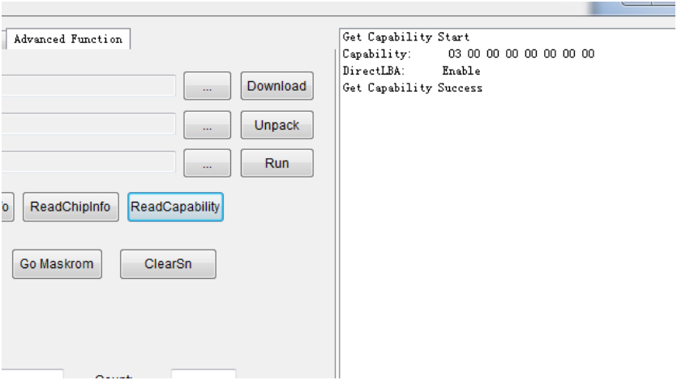</a>
<figcaption style="margin-top:.6rem;font-size:.9em;line-height:1.55"><strong>Рисунок 29: DirectLBA в результате Read Capability</strong></figcaption>
</figure>

### 12. Очистить серийный номер и устранить ошибки

#### 12.1 Очистить серийный номер

Clear sn в V1.2 очищает серийные номера, записанные инструментом единой библиотеки. Английское руководство дополнительно указывает SN/MAC в IDBlock sector3; заранее определите, какие сведения устройства нужно удалить.

<figure style="margin:1.6rem 0">
<a href="/assets/rockchip-tools/manuals/6a8a5813c129/p11-f01.png" target="_blank" rel="noopener" aria-label="Открыть изображение в полном размере">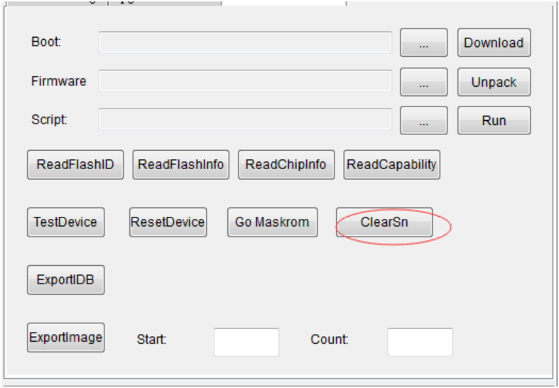</a>
<figcaption style="margin-top:.6rem;font-size:.9em;line-height:1.55"><strong>Рисунок 30: Пункт Clear sn в V1.2</strong></figcaption>
</figure>

#### 12.2 Отсутствует файл для загрузки

Если файл загрузки отсутствует, проверьте путь образа указанного раздела. Китайский пример называет kernel, английский — отсутствующий boot. Ориентируйтесь на конкретное сообщение.

<figure style="margin:1.6rem 0">

<figcaption style="margin-top:.6rem;font-size:.9em;line-height:1.55"><strong>Рисунок 31: Отсутствующий файл: проверьте имя в сообщении</strong></figcaption>
</figure>

#### 12.3 Ошибка загрузки файла прошивки

Проверьте, не занят ли файл другой программой, правильный ли формат и не повреждён ли он. При ошибке проверки чипа вернитесь к Read Chip information и сравните `Image Chip Flag` с флагом упаковки Loader/прошивки.

<figure style="margin:1.6rem 0">
<a href="/assets/rockchip-tools/manuals/6a8a5813c129/p12-f01.png" target="_blank" rel="noopener" aria-label="Открыть изображение в полном размере">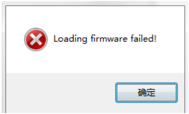</a>
<figcaption style="margin-top:.6rem;font-size:.9em;line-height:1.55"><strong>Рисунок 32: Сообщение об ошибке загрузки прошивки</strong></figcaption>
</figure>

#### 12.4 Ошибки записи или проверки

- **Ошибка загрузки Boot**: проверьте пайку DDR, SoC, соответствие Loader и USB; перед повтором перезапустите устройство.
- **Ошибка записи прошивки или раздела**: китайский текст рекомендует обновить Rockusb и инструмент, английский также обращает внимание на инструмент и Loader. Попробуйте экранированный кабель и задний порт ПК; проверьте поддержку Flash, пайку и повреждения.
- **Ошибка проверки**: убедитесь, что разделы parameter вмещают образы, проверьте отображение Flash и стабильность DDR. Оригинал предлагает при необходимости стереть Flash перед повтором; сначала оцените потерю данных.

#### 12.5 Запись GPT не поддерживается

При сообщении ниже проверьте через `Read Capability`, включён ли `DirectLBA`, затем проверьте GPT проекта.

<figure style="margin:1.6rem 0">
<a href="/assets/rockchip-tools/manuals/6a8a5813c129/p13-f01.png" target="_blank" rel="noopener" aria-label="Открыть изображение в полном размере">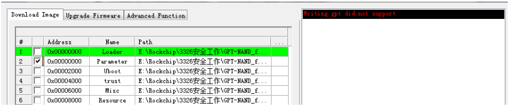</a>
<figcaption style="margin-top:.6rem;font-size:.9em;line-height:1.55"><strong>Рисунок 33: Проверка DirectLBA при отсутствии поддержки GPT</strong></figcaption>
</figure>

#### 12.6 Пути, права и применение настроек

Для не-китайской ОС используйте путь к инструменту только с английскими символами. Английская V1.2 требует учётную запись администратора; китайская отдельно называет Windows 7/Vista. После изменения `Config.ini` перезапустите инструмент.

### Дополнительные различия V1.2

Английский текст стирания сначала выбирает update.img/loader.bin через Firmware, подключает Maskrom/Loader и нажимает EraseFlash; китайский 2021 требует Maskrom и Boot. Следуйте своей версии. Английский Clear sn указывает SN/MAC в IDBlock sector3, китайский — серийный номер единой библиотеки. При сбоях английский советует обновить инструмент и Loader, китайский — Rockusb и инструмент; проверяйте оба. Администратор требуется в английском вообще, в китайском особо названы Win7/Vista.

## Применимость и проверка

Руководство составлено по документации этой коллекции. Проверьте плату, SoC, плату-носитель, SDK/BSP и архитектуру хоста. Прошивка, provisioning, запись регистров и аппаратные испытания не выполнялись. Наличие пакета не подтверждает поддержку всех изделий ArmSoM.

## Каталог GitHub, версии и SHA-256

Откройте соответствующий каталог GitHub, выберите платформу и версию, проверьте хеш и распакуйте весь каталог. Ссылки ниже ведут в каталоги репозитория.

[Открыть каталог инструмента на GitHub](https://github.com/ArmSoM/rockchip-tools/tree/main/downloads/rkdevtool)

| Платформа / версия | Файл | SHA-256 |
|---|---|---|
| Windows / 3.37 release notes | `RKDevTool-windows-directory-snapshot.zip` | `d453bd22c00141f12ef39469629d478aa61304763bdb2977288d6f019a74f20c` |

[GitHub · catalog.json](https://github.com/ArmSoM/rockchip-tools/blob/main/catalog.json) · [SHA256SUMS](https://github.com/ArmSoM/rockchip-tools/blob/main/SHA256SUMS)

## Документы и исходные иллюстрации

- RKDevTool_manual_v1.2_cn.pdf
- RKDevTool_manual_v1.2_en.pdf
- 开发工具使用说明_v1.0.pdf

## Связанные рабочие процессы

- [Полное руководство по накопителям Rockchip: flash, загрузка, разделы, запись и Vendor Storage](/ru/articles/099-rockchip-storage-application/)
- [DriverAssitant 5.13: драйверы Rockusb и ADB в Windows](/ru/articles/rockchip-tool-driver-assistant/)
- [upgrade_tool: команды прошивки Rockchip и выбор устройства](/ru/articles/rockchip-tool-upgrade-tool/)
- [Каталог инструментов Rockchip и руководств](/ru/articles/rockchip-tools-download-guide/)

## Документация плат ArmSoM

Требования платы и носителя проверяйте по руководству изделия. Эти ссылки — платформенные материалы, а не подтверждение проверки данного инструмента на изделиях.

[ArmSoM Docs](https://docs.armsom.org/) · [Sige7](https://www.armsom.org/sige7) / [Docs](https://docs.armsom.org/armsom-sige7) · [CM5](https://www.armsom.org/cm5) / [Docs](https://docs.armsom.org/armsom-cm5)


