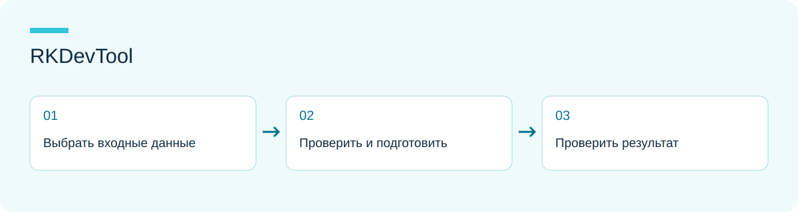





RKDevTool — графическая утилита Windows для работы с Rockusb. Она помогает при запуске плат ArmSoM и диагностике прошивки. Полный `update.img`, образы разделов и Loader требуют разных операций.

## Подготовка

Установите подходящий драйвер Rockusb через DriverAssitant. Распакуйте всю папку RKDevTool с DLL и языковыми файлами. По руководству платы определите USB-порт данных, питание и вход в Maskrom. Сохраните данные перед записью. Соединение ADB работающей ОС не равнозначно режиму Loader или Maskrom.

## Конфигурация разделов

1. В области загрузки выберите Import configuration, тип **ParameterFile** и parameter из той же сборки прошивки.
2. Удалите ненужные строки, задайте образы и целевой накопитель, если их несколько.
3. Сопоставьте размер образов с разделами, экспортируйте **ConfigFile**. Параметр `DEFAULT_IMAGE_CONFIG` в `config.ini` задаёт начальную конфигурацию.
4. Перед Execute проверьте отмеченные строки: импорт не подтверждает соответствие подключённой плате.

## Что именно записывается

В Maskrom операция **LoaderToDDR** загружает код обновления в RAM без записи накопителя согласно руководству. **Loader** создаёт IDBlock и записывает его в накопитель. Для диагностики DDR это принципиальное различие; нужен Loader для конкретной платы и памяти.

Для полного обновления выберите `update.img`, режим Maskrom/Loader и Upgrade. Для отдельных разделов сначала загрузите parameter. Адресную запись нельзя выполнять по смещениям другой платы. Erase All уничтожает данные накопителя.

## Диагностика и приёмка

Если устройство не обнаружено, проверьте кабель данных, порт, драйвер и режим. Ошибка Download Boot требует проверки DDR/Loader, питания и USB, затем перезапуска. Слишком большой образ означает несоответствие разделу. Ошибка chip flag или digest требует проверки упаковки и целостности. При случайных сбоях передачи проверяйте соединение, при постоянных — также устройство.

В пакете есть двуязычные руководства V1.2 2018 года, китайское V1.0 2021 года для V2.88 и журнал до 3.37. Номер документа сам по себе не определяет актуальность. Иллюстрации взяты из руководства. После записи проверьте холодный старт, накопитель и версию ОС; успешная передача не заменяет испытание изделия.

## Применимость и проверка

Руководство составлено по документации этой коллекции. Проверьте плату, SoC, плату-носитель, SDK/BSP и архитектуру хоста. Прошивка, provisioning, запись регистров и аппаратные испытания не выполнялись. Наличие пакета не подтверждает поддержку всех изделий ArmSoM.

## Загрузка, версии и SHA-256

Выберите архив, проверьте хеш и распакуйте весь каталог. Разделённый Linux PinDebug сначала восстановите по инструкции; его указанный хеш относится к целому файлу.

| Хост / версия | Пакет |
|---|---|
| Windows / 3.37 release notes | [RKDevTool-windows-directory-snapshot.zip](https://raw.githubusercontent.com/ArmSoM/rockchip-tools/main/downloads/rkdevtool/RKDevTool-windows-directory-snapshot.zip) |

**RKDevTool-windows-directory-snapshot.zip — SHA-256**

```text
d453bd22c00141f12ef39469629d478aa61304763bdb2977288d6f019a74f20c
```

[GitHub · catalog.json](https://github.com/ArmSoM/rockchip-tools/blob/main/catalog.json) · [SHA256SUMS](https://github.com/ArmSoM/rockchip-tools/blob/main/SHA256SUMS)

## Документы и исходные иллюстрации

- RKDevTool_manual_v1.2_cn.pdf; RKDevTool_manual_v1.2_en.pdf (2018)
- 开发工具使用说明_v1.0.pdf (2021, tool V2.88); bundled revision notes through 3.37
- [Исходный PDF: RKDevTool_manual_v1.2_cn.pdf](https://raw.githubusercontent.com/ArmSoM/rockchip-tools/main/manuals/27081f89d32f.pdf)
- [Исходный PDF: RKDevTool_manual_v1.2_en.pdf](https://raw.githubusercontent.com/ArmSoM/rockchip-tools/main/manuals/6a8a5813c129.pdf)
- [Исходный PDF: 开发工具使用说明_v1.0.pdf](https://raw.githubusercontent.com/ArmSoM/rockchip-tools/main/manuals/be6d064c5f70.pdf)

Иллюстрации извлечены из указанных PDF. При наличии только китайского оригинала текст интерфейса сохранён; подписи переведены. Это исторические примеры, не результаты тестов ArmSoM.


RKDevTool_manual_v1.2_en.pdf · p. 5


RKDevTool_manual_v1.2_en.pdf · p. 5

## Связанные рабочие процессы

- [Полное руководство по накопителям Rockchip: flash, загрузка, разделы, запись и Vendor Storage](/ru/articles/099-rockchip-storage-application/)
- [DriverAssitant 5.13: драйверы Rockusb и ADB в Windows](/ru/articles/rockchip-tool-driver-assistant/)
- [upgrade_tool: команды прошивки Rockchip и выбор устройства](/ru/articles/rockchip-tool-upgrade-tool/)
- [Каталог инструментов Rockchip и руководств](/ru/articles/rockchip-tools-download-guide/)

## Документация плат ArmSoM

Требования платы и носителя проверяйте по руководству изделия. Эти ссылки — платформенные материалы, а не подтверждение проверки данного инструмента на изделиях.

[ArmSoM Docs](https://docs.armsom.org/) · [Sige7](https://www.armsom.org/sige7) / [Docs](https://docs.armsom.org/armsom-sige7) · [CM5](https://www.armsom.org/cm5) / [Docs](https://docs.armsom.org/armsom-cm5)


