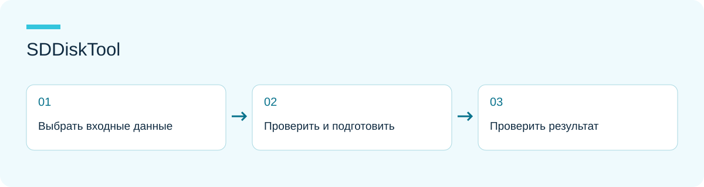





SDDiskTool создаёт разные носители Rockchip: Upgrade Firmware, PCBA Test и SD Boot. Это не универсальная запись произвольного дискового образа Linux.

## Выберите поведение

SD Boot готовит носитель загрузки; upgrade-карта может записывать накопитель платы; PCBA предназначена для испытаний. До вставки карты выясните действия bootloader. Создание носителя и обновление платы — разные этапы.

## Подготовка

1. Выберите карту, данные которой можно удалить, по ёмкости и идентичности, а не только букве диска.
2. Последовательно задайте съёмный диск, режим и подходящую прошивку.
3. Подготовьте файлы SDK: инструмент явно сообщает об отсутствии `SDBoot.bin` или `sd_boot_config.config`.
4. Перед Create повторно проверьте цель: подтверждение предупреждает об удалении данных.
5. Безопасно извлеките карту и следуйте порядку загрузки/питания платы.

## Ошибки и проверка

Отсутствие диска, ошибка блокировки/размонтирования, отсутствующая прошивка и форматирование требуют разных проверок. Закройте программы, занявшие том. Restore тоже удаляет содержимое карты и не восстанавливает прежние данные платы.

Версия 1.78 исправляет адресную ошибку резервной GPT; прежние версии меняли grow-разделы и большие образы. Это не доказательство общей совместимости. Проверьте фактический результат загрузки/обновления и сохраните способ восстановления.

## Применимость и проверка

Руководство составлено по документации этой коллекции. Проверьте плату, SoC, плату-носитель, SDK/BSP и архитектуру хоста. Прошивка, provisioning, запись регистров и аппаратные испытания не выполнялись. Наличие пакета не подтверждает поддержку всех изделий ArmSoM.

## Загрузка, версии и SHA-256

Выберите архив, проверьте хеш и распакуйте весь каталог. Разделённый Linux PinDebug сначала восстановите по инструкции; его указанный хеш относится к целому файлу.

| Хост / версия | Пакет |
|---|---|
| Windows / 1.78 | [SDDiskTool_v1.78.zip](https://raw.githubusercontent.com/ArmSoM/rockchip-tools/main/downloads/sd-disk-tool/SDDiskTool_v1.78.zip) |

**SDDiskTool_v1.78.zip — SHA-256**

```text
4b4a8349c102b2b791ce2ae6f179c94aa81962e788df7232b603e9bb76549d08
```

[GitHub · catalog.json](https://github.com/ArmSoM/rockchip-tools/blob/main/catalog.json) · [SHA256SUMS](https://github.com/ArmSoM/rockchip-tools/blob/main/SHA256SUMS)

## Документы и исходные иллюстрации

- SDDiskTool_v1.78.zip: English.ini and revision.txt; Rockchip SD-card boot guide

## Связанные рабочие процессы

- [Загрузка Rockchip с SD: обновление, восстановление и BCB](/ru/articles/087-rockchip-sd-card-boot/)
- [RKDevTool: загрузка, Loader, разделы и прошивка update.img](/ru/articles/rockchip-tool-rkdevtool/)
- [Каталог инструментов Rockchip и руководств](/ru/articles/rockchip-tools-download-guide/)

## Документация плат ArmSoM

Требования платы и носителя проверяйте по руководству изделия. Эти ссылки — платформенные материалы, а не подтверждение проверки данного инструмента на изделиях.

[ArmSoM Docs](https://docs.armsom.org/) · [Sige7](https://www.armsom.org/sige7) / [Docs](https://docs.armsom.org/armsom-sige7) · [CM5](https://www.armsom.org/cm5) / [Docs](https://docs.armsom.org/armsom-cm5)


