


## Историческое руководство Secure Boot V1.2

Руководство 2016 года перечисляет RK3126, RK3128, RK3228, RK3288 и RK3368, а не общую конфигурацию RK35xx. Возможности: Secure Boot ROM, SHA256/SHA160, RSA2048/RSA1024, проверка RSA через OTP и обновление Secure Boot Rockusb. Минимум: Miniloader 2.19, U-Boot 2.17, EfuseTool 1.35, SecureBootTool 1.75, RKBatchTool 1.8.

### 1. Цепочка доверия и настройка подписи

Схема ниже показывает проверки ROM и этапов загрузки. В Windows выберите чип (others для предшествующих 3188), затем eFuse либо программный режим. Источник поддерживает eFuse для 3128, 3288, 3228 и 3368, но не для других старых чипов. Слово encryption в GUI не означает, что проверка подписи обеспечивает секретность прошивки.

3188 и более ранние используют loaderex=false и 1024-битный ключ. Для 3128/3288/3228/3368 применяется следующее с указанными минимальными Loader/U-Boot. Допустимы только 1024 и 2048.

```ini
[Options]
Loaderex=true
Key=2048
```

### 2. Создать, сохранить и загрузить RSA

Источник требует одну пару на модель изделия, повторно используемую для прошивок и отдельно резервируемую. Создайте, подтвердите, сохраните и загрузите ключи. Поддерживается OpenSSL `.pem` RSA2048. Потеря может исключить обновление и восстановление. Снимки показывают порядок действий, не систему хранения производственных ключей.

### 3. Подготовить и подписать прошивку

boot.img и recovery.img должны содержать ядро. Снимок терминала показывает следующий пример RK3288 Android 4.4; прошивка NAND также включает miniloader и uboot.img. Загрузите ключи, выберите и подпишите прошивку, сохраните результат. Повторяющийся номер 3.5 оригинала упорядочен по действиям.

```text
./mkimage.sh ota
TARGET_PRODUCT=rk3288
TARGET_HARDWARE=rk30board
system filesystem is ext4
make ota images...
create boot.img with kernel... done.
create recovery.img with kernel... done.
create misc.img.... done.
```

### 4. Программирование eFuse

Откройте eFuse tool, выберите подписанную производственную прошивку и Start. Пустое устройство по USB входит в `maskromrockusb`, запись начинается автоматически; поддерживается несколько устройств. RK312X требует отдельного питания eFuse через оснастку, RK3288 имеет программно управляемое питание. Сначала проверьте один экземпляр с полной подписанной прошивкой. eFuse — необратимая настройка, не эксперимент на обычной плате.

### 5. Обновить и проверить

Обновите подписанную прошивку подходящим производственным инструментом. Без записи eFuse этот Secure Boot не включается. Отрицательная проверка записывает неподписанную прошивку: загрузка не проходит, устройство остаётся в `maskromrockusb`, после Loader возникает ошибка. Ниже исходные снимки, не тесты ArmSoM.

### 6. Типичные ошибки

При ошибке eFuse проверьте питание и предыдущую запись устройства. Не диагностируйте многократной записью; сохраните ключи, версию прошивки, чип и журнал и сверяйтесь с его документацией.

## Применимость и проверка

Руководство составлено по документации этой коллекции. Проверьте плату, SoC, плату-носитель, SDK/BSP и архитектуру хоста. Прошивка, provisioning, запись регистров и аппаратные испытания не выполнялись. Наличие пакета не подтверждает поддержку всех изделий ArmSoM.

## Каталог GitHub, версии и SHA-256

Откройте соответствующий каталог GitHub, выберите платформу и версию, проверьте хеш и распакуйте весь каталог. Ссылки ниже ведут в каталоги репозитория.

[Открыть каталог инструмента на GitHub](https://github.com/ArmSoM/rockchip-tools/tree/main/downloads/secureboot-tool)

| Платформа / версия | Файл | SHA-256 |
|---|---|---|
| Host to verify / 1.85 | `SecureBootTool_v1.85_foruser.zip` | `d241ccc7503a3202c68a036f51cdd7f5d2db2a7594eb749ec19e2ffb2c67681a` |

[GitHub · catalog.json](https://github.com/ArmSoM/rockchip-tools/blob/main/catalog.json) · [SHA256SUMS](https://github.com/ArmSoM/rockchip-tools/blob/main/SHA256SUMS)

## Документы и исходные иллюстрации

- Rockchip Secure Boot Application Note_v1.2_20160202.pdf

### Исходные интерфейсы и схемы руководства

Сохранён язык исходных интерфейсов. При наличии используются английские рисунки; дополнительные без английского оригинала остаются китайскими. Значения — примеры руководства, не измерения платы.

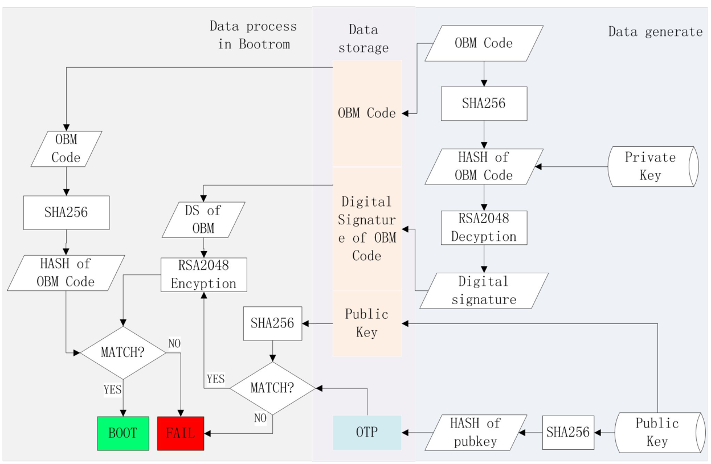

Rockchip Secure Boot Application Note_v1.2_20160202.pdf · p. 5

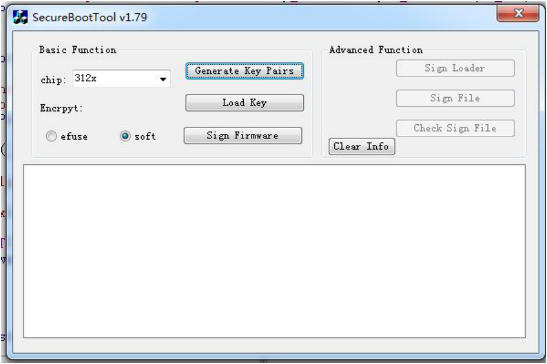

Rockchip Secure Boot Application Note_v1.2_20160202.pdf · p. 6


Rockchip Secure Boot Application Note_v1.2_20160202.pdf · p. 7

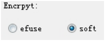

Rockchip Secure Boot Application Note_v1.2_20160202.pdf · p. 7

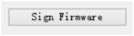

Rockchip Secure Boot Application Note_v1.2_20160202.pdf · p. 7


Rockchip Secure Boot Application Note_v1.2_20160202.pdf · p. 9

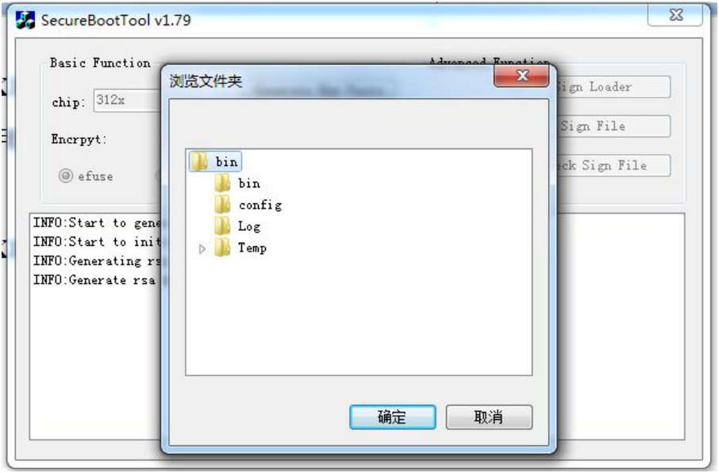

Rockchip Secure Boot Application Note_v1.2_20160202.pdf · p. 10

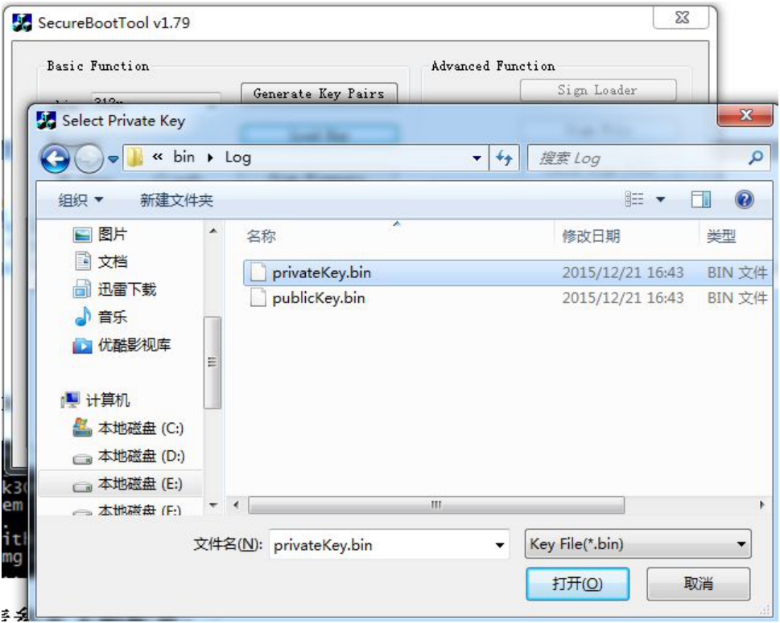

Rockchip Secure Boot Application Note_v1.2_20160202.pdf · p. 11


Rockchip Secure Boot Application Note_v1.2_20160202.pdf · p. 12

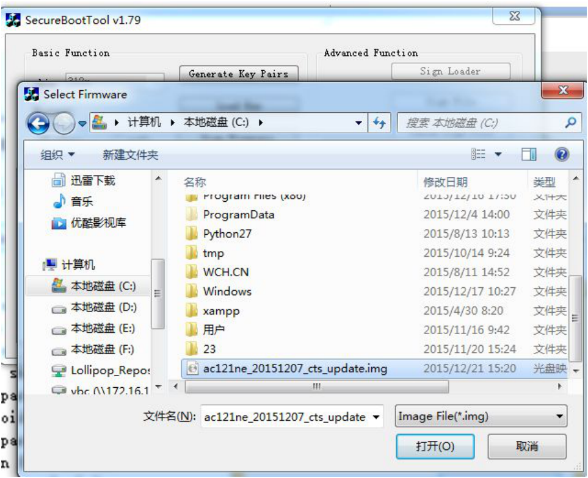

Rockchip Secure Boot Application Note_v1.2_20160202.pdf · p. 13

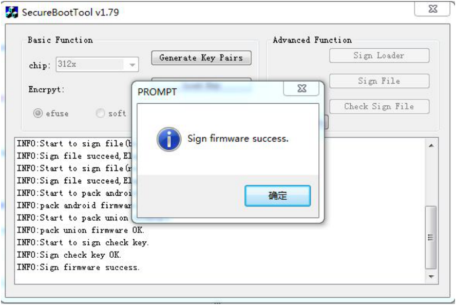

Rockchip Secure Boot Application Note_v1.2_20160202.pdf · p. 14


Rockchip Secure Boot Application Note_v1.2_20160202.pdf · p. 15

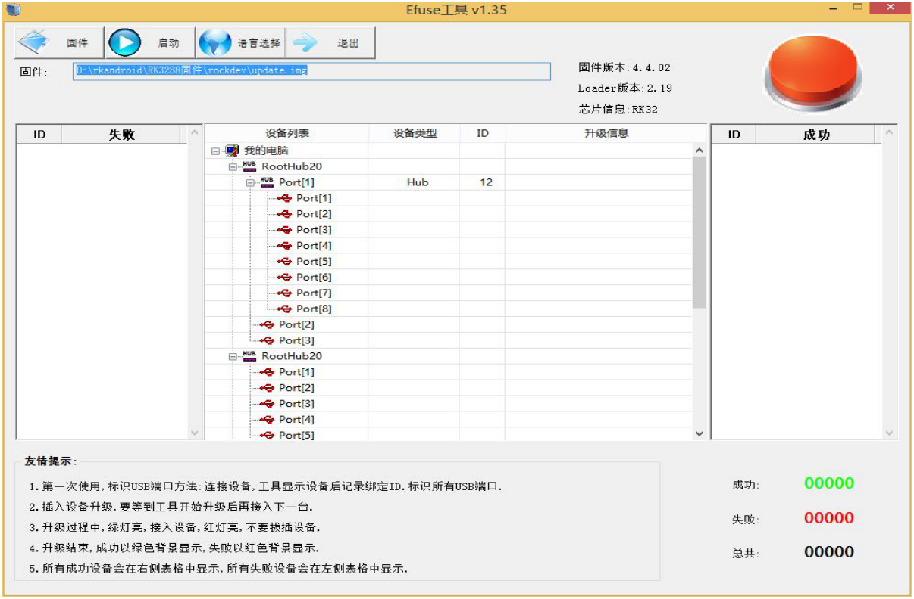

Rockchip Secure Boot Application Note_v1.2_20160202.pdf · p. 16

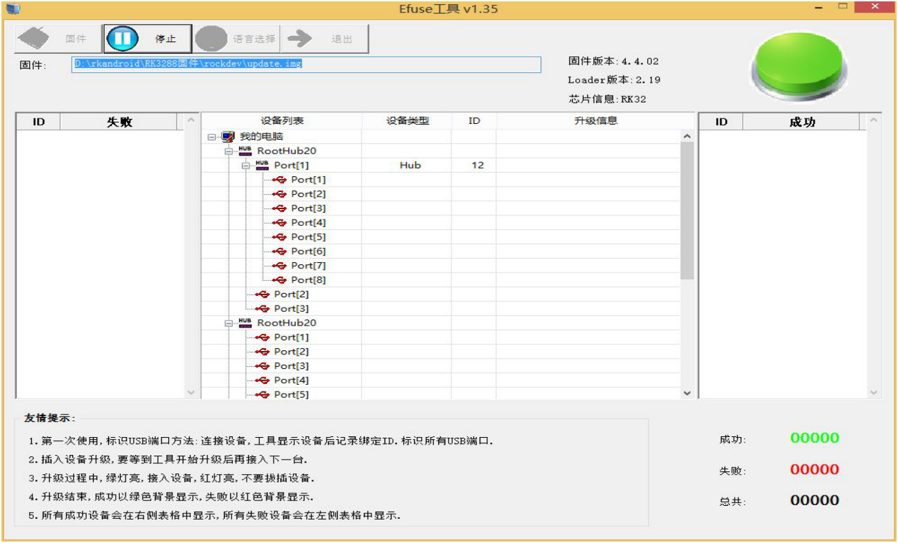

Rockchip Secure Boot Application Note_v1.2_20160202.pdf · p. 17

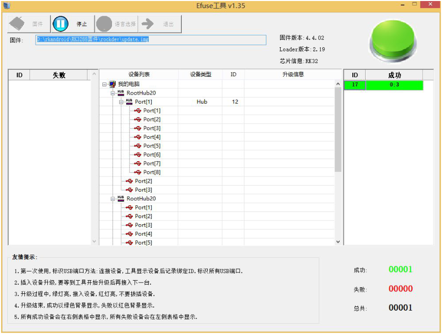

Rockchip Secure Boot Application Note_v1.2_20160202.pdf · p. 18

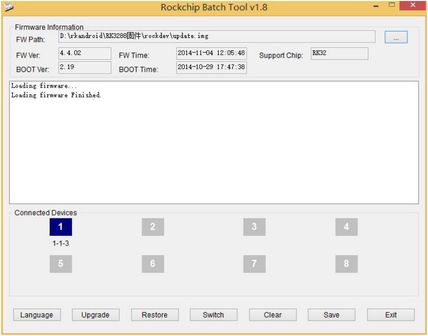

Rockchip Secure Boot Application Note_v1.2_20160202.pdf · p. 20

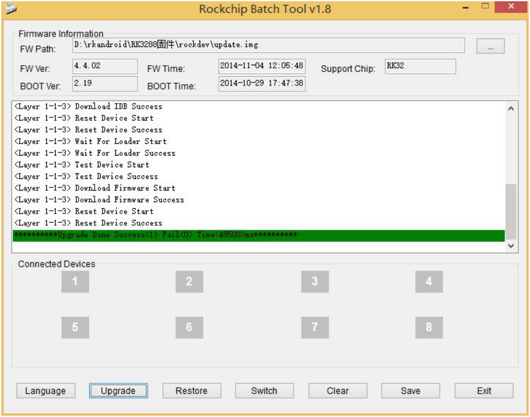

Rockchip Secure Boot Application Note_v1.2_20160202.pdf · p. 21

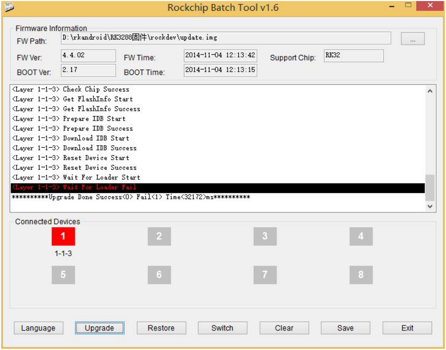

Rockchip Secure Boot Application Note_v1.2_20160202.pdf · p. 22

## Связанные рабочие процессы

- [Полное руководство Rockchip Secure Boot: подпись, eFuse, OTP и проверка](/ru/articles/105-rockchip-secure-boot/)
- [Руководство разработчика Rockchip Linux Secure Boot](/ru/articles/203-rockchip-linux-secure-boot/)
- [rk_sign_tool и sign_tool: подпись и проверка прошивки Rockchip](/ru/articles/rockchip-tool-rk-sign-tool/)
- [EfuseTool 1.42: подготовка станции Secure Boot provisioning](/ru/articles/rockchip-tool-efuse-tool/)
- [Каталог инструментов Rockchip и руководств](/ru/articles/rockchip-tools-download-guide/)

## Документация плат ArmSoM

Требования платы и носителя проверяйте по руководству изделия. Эти ссылки — платформенные материалы, а не подтверждение проверки данного инструмента на изделиях.

[ArmSoM Docs](https://docs.armsom.org/) · [Sige7](https://www.armsom.org/sige7) / [Docs](https://docs.armsom.org/armsom-sige7) · [CM5](https://www.armsom.org/cm5) / [Docs](https://docs.armsom.org/armsom-cm5)


