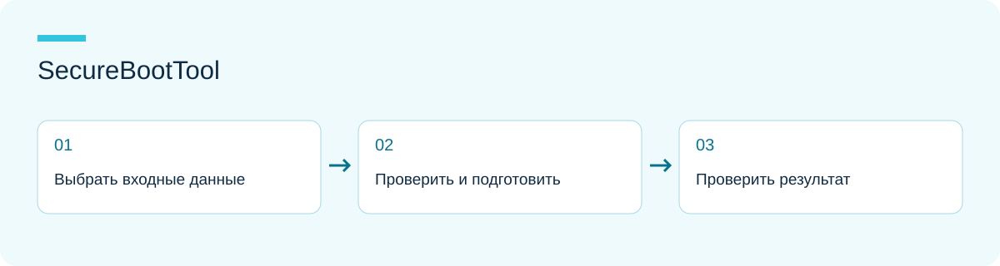





SecureBootTool относится к старой цепочке безопасности Rockchip. Приложенная записка описывает подпись, eFuse, обновление и тестирование, но не является готовой схемой для всех современных плат ArmSoM.

## Платформы

Записка V1.2 2016 года перечисляет RK3126, RK3128, RK3228, RK3288 и RK3368, а также miniloader 2.19 и U-Boot 2.17 или новее в рамках той схемы. Это не общие минимальные версии современных SDK. Каталог Linux сам по себе не определяет архитектуру программы.

## Четыре этапа

1. Выберите аппаратную схему, хранение ключей, подпись обновлений и восстановление.
2. Подготовьте утверждённые ключи и подпишите все требуемые загрузочные файлы.
3. Проверьте подписи, старт и обновление, пока восстановление ещё доступно.
4. Только по процедуре конкретного изделия фиксируйте хеши ключей и одноразовые состояния.

Запишите ревизию платы, SDK, схему ROM/Loader, идентификатор ключа, хеши файлов, состояние provisioning и результат recovery. Секретные ключи храните отдельно. Сообщение GUI об успехе не доказывает аутентификацию каждого этапа загрузки.

Для современных Linux-платформ используйте связанную новую документацию и BSP. Не смешивайте старые GUI-шаги с новыми OTP-картами или сертификатами. Это ориентир по архивному инструменту, а не универсальная инструкция программирования предохранителей.

## Применимость и проверка

Руководство составлено по документации этой коллекции. Проверьте плату, SoC, плату-носитель, SDK/BSP и архитектуру хоста. Прошивка, provisioning, запись регистров и аппаратные испытания не выполнялись. Наличие пакета не подтверждает поддержку всех изделий ArmSoM.

## Загрузка, версии и SHA-256

Выберите архив, проверьте хеш и распакуйте весь каталог. Разделённый Linux PinDebug сначала восстановите по инструкции; его указанный хеш относится к целому файлу.

| Хост / версия | Пакет |
|---|---|
| Host to verify / 1.85 | [SecureBootTool_v1.85_foruser.zip](https://raw.githubusercontent.com/ArmSoM/rockchip-tools/main/downloads/secureboot-tool/SecureBootTool_v1.85_foruser.zip) |

**SecureBootTool_v1.85_foruser.zip — SHA-256**

```text
d241ccc7503a3202c68a036f51cdd7f5d2db2a7594eb749ec19e2ffb2c67681a
```

[GitHub · catalog.json](https://github.com/ArmSoM/rockchip-tools/blob/main/catalog.json) · [SHA256SUMS](https://github.com/ArmSoM/rockchip-tools/blob/main/SHA256SUMS)

## Документы и исходные иллюстрации

- SecureBootTool_v1.85_foruser.zip; Rockchip Secure Boot Application Note V1.2 (2016)
- [Исходный PDF: Rockchip Secure Boot Application Note_v1.2_20160202.pdf](https://raw.githubusercontent.com/ArmSoM/rockchip-tools/main/manuals/094883c784c1.pdf)

## Связанные рабочие процессы

- [Полное руководство Rockchip Secure Boot: подпись, eFuse, OTP и проверка](/ru/articles/105-rockchip-secure-boot/)
- [Руководство разработчика Rockchip Linux Secure Boot](/ru/articles/203-rockchip-linux-secure-boot/)
- [rk_sign_tool и sign_tool: подпись и проверка прошивки Rockchip](/ru/articles/rockchip-tool-rk-sign-tool/)
- [EfuseTool 1.42: подготовка станции Secure Boot provisioning](/ru/articles/rockchip-tool-efuse-tool/)
- [Каталог инструментов Rockchip и руководств](/ru/articles/rockchip-tools-download-guide/)

## Документация плат ArmSoM

Требования платы и носителя проверяйте по руководству изделия. Эти ссылки — платформенные материалы, а не подтверждение проверки данного инструмента на изделиях.

[ArmSoM Docs](https://docs.armsom.org/) · [Sige7](https://www.armsom.org/sige7) / [Docs](https://docs.armsom.org/armsom-sige7) · [CM5](https://www.armsom.org/cm5) / [Docs](https://docs.armsom.org/armsom-cm5)


