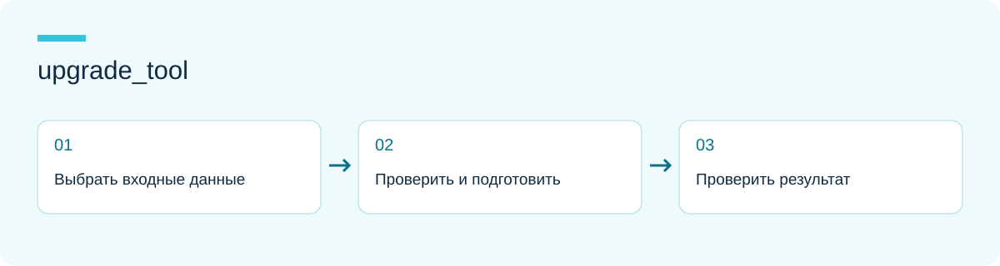





`upgrade_tool` предоставляет операции Rockusb из командной строки. В коллекции отдельно представлены Linux 2.44, macOS 2.13 и Windows 2.46. Выбирайте пакет для своего компьютера.

## Сначала идентификация

Подключите одну плату с правильным питанием в Loader/Maskrom. Список устройств и информационные запросы, доступные в текущем режиме:

```text
upgrade_tool ld
upgrade_tool rfi
upgrade_tool rci
upgrade_tool pl
```

`ld` показывает устройства, `rfi` — накопитель, `rci` — чип, `pl` — разделы. До исправления драйвера, кабеля или режима не переходите к записи.

## RAM и накопитель

Пример руководства для загрузки кода обновления в RAM:

```text
upgrade_tool db rkxxloader.bin
```

Нужен Loader именно для этой платы. `db` отличается от `ul`, записывающего Loader в накопитель. Для разделов сначала задаётся parameter:

```text
upgrade_tool di -p parameter.txt
upgrade_tool di -u uboot.img -b boot.img
```

Эти команды изменяют накопитель: проверьте резервную копию, SoC, образы, таблицу и выбранное хранилище. `-boot_a`/`-boot_b` относятся к реальным разделам A/B. Полный пакет записывается так:

```text
upgrade_tool uf update.img
```

## Выбор платы и ограничения

LocationID берётся из `ld`; `100` — пример, не постоянный серийный номер:

```text
upgrade_tool -s 100 ul rkxxloader.bin
```

`wl`/`rl` работают с сырыми диапазонами, для которых нужны проверенные смещения. `ef`/`el` удаляют данные. V1.0 описывает `el` для eMMC, а V1.1 также обсуждает SPI NAND/NOR; старому бинарному файлу нельзя автоматически приписывать новые возможности.

Проверяйте код завершения, сохраняйте идентификатор устройства и журнал. После записи нужен холодный старт и проверка ОС. Слишком большой образ требует исправления разметки, chip flag — упаковки, случайные USB-сбои — проверки питания и кабеля. Работа с подключённой платой при подготовке статьи не выполнялась.

## Применимость и проверка

Руководство составлено по документации этой коллекции. Проверьте плату, SoC, плату-носитель, SDK/BSP и архитектуру хоста. Прошивка, provisioning, запись регистров и аппаратные испытания не выполнялись. Наличие пакета не подтверждает поддержку всех изделий ArmSoM.

## Загрузка, версии и SHA-256

Выберите архив, проверьте хеш и распакуйте весь каталог. Разделённый Linux PinDebug сначала восстановите по инструкции; его указанный хеш относится к целому файлу.

| Хост / версия | Пакет |
|---|---|
| Linux / 2.44 | [upgrade_tool_v2.44_for_linux.zip](https://raw.githubusercontent.com/ArmSoM/rockchip-tools/main/downloads/upgrade-tool/upgrade_tool_v2.44_for_linux.zip) |
| macOS / 2.13 | [upgrade_tool_v2.13_for_mac.zip](https://raw.githubusercontent.com/ArmSoM/rockchip-tools/main/downloads/upgrade-tool/upgrade_tool_v2.13_for_mac.zip) |
| Windows / 2.46 | [upgrade_tool_v2.46.zip](https://raw.githubusercontent.com/ArmSoM/rockchip-tools/main/downloads/upgrade-tool/upgrade_tool_v2.46.zip) |

**upgrade_tool_v2.44_for_linux.zip — SHA-256**

```text
b779239cb1dc6cadd823520439e4163cf223145d048e6b5f9eaf1735b407cff8
```

**upgrade_tool_v2.13_for_mac.zip — SHA-256**

```text
d49db00e892b72a1760b9766b5e4ab998e75a17a37cb3acc8bf13b981b0ffc34
```

**upgrade_tool_v2.46.zip — SHA-256**

```text
de1dc7ce00ed5cfdaa0432f1c7e3efaf096e5dbb7e0ad851345739f6342c06dc
```

[GitHub · catalog.json](https://github.com/ArmSoM/rockchip-tools/blob/main/catalog.json) · [SHA256SUMS](https://github.com/ArmSoM/rockchip-tools/blob/main/SHA256SUMS)

## Документы и исходные иллюстрации

- 命令行开发工具使用文档.pdf V1.0 (Linux/macOS packages), V1.1 (Windows package)
- [Исходный PDF: 命令行开发工具使用文档.pdf](https://raw.githubusercontent.com/ArmSoM/rockchip-tools/main/manuals/925b67105873.pdf)
- [Исходный PDF: 命令行开发工具使用文档v1.1.pdf](https://raw.githubusercontent.com/ArmSoM/rockchip-tools/main/manuals/8a7aa375abfc.pdf)

## Связанные рабочие процессы

- [RKDevTool: загрузка, Loader, разделы и прошивка update.img](/ru/articles/rockchip-tool-rkdevtool/)
- [Полное руководство по накопителям Rockchip: flash, загрузка, разделы, запись и Vendor Storage](/ru/articles/099-rockchip-storage-application/)
- [Каталог инструментов Rockchip и руководств](/ru/articles/rockchip-tools-download-guide/)

## Документация плат ArmSoM

Требования платы и носителя проверяйте по руководству изделия. Эти ссылки — платформенные материалы, а не подтверждение проверки данного инструмента на изделиях.

[ArmSoM Docs](https://docs.armsom.org/) · [Sige7](https://www.armsom.org/sige7) / [Docs](https://docs.armsom.org/armsom-sige7) · [CM5](https://www.armsom.org/cm5) / [Docs](https://docs.armsom.org/armsom-cm5)


