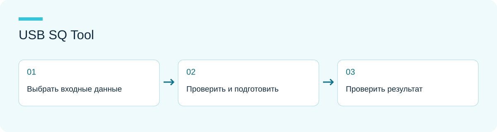
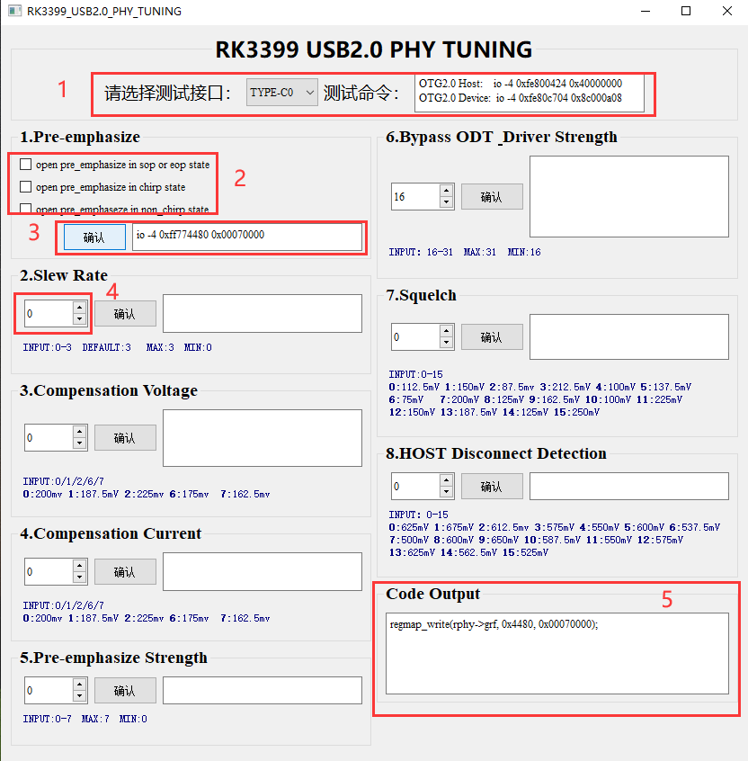



**Загрузка временно приостановлена.** Windows Defender обнаружил `Trojan:Win32/Pomal!rfn` в USB SQ 1.5 и изолировал файл; запуск не зарегистрирован. Ожидается проверка производителя. Не отключайте защиту и не запускайте архив из истории Git. [Статус](https://github.com/ArmSoM/rockchip-tools/blob/main/SECURITY-REVIEW.md). Статья и PDF доступны как справочные материалы; хеш идентифицирует удержанный пакет.



USB SQ Tool формирует команды проверки, регистры и пример кода PHY-драйвера. Он помогает при сигнальных сбоях перечисления и отключениях, но не компенсирует автоматически плохой кабель или разводку.

## Сначала измерение

Проверьте кабель, импеданс, разъём, питание и порт. Получите глазковую диаграмму подходящим оборудованием; сохраните исходные настройки и условия сбоя.

## Работа со страницей платформы

1. Выберите точный поддерживаемый SoC и порт; списки USB2.0 и USB3.1 различаются.
2. Следуйте порядку настроек, меняя по одному параметру.
3. Если требуется начальный регистр, считайте его с платы. В примере RK3568 нет high-word write-enable, поэтому важно сохранить остальные биты.
4. Подтвердите выбор для генерации I/O-команды и Code Output, затем проверьте их по BSP.
5. Повторите измерение и оставьте только полезные изменения без регрессий.

Pre-emphasis, высота диаграммы, slew rate и ODT относятся к передаче; Squelch — к приёму. Host Disconnect и B-session-valid обслуживают разные цепи обнаружения. Большее значение не обязательно лучше; адреса другого SoC не подходят автоматически.

Сгенерированный код — пример для PHY-драйвера, не готовый универсальный патч. После сборки проверьте загрузку, hot-plug, скорости и периферию.

Здесь инструмент 1.5 с руководством V1.4.0. Существующая полная статья основана на V1.8.0 с более широким списком платформ. Эти области поддержки нельзя смешивать; наличие инструмента не является сертификацией.

## Применимость и проверка

Руководство составлено по документации этой коллекции. Проверьте плату, SoC, плату-носитель, SDK/BSP и архитектуру хоста. Прошивка, provisioning, запись регистров и аппаратные испытания не выполнялись. Наличие пакета не подтверждает поддержку всех изделий ArmSoM.

## Загрузка, версии и SHA-256

Выберите архив, проверьте хеш и распакуйте весь каталог. Разделённый Linux PinDebug сначала восстановите по инструкции; его указанный хеш относится к целому файлу.

| Хост / версия | Пакет |
|---|---|
| Windows / 1.5 | [Загрузка приостановлена — статус](https://github.com/ArmSoM/rockchip-tools/blob/main/SECURITY-REVIEW.md) |

**Rockchip_USB_SQ_Tool_V1.5.7z — SHA-256**

```text
9b2ca5e6773bcb88e2bd73c57044ca16c1f2e16d81b1f010569724cb66550b37
```

[GitHub · catalog.json](https://github.com/ArmSoM/rockchip-tools/blob/main/catalog.json) · [SHA256SUMS](https://github.com/ArmSoM/rockchip-tools/blob/main/SHA256SUMS)

## Документы и исходные иллюстрации

- Rockchip_Introduction_USB_SQ_Tool_CN_V1.4.0.pdf, bundled in tool 1.5; existing article based on V1.8.0 is separate
- [Исходный PDF: Rockchip_Introduction_USB_SQ_Tool_CN_V1.4.0.pdf](https://raw.githubusercontent.com/ArmSoM/rockchip-tools/main/manuals/0ec9ef065fdc.pdf)

Иллюстрации извлечены из указанных PDF. При наличии только китайского оригинала текст интерфейса сохранён; подписи переведены. Это исторические примеры, не результаты тестов ArmSoM.



Rockchip_Introduction_USB_SQ_Tool_CN_V1.4.0.pdf · p. 5

## Связанные рабочие процессы

- [Rockchip USB SQ Tool: настройка PHY USB2.0/USB3.1 и интеграция кода](/ru/articles/165-rockchip-usb-sq-tool/)
- [PinDebug: диагностика IOMUX, GPIO и доменов питания Rockchip](/ru/articles/rockchip-tool-pin-debug/)
- [Каталог инструментов Rockchip и руководств](/ru/articles/rockchip-tools-download-guide/)

## Документация плат ArmSoM

Требования платы и носителя проверяйте по руководству изделия. Эти ссылки — платформенные материалы, а не подтверждение проверки данного инструмента на изделиях.

[ArmSoM Docs](https://docs.armsom.org/) · [Sige7](https://www.armsom.org/sige7) / [Docs](https://docs.armsom.org/armsom-sige7) · [CM5](https://www.armsom.org/cm5) / [Docs](https://docs.armsom.org/armsom-cm5)


