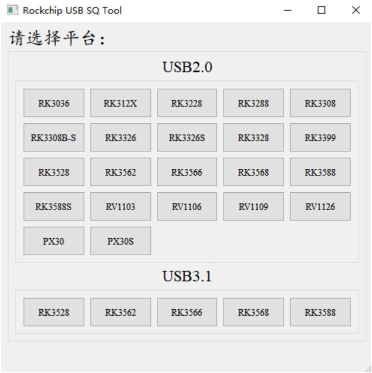
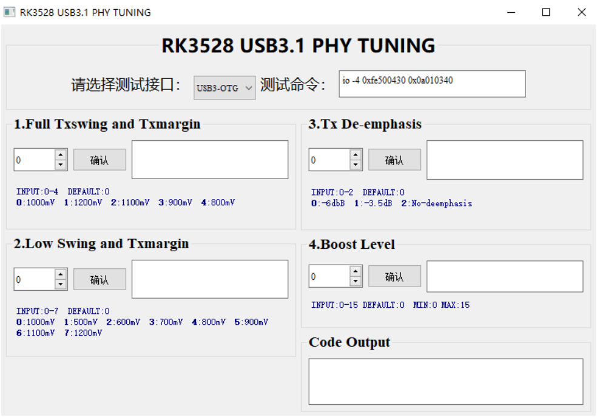




## Полный технический справочник USB SQ Tool V1.4.0

Раздел следует руководству V1.4.0 из пакета. Совпадающие разделы используют проверенный перевод V1.8.0, отобранный по старой области; новые платформы не означают поддержку старым инструментом. Главный список USB2.0: RK3588/RK3588S, RK3568/RK3566/RK3562/RK3528, RK3399, PX30/PX30S, RK3308/RK3308B-S, RK3326/RK3326S, RK3228, RK3288, RK3328, RV1103/RV1106. У RK3328 только OTG/HOST, без USB3 U2PHY. USB3.1: RK3528/RK3562/RK3566/RK3568/RK3588. Далее оригинал также описывает RK3036/RK312X и RV1109/RV1126; расхождение сохранено. Порядок Windows-интерфейса: платформа, порт, тестовая команда, параметры, подтверждение, Code Output. Сначала улучшайте кабель, импеданс и питание, затем постепенно настраивайте по глазковой диаграмме; больше не значит лучше.

Пример RK3562 заканчивается `]`, как в оригинале, и не компилируется непосредственно. Многоточия — места вставки, не полные патчи. Все рисунки — китайские оригиналы V1.4.0.

### 1. RK3399 USB2.0 Tuning интерфейс

RK3399 USB2.0 поддерживает TYPE-C0, TYPE-C1, HOST0, HOST1. Порядок настройки:

1. Выберите интерфейс слева в рамке 1; справа автоматически появится команда SQ-теста.

2. Выберите параметры в красной рамке 2. Pre-emphasize выбирается флажками; остальные — элементами вроде рамки 4, вводом или кнопками вверх/вниз. Для каждого указаны диапазон и описание.

3. Выберите параметры и нажмите подтверждение в рамке 3. Рядом появятся команды io, в Code Output рамки 5 — пример кода.

Таблица 3.  RK3399 USB2.0 параметры настройки сигнала

| Параметр | Описание |
| --- | --- |
| Pre-emphasize | Предыскажение HS Tx |
| Slew Rate | Скорость фронта глаза HS Tx |
| Compensation Voltage | Калибровка напряжения HS Tx: повышение увеличивает высоту глаза |
| Compensation Current | Калибровка тока HS Tx: повышение увеличивает высоту глаза |
| Pre-emphasize Strength | Сила предыскажения HS Tx |
| Bypass ODT &amp; Driver Strength | Обход автоматической настройки сопротивления компенсационной схемы для изменения высоты глаза |
| Squelch | Порог шума HS Rx |
| HOST Disconnect Detection | Порог отключения HS, только HOST |

### 2. RK3568 USB2.0 Tuning интерфейс

RK3568 USB2.0 поддерживает OTG, HOST1, HOST2, HOST3. Порядок настройки:

1. Выберите интерфейс слева в рамке 1; справа автоматически появится команда SQ-теста.

2. Регистры PHY RK3568 USB2.0 не имеют write_enable в старших 16 битах. Чтобы не изменить посторонние биты, прочитайте исходное значение командой рамки 2 и введите его в поле справа.

3. Выберите параметры в рамке 3. Pre-emphasize задаётся флажками, остальные — элементами вроде рамки 5: вводом или кнопками вверх/вниз. Каждый параметр содержит диапазон и описание.

4. Нажмите подтверждение в рамке 4. Рядом появятся команды io, в Code Output рамки 6 — пример кода. Важно: поле начального значения заполнено по умолчанию; без замены это может повлиять на результат. Перед тестом обязательно прочитайте текущее значение регистра и введите его.

| Параметр | Описание |
| --- | --- |
| Pre-emphasize | Предыскажение HS Tx |
| HS Eye Height | Высота глаза HS Tx |
| HS ODT Value | Сопротивление ODT 45Ω: большее значение уменьшает сопротивление, повышает высоту глаза, но ускоряет фронты FS/LS |
| Slew Rate | Скорость фронта HS; влияние мало |
| Squelch | Порог шума HS Rx |
| HOST Disconnect Detection | Порог отключения, только HOST |
| B_Session Valid | Порог VBUS DET, только Device |

Порог шума RK3568 USB2.0: длинный, плохой или высокоимпедансный кабель может мешать перечислению High-speed. Обычно порог PHY равен 150mV. Затухание снижает полезный сигнал ниже 150mV, и он воспринимается как шум. Squelch позволяет умеренно снизить порог, обычно до 125mV или 112.5mV.

Порог отключения RK3568: используйте Host Disconnect Detection. Ниже типичный журнал подключения Host Rockchip:

```text
[ 1204.092638] usb 1-1: new high-speed USB device number 3 using ehci-platform
[ 1204.280373] usb 1-1: New USB device found, idVendor=058f, idProduct=6387, bcdDevice= 1.04
[ 1204.280449] usb 1-1: New USB device strings: Mfr=1, Product=2, SerialNumber=3
[ 1204.280476] usb 1-1: Product: Mass Storage
[ 1204.280498] usb 1-1: SerialNumber: FA45A19C
```

Типичный журнал отключения Host Rockchip:

```text
[ 985.341233] usb 1-1: USB disconnect, device number 2
```

1) Извлечение USB2.0 не обнаруживается. Если журнал отключения отсутствует, попробуйте следующее:

1. Включите предыскажение EOP, по умолчанию отключённое в SDK, как на рисунке 5.

2. Уменьшите порог отключения Host. Некоторые чипы не имеют настройки EOP: пропустите шаг 1 согласно интерфейсу. Иначе выполняйте шаг 2 дополнительно к шагу 1, только если первый не помог. Слишком низкий порог вызывает самопроизвольные отключения при нормальной работе; учитывайте риск.

2) Неожиданное отключение USB2.0 при работе: попробуйте повысить порог Host. Не все отключения вызваны порогом: часто виновато устройство или аппаратная среда, поэтому не настраивайте вслепую. EOP уже отключён по умолчанию SDK, дополнительная запись не нужна. Слишком высокий порог мешает обнаружению извлечения.

B_Sessionvalid RK356X применяют, когда ПК не распознаёт USB Device (ADB/MTP) или теряет его после распознавания. Снизьте порог решения по напряжению: исходное 3'b000; в источнике рекомендованы 3'b111 (7) либо 3'b101 (5).

Три основные аппаратные причины: низкий VBUS (ниже 4.7V часто вызывает проблемы); большая пульсация USB_AVDD1V0 либо повышение до 1.2V, из-за чего PHY не обнаруживает Bvalid; большая пульсация Logic, нарушающая работу контроллера.

### 3. RK3588 USB2.0 Tuning интерфейс

RK3588 USB2.0 поддерживает TYPE-C0, TYPE-C1, USB2.0 HOST0, USB2.0 HOST1. Шаги:

1. Выберите интерфейс слева в рамке 1; справа автоматически появится команда SQ-теста.

2. Выберите параметры в рамке 2 вводом или кнопками вверх/вниз. Каждый содержит диапазон и описание.

3. Выберите параметры и нажмите подтверждение в рамке 2. Рядом появятся команды io, в Code Output рамки 3 — пример кода.

Таблица 5.  RK3588 USB2.0  параметры настройки сигнала

| Параметр | Описание |
| --- | --- |
| TXRISE | Скорость фронта HS Tx для изменения времени нарастания/спада |
| TXPREEMPAMP | Ток предыскажения HS Tx |
| TXPREEMPPLUSE | Коэффициент заполнения тока предыскажения; действует только при включённом TXPREEMPAMP TUNE |
| TXHSXV | Напряжение пересечения DP/DM HS Tx; заметного изменения нет |
| TXVREF | Постоянное напряжение HS Tx; заметно меняет амплитуду глаза |
| TXRES | Импеданс HS Tx; меняет амплитуду и время фронтов |
| TXFSLS | Импеданс FS/LS Tx; меняет амплитуду, фронты, напряжение пересечения и коэффициент заполнения |
| HOST DISCONNECT DETECTION | Порог отключения, только HOST |

### 4. RK3588 USB3.1 Tuning интерфейс

RK3588 USB3.1 охватывает USB3-OTG0 (USB3&amp;Dp CombPhy0), USB3-OTG1 (USB3&amp;Dp CombPhy1), USB3-HOST2 (USB3&amp;PCIE&amp;SATA CombPhy). Шаги:

1. Выберите интерфейс слева в рамке 1; справа автоматически появится команда SQ-теста.

2. Для USB3-OTG0/1 прочитайте регистр ориентации CombPhy0/1 командой рамки 2 и введите значение. Требуется 0xCx либо 0x3x, иначе ошибка. Если чтение не удаётся (обычно Type-C), подключите кабель к проверяемому порту для активации CombPhy0/1 и повторите чтение.

3. Для USB3-HOST2 пропустите рамку 2 и нажмите START в рамке 3.

4. После START для USB3-OTG0/1 активны левые кнопки рамки 5, а правые USB3-HOST2 рамки 6 отключены; для HOST2 — наоборот.

5. Регистры PHY RK3588 USB3.1 не имеют write_enable в старших 16 битах. Чтобы не изменить посторонние биты, прочитайте исходное значение командой рамки 4 и введите его в поле справа.

6. Выберите параметры и нажмите подтверждение в рамке 5. Рядом появятся команды io, в Code Output рамки 7 — пример кода.

Таблица 11.  RK3588 USB3.1  параметры настройки сигнала

| Параметр | Описание |
| --- | --- |
| TX Driver main-tap level(USB3-OTG) | Напряжение SS Tx |
| TX Pmos current control(USB3-OTG) | Ток SS Tx; рекомендуется только если настройки напряжения недостаточно |
| TX De-emphasis(USB3-OTG) | Деэмфазис SS Tx |
| TX Slew Rate(USB3-OTG) | Скорость фронта SS Tx |
| Full Txswing and TXmargin(USB3-HOST) | Полный размах/Txmargin: TX_SWING и TX_MARGIN[2:0] совместно управляют выходной амплитудой Tx |
| Low swing and Txmargin(USB3-HOST) | Low swing/Txmargin: та же функция, что Full Tx swing, но другие уровни |
| TX De-emphasis(USB3- HOST) | Уровень деэмфазиса передатчика |

### 5. RV1106 USB2.0 Tuning интерфейс

RV1106 USB2.0 поддерживает предыскажение и его силу, ODT, высоту глаза, пороги шума, Bvalid и отключения. У RV1103/RV1103B нет вывода VBUS DET, поэтому Bvalid не регулируется; остальные параметры совпадают с RV1106.

Таблица 6.  RV1106 USB2.0  параметры настройки сигнала

| Параметр | Описание |
| --- | --- |
| Pre-emphasize | Предыскажение HS Tx; по умолчанию включено |
| Pre-emphasize Strength | Сила предыскажения HS Tx; регистр действует только при включённом предыскажении |
| HS ODT Value | Сопротивление ODT 45Ω: большее значение снижает сопротивление и повышает высоту глаза, не меняя фронты FS/LS |
| Eye Height | Высота глаза HS Tx. Уровень 4:470mV требует напряжения logic чипа &gt; 850mV |
| Squelch | Порог шума HS Rx |
| BValid | Порог VBUS DET, только Device |
| HOST Disconnect Detection | Порог отключения, только HOST |

### 6. RV1109 USB2.0 Tuning интерфейс

RV1109 USB2.0 поддерживает скорость фронта, высоту глаза, пороги шума и отключения. RV1126 имеет те же параметры.

Таблица 7.  RV1109 USB2.0  параметры настройки сигнала

| Параметр | Описание |
| --- | --- |
| Slew Rate | Скорость фронта глаза HS Tx |
| Eye Height | Высота глаза HS Tx |
| Squelch | Порог шума HS Rx |
| HOST Disconnect Detection | Порог отключения, только HOST |

### 7. RK3528 USB3.1 Tuning интерфейс

RK3528 USB3.1 поддерживает Full Txswing and Txmargin, Low Swing and Txmargin, Tx De-emphasis, Boost Level. RK3562 и RK3568 имеют те же параметры.

Таблица 10.  RK3528 USB3.1  параметры настройки сигнала

| Параметр | Описание |
| --- | --- |
| Full Txswing and TXmargin | Полный размах/Txmargin: TX_SWING и TX_MARGIN[2:0] совместно управляют выходной амплитудой Tx |
| Low swing and Txmargin | Low swing/Txmargin: та же функция, что Full Tx swing, но другие уровни |
| TX De-emphasis | Уровень деэмфазиса передатчика |
| Boost Level | Уровень усиления Tx |

### 8. RK3036/RK312X USB2.0 PHY

RK3036 пока поддерживает только ядро 3.10. Добавьте код в `usb20otg_hw_init()` файла `kernel/drivers/usb/dwc_otg_310/usbdev_rk3036.c`.

```text
static void usb20otg_hw_init(void) {
    .../* OTG/Host PHY Tuning Code */
}
```

Добавьте код настройки RK312X в `rk312x_usb2phy_tuning()` файла `kernel/drivers/phy/rockchip/phy-rockchip-inno-usb2.c`.

```text
static int rk312x_usb2phy_tuning(struct rockchip_usb2phy *rphy)
{
    .../* OTG/Host PHY Tuning Code */
}
```

### 9. RK3228 USB2.0 PHY

Добавьте код настройки RK3228 в `rk3228_usb2phy_tuning()` файла `kernel/drivers/phy/rockchip/phy-rockchip-inno-usb2.c`.

```text
static int rk3228_usb2phy_tuning(struct rockchip_usb2phy *rphy)
{
    .../* OTG/Host PHY Tuning Code */
}
```

### 10. RK3288 USB2.0 PHY

RK3288 имеет две версии PHY-драйвера. Выбирайте Kernel Version 4.4 для ядра 4.4 и старше, 4.19 для 4.19 и новее. Меняется лишь формат кода, не команды io. Для 4.19 добавляйте в конец `rk3288_usb_phy_probe_init()` файла `kernel/drivers/phy/rockchip/phy-rockchip-usb.c`. Для трёх портов перед фрагментами требуется проверка смещения регистра. Код OTG:

```text
if (rk_phy->reg_offset == 0x320) {
    ... /* OTG PHY Tuning Code */
}
```

Код HOST1:

```text
if (rk_phy->reg_offset == 0x334) {
    ... /* HOST1 PHY Tuning Code */
}
```

Код HOST2:

```text
if (rk_phy->reg_offset == 0x348) {
    ... /* HOST2 PHY Tuning Code */
}
```

Драйвер RK3288 ядра 4.4: `kernel/drivers/usb/dwc_otg_310/usbdev_rk32.c`. Код OTG добавьте в конец `usb20otg_hw_init()`, HOST1 — `rk_ehci_hw_init()`, HOST2 — `usb20host_hw_init()`.

### 11. RK3308B_S/RK3308 USB2.0 PHY

Для RK3308B_S добавьте код в конец ветви `soc_is_rk3308bs()` функции `rk3308_usb2phy_tuning()` файла `kernel/drivers/phy/rockchip/phy-rockchip-inno-usb2.c`.

```text
if (soc_is_rk3308bs()) {
    ... /* OTG/HOST PHY Tuning Code */
}
```

Для RK3308 добавьте код в конец ветви else функции `rk3308_usb2phy_tuning()` файла `kernel/drivers/phy/rockchip/phy-rockchip-inno-usb2.c`.

```text
if (soc_is_rk3308bs()) {
    ...
} else {
    .../* OTG/HOST PHY Tuning Code */
}
```

### 12. RK3326S/PX30S/RK3326/PX30/RK3328 USB2.0 PHY

Для RK3326S/PX30S добавьте код в конец ветви `soc_is_px30s()` функции `rk3328_usb2phy_tuning()` файла `kernel/drivers/phy/rockchip/phy-rockchip-inno-usb2.c`.

```text
if (soc_is_px30s()) {
    .../* OTG/HOST PHY Tuning Code */
}
```

Для RK3326/PX30/RK3328 добавьте код в конец ветви else функции `rk3328_usb2phy_tuning()` файла `kernel/drivers/phy/rockchip/phy-rockchip-inno-usb2.c`.

```text
if (soc_is_px30s()) {
    ...
} else {
    .../* OTG/HOST PHY Tuning Code */
}
```

### 13. RK3399 USB2.0 PHY

Добавьте настройку RK3399 USB2.0 перед `if (!of_property_read_bool(node, "rockchip,u2phy-tuning"))` в `rk3399_usb2phy_tuning()` файла `kernel/drivers/phy/rockchip/phy-rockchip-inno-usb2.c`. TYPE-C0/HOST0 используют PHY 0xe450, TYPE-C1/HOST1 — 0xe460. Перед кодом нужна проверка адреса для различения четырёх портов.

```text
if (rphy->phy_cfg->reg == 0xe450) {
    .../* TYPE-C0/HOST0 PHY Tuning Code */
} else {
    ... /* TYPE-C1/HOST1 PHY Tuning Code */
}
if (!of_property_read_bool(node, "rockchip,u2phy-tuning"))
    return ret;
```

### 14. RK3528 USB2.0 PHY

Добавьте код настройки RK3528 USB2.0 в `rk3528_usb2phy_tuning()` файла `kernel/drivers/phy/rockchip/phy-rockchip-inno-usb2.c`.

```text
static int rk3528_usb2phy_tuning(struct rockchip_usb2phy *rphy)
{
    .../* USB2.0 PHY Tuning Code */
}
```

### 15. RK3562 USB2.0 PHY

Добавьте код настройки RK3562 USB2.0 в `rk3562_usb2phy_tuning()` файла `kernel/drivers/phy/rockchip/phy-rockchip-inno-usb2.c`.

```text
static int rk3562_usb2phy_tuning(struct rockchip_usb2phy *rphy)
{
    .../* USB2.0 PHY Tuning Code */
]
```

### 16. RK3568/RK3566 USB2.0 PHY

RK3568/RK3566 используют общий код в конце `rk3568_usb2phy_tuning()` файла `kernel/drivers/phy/rockchip/phy-rockchip-inno-usb2.c`. OTG/HOST1 RK3568 имеют базу 0xfe8a0000, HOST2/HOST3 — 0xfe8b0000. Перед кодом проверяйте базовый адрес. OTG/HOST1:

```text
if (rphy->phy_cfg->reg == 0xfe8a0000) {
    ... /* OTG/Host1 PHY Tuning Code */
}
```

Код HOST2/HOST3:

```text
if (rphy->phy_cfg->reg == 0xfe8b0000) {
    ... /* Host2/Host3 PHY Tuning Code */
}
```

### 17. RK3528/RK3562/RK3566/RK3568 USB3.1 PHY

Код USB3.1 RK3528, RK3562, RK3568 добавляется в соответствующую combphy_cfg файла `kernel/drivers/phy/rockchip/phy-rockchip-naneng-combphy.c`. Место в `rk3528_combphy_cfg` для RK3528:

```text
case PHY_TYPE_USB3:
    ...
    /* Enable adaptive CTLE for USB3.0 Rx */
    val = readl(priv->mmio + 0x200);
    val &= ~GENMASK(17, 17);
    val |= 0x01;
    writel(val, priv->mmio + 0x200);
    ...
    .../* USB3.1 PHY Tuning Code */
    ...
    param_write(priv->phy_grf, &cfg->pipe_txcomp_sel, false);
    param_write(priv->phy_grf, &cfg->pipe_txelec_sel, false);
    param_write(priv->phy_grf, &cfg->usb_mode_set, true);
    break;
```

Место RK3562 в `rk3562_combphy_cfg`:

```text
case PHY_TYPE_USB3:
    /* Set SSC downward spread spectrum */
    val = readl(priv->mmio + (0x1f << 2));
    val &= ~GENMASK(5, 4);
    val |= 0x01 << 4;
    writel(val, priv->mmio + 0x7c);
    ...
    .../* USB3.1 PHY Tuning Code */
    ...
    param_write(priv->phy_grf, &cfg->pipe_sel_usb, true);
    param_write(priv->phy_grf, &cfg->pipe_txcomp_sel, false);
    param_write(priv->phy_grf, &cfg->pipe_txelec_sel, false);
    param_write(priv->phy_grf, &cfg->usb_mode_set, true);
    break;
```

RK3566 и RK3568 используют общий код; добавьте его здесь в `rk3568_combphy_cfg`:

```text
case PHY_TYPE_USB3:
    ...
    /* Set PLL KVCO to min and set PLL charge pump current to max */
    writel(0xf0, priv->mmio + (0xa << 2));
    ...
    .../* USB3.1 PHY Tuning Code */
    ...
    param_write(priv->phy_grf, &cfg->pipe_sel_usb, true);
    param_write(priv->phy_grf, &cfg->pipe_txcomp_sel, false);
    param_write(priv->phy_grf, &cfg->pipe_txelec_sel, false);
    param_write(priv->phy_grf, &cfg->usb_mode_set, true);
```

### 18. RK3588 USB2.0 PHY

Добавьте настройку RK3588 USB2.0 в `rk3588_usb2phy_tuning()` файла `kernel/drivers/phy/rockchip/phy-rockchip-inno-usb2.c`. TYPE-C0, TYPE-C1, HOST0, HOST1 различаются по `rphy->phy_cfg->reg`:

```text
if (rphy->phy_cfg->reg == 0x0000) {
    .../* TYPE-C0 PHY Tuning Code */
} else if (rphy->phy_cfg->reg == 0x4000) {
    .../* TYPE-C1 PHY Tuning Code */
} else if (rphy->phy_cfg->reg == 0x8000) {
    .../* HOST0 PHY Tuning Code */
} else if (rphy->phy_cfg->reg == 0xc000) {
    .../* HOST1 PHY Tuning Code */
}
```

### 19. RK3588 USB3.1 PHY

Для RK3588 USB3-OTG и USB3-HOST места различаются. У USB3-OTG пока нет отдельного интерфейса настройки как у USB2.0; добавьте код в конец `rk3588_udphy_init()` файла `kernel/drivers/phy/rockchip/phy-rockchip-usbdp.c`.

```text
ret = rk3588_udphy_status_check(udphy);
if (ret)
    goto assert_phy;
    .../* USB3-OTG PHY Tuning Code */
return 0;
```

RK3588 USB3-HOST добавляется в `rk3588_combphy_cfg()` файла `kernel/drivers/phy/rockchip/phy-rockchip-naneng-combphy.c`.

```text
case PHY_TYPE_USB3:
    /* Set SSC downward spread spectrum */
    val = readl(priv->mmio + (0x1f << 2));
    val &= ~GENMASK(5, 4);
    val |= 0x01 << 4;
    ...
    .../* USB3-HOST PHY Tuning Code */
    ...
    param_write(priv->phy_grf, &cfg->pipe_txcomp_sel, false);
    param_write(priv->phy_grf, &cfg->pipe_txelec_sel, false);
    param_write(priv->phy_grf, &cfg->usb_mode_set, true);
    break;
```

### 20. RV1103/RV1106 USB2.0 PHY

Добавьте код настройки RV1103/RV1106 в `rv1106_usb2phy_tuning()` файла `kernel/drivers/phy/rockchip/phy-rockchip-inno-usb2.c`.

```text
static int rv1106_usb2phy_tuning(struct rockchip_usb2phy *rphy)
{
    .../* OTG PHY Tuning Code */
}
```

### 21. RV1109/RV1126 USB2.0 PHY

Добавьте код настройки RV1109/RV1126 в `rv1126_usb2phy_tuning()` файла `kernel/drivers/phy/rockchip/phy-rockchip-naneng-usb2.c`.

```text
static int rv1126_usb2phy_tuning(struct rockchip_usb2phy *rphy)
{
    if (rphy->phy_cfg->reg == 0xff4c0000) {
        .../* OTG PHY Tuning Code */
    }
    if (rphy->phy_cfg->reg == 0xff4c8000) {
        .../* HOST PHY Tuning Code */
    }
}
```

## Применимость и проверка

Руководство составлено по документации этой коллекции. Проверьте плату, SoC, плату-носитель, SDK/BSP и архитектуру хоста. Прошивка, provisioning, запись регистров и аппаратные испытания не выполнялись. Наличие пакета не подтверждает поддержку всех изделий ArmSoM.

## Документы и исходные иллюстрации

- Rockchip_Introduction_USB_SQ_Tool_CN_V1.4.0.pdf

### Исходные интерфейсы и схемы руководства

Сохранён язык исходных интерфейсов. При наличии используются английские рисунки; дополнительные без английского оригинала остаются китайскими. Значения — примеры руководства, не измерения платы.



Rockchip_Introduction_USB_SQ_Tool_CN_V1.4.0.pdf · p. 4


Rockchip_Introduction_USB_SQ_Tool_CN_V1.4.0.pdf · p. 5


Rockchip_Introduction_USB_SQ_Tool_CN_V1.4.0.pdf · p. 7


Rockchip_Introduction_USB_SQ_Tool_CN_V1.4.0.pdf · p. 9


Rockchip_Introduction_USB_SQ_Tool_CN_V1.4.0.pdf · p. 10


Rockchip_Introduction_USB_SQ_Tool_CN_V1.4.0.pdf · p. 12


Rockchip_Introduction_USB_SQ_Tool_CN_V1.4.0.pdf · p. 14


Rockchip_Introduction_USB_SQ_Tool_CN_V1.4.0.pdf · p. 15



Rockchip_Introduction_USB_SQ_Tool_CN_V1.4.0.pdf · p. 16

## Связанные рабочие процессы

- [Rockchip USB SQ Tool: настройка PHY USB2.0/USB3.1 и интеграция кода](/ru/articles/165-rockchip-usb-sq-tool/)
- [PinDebug: диагностика IOMUX, GPIO и доменов питания Rockchip](/ru/articles/rockchip-tool-pin-debug/)
- [Каталог инструментов Rockchip и руководств](/ru/articles/rockchip-tools-download-guide/)

## Документация плат ArmSoM

Требования платы и носителя проверяйте по руководству изделия. Эти ссылки — платформенные материалы, а не подтверждение проверки данного инструмента на изделиях.

[ArmSoM Docs](https://docs.armsom.org/) · [Sige7](https://www.armsom.org/sige7) / [Docs](https://docs.armsom.org/armsom-sige7) · [CM5](https://www.armsom.org/cm5) / [Docs](https://docs.armsom.org/armsom-cm5)


