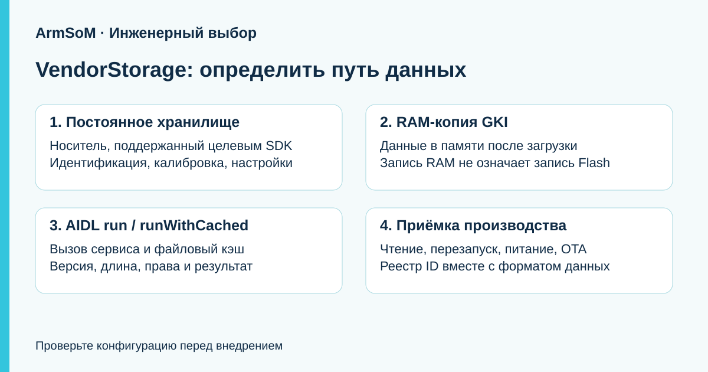

**VendorStorage предназначен для небольших идентификационных, калибровочных и производственных записей, однако успешный вызов API не доказывает сохранение на носителе.** Сначала различите настоящий доступ к данным, RAM-копию GKI и файловый кэш Android-сервиса.

Руководство ArmSoM перерабатывает предоставленный пример Android 16 AIDL V2. Соответствующий SDK нового сервиса здесь не был получен и скомпилирован; имена следует сверить со своей веткой. Старые API описаны в статье [Vendor Storage V1.3](/ru/articles/100-rockchip-vendor-storage-v13/).



## 1. Выбираем путь доступа

| Среда | Типичный интерфейс | Что установить |
| --- | --- | --- |
| U-Boot | `vendor_storage_read()` / `vendor_storage_write()` | Инициализация, загрузочный носитель и разметка ветки |
| Ядро без GKI | `rk_vendor_read()` / `rk_vendor_write()` | Зарегистрированный backend и ошибки |
| RAM-модуль GKI | `ram_vendor_storage` | Является ли он снимком и доходят ли записи до носителя |
| Linux userspace | `/dev/vendor_storage`, ioctl | ABI ядра, пределы и права |
| Android AIDL | `IVendorStorage`, `libvendor_storage` | Версия, VINTF, носители и SELinux |
| Файловый кэш AIDL | `runWithCached()` | Путь и жизненный цикл, отличный от NVM |

[Исходники Rockchip develop-6.1](https://github.com/rockchip-linux/kernel/blob/develop-6.1/drivers/soc/rockchip/sdmmc_vendor_storage.c) показывают старый путь ядра, но не подтверждают наличие или одинаковую поддержку носителей в Android 16 AIDL.

## 2. Структура и ID — это не файловая система

Обычно присутствуют заголовок, индекс записей и данные. Версии, контроль целостности и резервные копии помогают выбрать действительное содержимое. Размер региона, число слотов, смещения и ёмкость зависят от SDK и носителя. Не переносите eMMC-разметку на UFS, SPI NOR или NAND и не перезаписывайте предположительно свободные секторы.

Источник называет **156–256** клиентским диапазоном своей ветки. В старых документах диапазоны отличаются. До производства проверьте заголовки и соглашение с поставщиком, затем ведите реестр ID проекта.

| Данные | Правило |
| --- | --- |
| SN, MAC, калибровка | Использовать выделенные ID, сохранять заводские значения |
| Собственная конфигурация | Задать версию, размер, порядок байтов и контроль целостности |
| Строки | Определить завершающий символ, учитывать возвращённую длину |
| Двоичные записи | Не использовать `strlen()` и не печатать как строки |
| Ключи и DRM | Использовать профильную защиту; VendorStorage сам по себе не гарантирует секретность |

Предусмотрите миграцию: старая прошивка должна отвергнуть либо безопасно прочитать новую запись, а не трактовать её как старую структуру.

## 3. Четыре уровня интеграции Android

Проверьте исходники, версию интерфейса, комплектность образа и доступ на устройстве:

```bash
export SDK_ROOT=/path/to/android-sdk
rg -n 'BOARD_VENDOR_STORAGE_SERVICE|IVendorStorage|runWithCached' \
  "$SDK_ROOT/vendor/rockchip" "$SDK_ROOT/device/rockchip"
rg -n 'vendorstorage-V2-ndk|libvendor_storage|AidlVendorStorageClient' \
  "$SDK_ROOT/vendor/rockchip"
adb shell ls -l /vendor/bin/hw/rockchip.aidl.vendorstorage-service
adb shell service check rockchip.aidl.vendorstorage.IVendorStorage/default
adb shell ls -l /dev/vendor_storage
```

Это поиск и запросы без записи. Отсутствие сервиса может означать неполную упаковку, VINTF, другое имя или другую архитектуру, а не повреждение данных. В источнике используются:

| Компонент | Имя примера | Назначение |
| --- | --- | --- |
| Сервис | `rockchip.aidl.vendorstorage-service` | Запросы Binder |
| Экземпляр | `rockchip.aidl.vendorstorage.IVendorStorage/default` | Поиск и VINTF |
| Библиотека | `libvendor_storage` | Доступ к носителю |
| NDK-интерфейс | `rockchip.aidl.vendorstorage-V2-ndk` | Соответствие замороженной AIDL-версии |
| Клиент | `AidlVendorStorageClient` | Проверка при разработке |

Флаг из примера работает только при наличии использующих его правил сборки:

```makefile
BOARD_VENDOR_STORAGE_SERVICE := true
```

Проверьте init, матрицы совместимости, SEPolicy и библиотеки. `disabled` и `oneshot` могут быть нормальной схемой lazy HAL; отсутствие постоянного процесса не требует принудительного запуска навсегда. Не включайте одновременно конкурирующие реализации одного экземпляра.

## 4. Успех Binder — не весь результат

Интерфейс исходного примера:

```aidl
VendorStorageResponse run(in VendorStorageRequest request);
VendorStorageResponse runWithCached(in VendorStorageRequest request, String cachePath);
```

Запрос содержит `id`, `cmd`, `buf`, `buf_size`. Пример начинает с `CMD_INIT`, затем читает или пишет; ответы имеют собственную семантику. Проверяйте:

1. Объявление и доступность сервиса, ограниченное ожидание и обработку отказа.
2. Успех Binder transaction, а не только ненулевой proxy.
3. Неотрицательный `buf_size`, не превышающий вектор и буфер вызывающего кода.
4. Полноту `CMD_READ`; короткое чтение обрабатывается явно.
5. Формат успеха `CMD_WRITE` и `CMD_INIT` конкретной версии. В примере это один нулевой байт, но другие выпуски необходимо проверить.

`registerCallback()` не заменяет синхронный ответ. Согласуйте сгенерированный интерфейс, сервис и клиент, а не переносите один `.so` между версиями.

## 5. Проверяем выделенный клиентский ID

Ниже — пример только чтения из исходного CLI. Сначала посмотрите подсказку; **ID 156 допустим лишь как выделенная вашему проекту несекретная тестовая запись**. Синтаксис иной ветки может отличаться.

```bash
adb shell AidlVendorStorageClient
adb shell AidlVendorStorageClient r156
```

Запись проверяйте на отдельном устройстве через поддержанный API и зарегистрированный ID. Сохраните прежнее значение, запишите короткую запись с версией, прочитайте и сравните байты, повторите после перезапуска и полного отключения питания, восстановите исходное. Фиксируйте коды и длины. Заводские MAC, SN, калибровку и защищённые поля для проб не используйте.

| Симптом | Первая проверка |
| --- | --- |
| Читается сейчас, пропадает после старта | RAM-backend или временный кэш |
| Переживает reboot, но не питание | Путь записи, завершение операции, носитель |
| Данные обрезаны | Буфер клиента, ёмкость записи, трактовка длины |
| Shell работает, приложение нет | Поиск сервиса, домены, SELinux |
| После OTA значение изменилось | Разметка, миграция, перезапись производственной области |

## 6. Кэш, права и обмен с U-Boot

Файл `runWithCached()` не получает свойства производственного NVM только потому, что лежит в `/data`. Отдельно определите поведение при сбросе, очистке userdata, переустановке приложения и OTA. Сервис должен ограничивать пути кэша, не открывая произвольные системные файлы.

Давайте бизнес-домену только необходимые права, а не полный доступ всем приложениям и shell. Если поля общие с U-Boot, сверяйте разметку, ID и инициализацию обеих сторон:

```bash
rg -n 'vendor_storage_init|vendor_storage_read|vendor_storage_write' u-boot
rg -n 'rk_vendor_read|rk_vendor_write|ram_vendor_storage' kernel*
```

В поставку включите реестр ID, версии форматов, носители, версию сервиса, политику прав и результаты питания/OTA. Незагруженные изображения заменены собственной схемой; отсутствующие исходники и параметры не выдуманы. [Исходная статья](https://mp.weixin.qq.com/s/hv_oSAa7SZSpjwOI16nBQw)

## Продукты и дальнейшее чтение

Для проекта ArmSoM можно оценить [Sige7](https://www.armsom.org/sige7), [AIM7](https://www.armsom.org/aim7) и [LM7](https://www.armsom.org/lm7) на RK3588 либо [CM5](https://www.armsom.org/cm5) и [Sige5](https://www.armsom.org/sige5) на RK3576. Интерфейсы и доступные образы проверяйте в документации [Sige7](https://docs.armsom.org/armsom-sige7), [CM5](https://docs.armsom.org/armsom-cm5) и [Sige5](https://docs.armsom.org/armsom-sige5). Ссылки помогают выбрать продукт, но не подтверждают проверку всех описанных сочетаний SDK на этих платах.
