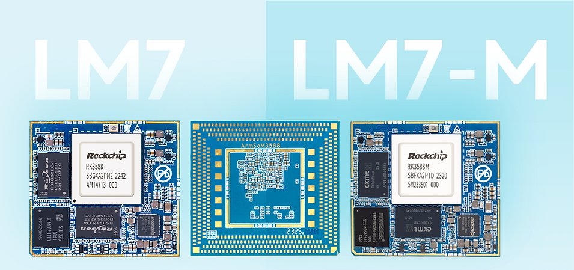

Sige7 и LM7 используют RK3588, но решают разные задачи интеграции. Sige7 — SBC с готовыми портами, LM7 — LGA-модуль для своей платы. Это не просто разные уровни производительности.

## Сначала форм-фактор

| Потребность | Начальная платформа | Основная работа |
|---|---|---|
| Быстро подключить сеть, экран и SSD | Sige7 | Образ, периферия, приложение |
| Свой корпус и разъёмы | LM7 с подходящим комплектом | Несущая плата, монтаж, система |
| Съёмный модуль | AIM7 с совместимой платой | Разъём, контакты, совместимость |

Sige7 документирует два 2.5GbE и M.2 PCIe 3.0 x4. LM7 — LGA-модуль с 506 контактами размером 45×50mm. Эти характеристики не гарантируют сквозную скорость приложения.

## 1. Хранилище и центр данных оборудования

Подключите SSD и сеть для файловых служб, архива или edge-кэша. Проверяйте протокол, размеры файлов, клиентов и длительную запись: скорость линии не равна копированию. Несколько дисков требуют проверки контроллеров, питания и охлаждения; один M.2 ещё не готовая NAS-система.

## 2. Анализ событий нескольких камер

Принимайте видео, выбирайте кадры с нужной частотой, обрабатывайте и сохраняйте события для просмотра. Камеры, декодер, память, NPU и накопитель совместно ограничивают число потоков. Начните с одного, затем увеличивайте параллельность и фиксируйте потери кадров и нагрев.

## 3. Выставочные терминалы и панели

Объедините видео, веб-интерфейс и управление контентом. Проверьте экран, сенсор, форматы и автозапуск, затем обновления и восстановление после отключения питания. HDMI-вход чипа не означает наличие разъёма захвата на выбранной плате; входы и выходы проверяются отдельно.

## 4. Помощь промышленному визуальному контролю

При фиксированном свете и положении камеры оцените классификацию, подсчёт и внешний осмотр. Показывайте результат оператору или передавайте системе предприятия. Критерии включают ложные тревоги, пропуски, полную задержку и сложные образцы. Это направление разработки, не сертификат контроля или безопасности.

## 5. Высокоуровневые задачи робота

Восприятие, карты и планирование на RK3588 сочетаются с отдельным контроллером движения. Контуры двигателей и защита требуют подходящей управляющей системы; обычный Linux не гарантирует жёсткое реальное время. Проверяйте батарею, джиттер, охлаждение и синхронизацию камер.

## 6. Собственные коммерческие терминалы

После проверки приложения спроектируйте плату LM7 под корпус, специальные порты и производственные тесты. Учтите последовательность питания, трассировку, монтаж, пайку/ремонт и программирование. Документация LM7 требует 4V±5% для модуля: нельзя напрямую переносить схему питания Sige7.

## От прототипа к производству

Зафиксируйте аппаратную ревизию, образ, ядро, модель и runtime. Предусмотрите recovery, серийные номера, логи и обновления. Испытайте конечный корпус при реальной нагрузке и рабочей среде. Неизмеренные преимущества цены, потребления или ресурса не заявляются; температурный диапазон проверяется для каждого изделия.

## Статьи серии и продукты

- [RK3588: восьмиядерный CPU, NPU 6 TOPS и скоростные интерфейсы](/ru/articles/rk3588-chip-guide/)
- [AIM7 как альтернатива Jetson Nano/Orin: аппаратура и перенос на RKNN](/ru/articles/aim7-jetson-nano-orin-alternative/)
- [RK3588 Datasheet V1.4: загрузка, блок-схема, корпус и электрические параметры](/ru/articles/rk3588-datasheet-v14/)
- [ArmSoM AIM7](https://docs.armsom.org/armsom-aim7) · [Sige7](https://docs.armsom.org/armsom-sige7) · [LM7](https://docs.armsom.org/armsom-lm7)

## Источники

- [Rockchip RK3588](https://www.rock-chips.com/a/en/products/RK35_Series/2022/0926/1660.html)
- [ArmSoM AIM7](https://docs.armsom.org/armsom-aim7)
- [ArmSoM Sige7](https://docs.armsom.org/armsom-sige7)
- [ArmSoM LM7](https://docs.armsom.org/armsom-lm7)
- [NVIDIA Jetson modules](https://developer.nvidia.com/embedded/jetson-modules)
- [RKNN-Toolkit2](https://github.com/airockchip/rknn-toolkit2)
