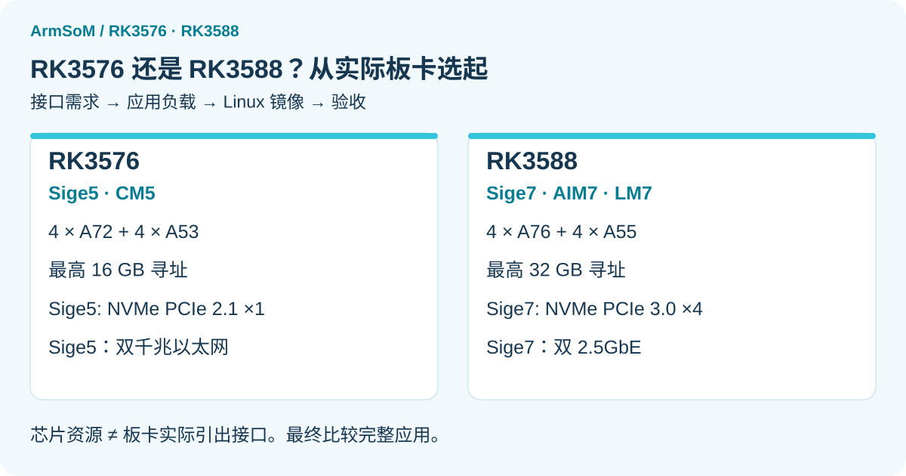
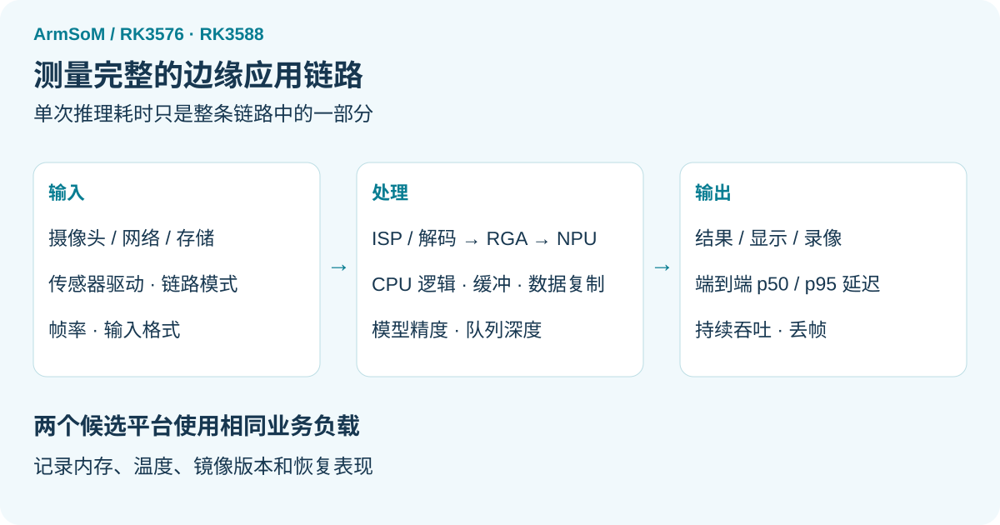

**如果 Sige5／CM5 引出的接口、16 GB 以内的内存范围和实际应用负载已经满足需求，可以优先评估 RK3576；如果项目需要更宽的内存子系统、Sige7 的 PCIe 3.0 ×4 NVMe 与双 2.5GbE，或为并行任务预留更多 CPU／GPU 资源，则重点评估 RK3588。** 两者都宣传 6 TOPS，但这个数字不能单独决定应用运行效果。

本文把芯片规格、ArmSoM 板卡、Linux 软件和验收方法串起来。资料核对日期为 2026 年 11 月 18 日；场景建议属于工程选型分析，并非 ArmSoM 对比实测结果。实际功能取决于硬件版本、载板与 BSP。



## 1. RK3576 与 RK3588 的关键区别

| 项目 | RK3576 | RK3588 | 项目中要核对什么 |
|---|---|---|---|
| CPU | 4× Cortex-A72 + 4× Cortex-A53 | 4× Cortex-A76 + 4× Cortex-A55 | 业务逻辑、预处理、数据库和容器占用的 CPU 时间 |
| GPU | Mali-G52 MC3 | Mali-G610 MC4 | 图形驱动、合成器、API 支持及真实显示负载 |
| NPU | 双核；标称 6 TOPS INT8，带稀疏计算限定 | 三核；标称 6 TOPS | 模型转换、算子、精度、核心调度和延迟 |
| 内存接口 | 2×16-bit；LPDDR4/4X/5；最高 16 GB 寻址 | 4×16-bit；LPDDR4/4X/5；最高 32 GB 寻址 | 板上实际内存规格与应用峰值占用 |
| PCIe | PCIe 2.1 资源，部分接口存在复用 | PCIe 3.0 及其他 PCIe 资源 | 实际引出通道、载板走线、共享 PHY 与协商速率 |
| 多媒体 | ISP、RGA、硬件编解码及多种显示接口 | ISP、RGA、硬件编解码、多屏及 HDMI RX | 按编码格式的限制、传感器驱动和并发组合 |
| NPU 软件体系 | RKNN-Toolkit2 / RKNPU2 | RKNN-Toolkit2 / RKNPU2 | 与目标平台匹配的转换工具、运行库和内核驱动 |

芯片层面的依据是 [RK3576 官方规格](https://www.rock-chips.com/a/en/products/RK35_Series/2024/1212/2033.html)、[RK3588 官方规格](https://www.rock-chips.com/a/en/products/RK35_Series/2022/0926/1660.html)，以及本站已整理的 [RK3576 数据手册](/zh/articles/rk3576-datasheet-v10/)和 [RK3588 数据手册](/zh/articles/rk3588-datasheet-v14/)。这些是芯片能力，不等于每款产品都提供对应插座。

RK3588 内存总线更宽，不代表应用吞吐量必然翻倍。内存类型、频率、缓存命中、数据复制和其他模块争用都会影响有效带宽。CPU 核心名称也不能直接换算成固定性能倍数或整机功耗差异。

视频规格要分别看**解码、编码和显示输出**。例如 RK3588 对 H.265 和 AV1 的详细上限不同，“8K”并不适用于所有格式。RK3576 较早的完整数据手册与后续 Brief 对视频规格的展示也有差异。应先固定编码格式、profile、位深、分辨率与帧率，再用目标镜像验证，不能把不同文档中的最高数字拼成一项无条件能力。

## 2. Sige5 与 Sige7：先比较真正能接上的接口

使用单板计算机做原型时，板级走线往往比完整 SoC 框图更直接影响决策。[Sige5 手册](https://docs.armsom.org/armsom-sige5)与 [Sige7 手册](https://docs.armsom.org/armsom-sige7)列出了以下区别：

| 板级项目 | ArmSoM Sige5 | ArmSoM Sige7 |
|---|---|---|
| 处理器 | RK3576 | RK3588 |
| 文档列出的内存配置 | 8/16 GB，32-bit LPDDR4X | 8/16/32 GB，64-bit LPDDR4/4X |
| NVMe 插座 | M.2 Key M，PCIe 2.1 ×1 | M.2 Key M，PCIe 3.0 ×4 |
| 有线网络 | 2× 千兆以太网 | 2× 2.5 千兆以太网 |
| 摄像头接口 | 2× 四通道 MIPI CSI | 2× 四通道 MIPI CSI |
| 显示接口 | HDMI、USB-C DisplayPort、MIPI DSI | HDMI、USB-C DisplayPort、MIPI DSI |
| 板卡平面尺寸 | 92 × 62 mm | 92 × 62 mm |

支持 PCIe 3.0 ×4 的 SSD 接到其他主机时，可以协商成更低速、更窄的链路；其桌面平台标称性能不能直接套用到 Sige5 的 ×1 接口上。两款手册均将这个 M.2 插座定义为 NVMe，不能仅凭外形相似就购买 M.2 SATA SSD。

Sige7 的 2.5GbE 还需要交换机、线缆和对端共同支持相应模式。两个网口不自动组成一条双倍速率的连接。同样，两个 CSI 插座不等于摄像头已经兼容，还要核对传感器驱动、lane 连接、电源、时钟、设备树和 ISP 调试参数。

相同的板卡长宽有利于早期结构评估，但不意味着所有安装净空、接口位置或电气引脚相同。复用外壳前仍应检查机械图。

## 3. 从开发板走向 CM5、AIM7 或 LM7

SBC 已经集成接口和较多外围电路；核心板则把部分系统集成工作交给自己的载板。

| 产品 | 平台与形态 | 适合从什么需求出发 |
|---|---|---|
| [CM5](https://www.armsom.org/cm5) | RK3576；55 × 40 mm 核心板 | 为终端、网关或视觉设备设计紧凑载板 |
| [AIM7](https://www.armsom.org/aim7) | RK3588；260-pin SO-DIMM 核心板 | 在经过核对的载板上使用可插拔计算模块 |
| [LM7](https://www.armsom.org/lm7) | RK3588；45 × 50 mm LGA 核心板 | 将焊接式核心板集成到量产载板 |

[CM5 文档](https://docs.armsom.org/armsom-cm5)区分了 V1.3 LPDDR5 与 V2.0 LPDDR4X 配置。“RK3576 支持 LPDDR5”不代表每块 Sige5 或 CM5 都安装 LPDDR5，应以订购配置和实物版本为准。

[AIM7](https://docs.armsom.org/armsom-aim7)要核对引脚表和经过验证的载板配置；模块轮廓相似，不等于适配所有 Jetson 载板，也不等于兼容 CUDA 软件。[LM7](https://docs.armsom.org/armsom-lm7)则需要同时考虑贴装、载板信号完整性、电源时序和维修方式。从 SBC 转到核心板后，设备树和外设仍需重新验证。

## 4. 按完整应用选，而不是按一个参数选

### 摄像头 AI 与工业检测

完整视觉链路包括采集、ISP 处理或解码、缩放／颜色转换、推理与后处理。如果 Sige5 的摄像头路径和内存预算满足原型要求，可以从它开始；如果并发服务、帧缓冲或 CPU／GPU 处理已经成为资源瓶颈，再重点评估 Sige7。任何一种选择都不直接保证可运行多少路 AI 摄像头。

应测量从帧到达到产生可用结果的耗时，包含排队和内存传输。即使单次推理很快，CPU 缩放或反复复制图像仍可能造成较高总延迟。[RKNN-Toolkit2](https://github.com/airockchip/rknn-toolkit2)列出了两种平台，但模型仍须针对目标芯片转换和校验。

### NAS、数据记录与网络网关

当双千兆网口和单通道 NVMe 已满足需求时，Sige5 值得进入评估；需要双 2.5GbE 与更宽 NVMe 链路时，Sige7 提供了更合适的接口起点。这是接口规格差异，并非文件传输实测结果。

测试中还应纳入加密、文件系统、小文件访问、SSD 温度及断电恢复。芯片具有 SATA 控制器，并不会让板上的 NVMe 专用插座变成 SATA 插座。

### HMI、自助终端与显示设备

屏幕组合明确的终端，应先验证面板时序、触摸、合成器与硬件视频路径。如果真实图形负载或并发显示需要更多余量，再评估 RK3588。不能仅凭 SoC 显示引擎总数推断某种多屏组合可用：物理接口可能共享资源，BSP 也必须支持该组合。

### 容器与边缘服务

网关同时运行数据库、消息代理和推理服务时，要把系统、模型、帧缓冲、文件缓存及突发队列一起计入内存预算。如果实测需求超过 16 GB，可重点考虑提供 32 GB 配置的 RK3588 产品。容器不会消除硬件依赖：GPU、NPU 和多媒体访问仍依赖主机内核、设备权限及兼容的用户态库。

## 5. 冻结硬件之前，先确定 Linux 镜像

“Linux 能启动”和“应用里的所有加速器都能工作”是两个验收节点。先从 [ArmSoM 快速开始](https://docs.armsom.org/getting-started)为具体板卡提供的镜像入口出发，记录内核与软件包版本。

| 软件层 | 定型前要验证什么 |
|---|---|
| Bootloader、内核和设备树 | 板卡版本、电源配置、引脚复用及外设启用状态 |
| 图形与显示 | 内核驱动、Mesa 或厂商用户态、合成器和目标 API 版本 |
| 视频与图像处理 | MPP/RGA 库，以及应用是否真正接入硬件加速 |
| NPU | 转换目标、RKNN 运行库、驱动兼容性和模型精度 |
| 产品维护 | 镜像更新、安全修复、恢复流程与明确负责的发布基线 |

[Rockchip MPP](https://github.com/rockchip-linux/mpp)提供多媒体处理组件；安装了 FFmpeg 或 GStreamer，并不能证明当前构建会调用它们。播放代表性素材时，应结合应用日志与 CPU 负载检查。相同板卡上的厂商 BSP 镜像和偏上游的发行版，可能提供不同的功能覆盖。

RKNN-Toolkit2 转换时，按目标选择 `target_platform="rk3576"` 或 `target_platform="rk3588"`，分别保存模型产物。不要默认转换后的模型、NPU 核心掩码、启动镜像或设备树可以在两个平台间原样复制。部署记录中应保留模型、校准数据及 SDK／运行库版本。

## 6. 用真实命令检查 Linux 原型

下面的命令读取系统信息，不刷写存储，也不修改频率设置；它们适用于 Linux shell，不是 Android ADB 命令。具体镜像可能没有全部工具，权限不足或命令不存在也不代表硬件不存在。

### 确认板卡、系统与内存

```bash
uname -a
cat /etc/os-release
for f in /proc/device-tree/model /proc/device-tree/compatible; do
  if [ -r "$f" ]; then
    printf '\n%s\n' "$f"
    tr '\000' '\n' < "$f"
  fi
done
command -v lscpu >/dev/null 2>&1 && lscpu
free -h
lsblk -o NAME,SIZE,TYPE,FSTYPE,MOUNTPOINT
```

`MemTotal`／`free` 显示 Linux 可用内存，因预留区域等原因，可能低于物理内存容量。`lsblk` 用于确认存储布局，不是测速。除命令输出外，还应记录板上标识的硬件版本。

### 检查 PCIe、USB 与网络链路

```bash
command -v lspci >/dev/null 2>&1 && lspci -nn
command -v lsusb >/dev/null 2>&1 && lsusb -t
for d in /sys/bus/pci/devices/*; do
  [ -d "$d" ] || continue
  printf '\n%s\n' "${d##*/}"
  for f in current_link_speed current_link_width; do
    [ -r "$d/$f" ] && { printf '%s: ' "$f"; cat "$d/$f"; }
  done
done
if command -v ethtool >/dev/null 2>&1; then
  for d in /sys/class/net/*; do
    name=${d##*/}
    [ "$name" = lo ] && continue
    printf '\n%s\n' "$name"
    ethtool "$name"
  done
fi
```

PCIe 输出是当前链路状态，不是带宽测试结果。若出现通道数偏少、代际不符、USB 降为 2.0 或网口协商为 100 Mb/s，应先解决这些问题，再比较应用性能。Debian／Ubuntu 中相关工具通常来自 `pciutils`、`usbutils` 和 `ethtool`。

### 查找摄像头与显示节点

```bash
command -v v4l2-ctl >/dev/null 2>&1 && v4l2-ctl --list-devices
if command -v media-ctl >/dev/null 2>&1; then
  for d in /dev/media*; do
    [ -e "$d" ] || continue
    media-ctl -d "$d" -p
  done
fi
for d in /sys/class/drm/card*-*; do
  [ -r "$d/status" ] || continue
  printf '\n%s\n' "${d##*/}"
  cat "$d/status"
  [ -r "$d/modes" ] && cat "$d/modes"
done
```

有 `/dev/video*` 并不证明那就是摄像头，编解码设备也可能使用 video 节点。先确认传感器和媒体拓扑，再使用板卡支持的示例采集。DRM 列出的 HDMI 模式只是报告的模式，不证明整条渲染或播放链路能持续达到该规格。`v4l2-ctl` 和 `media-ctl` 通常由 `v4l-utils` 提供。

### 观察负载运行时的温度与频率

```bash
for d in /sys/class/thermal/thermal_zone*; do
  [ -r "$d/temp" ] || continue
  printf '%s ' "${d##*/}"
  [ -r "$d/type" ] && tr '\n' ' ' < "$d/type"
  cat "$d/temp"
done
for d in /sys/devices/system/cpu/cpufreq/policy*; do
  [ -d "$d" ] || continue
  printf '\n%s\n' "${d##*/}"
  for f in scaling_governor scaling_cur_freq scaling_max_freq; do
    [ -r "$d/$f" ] && { printf '%s: ' "$f"; cat "$d/$f"; }
  done
done
```

thermal zone 的温度通常以千分之一摄氏度表示，示例中的 cpufreq 频率单位为 kHz；区域名称和可用文件由 BSP 决定。这些是瞬时读数，不是电功耗测量，也不能单独证明发生了热降频。应在同一负载下重复观察，将频率变化与温度、延迟一起分析。

## 7. 做能真正影响选型的验收



两个候选平台使用相同输入数据、模型设置与业务配置；允许使用各自所需的驱动及目标模型转换，但要记录差异。例如“两路 1080p 摄像头加事件录像”可以是测试需求，不能写成任一产品已通过的结果。

| 验收方面 | 记录内容 | 要排除的典型问题 |
|---|---|---|
| 功能覆盖 | 每项必需外设和同时运行的组合 | 有插座，但缺驱动或共享资源冲突 |
| 应用性能 | 持续吞吐、p50／p95 延迟和队列深度 | CPU 预处理或复制耗时超过 NPU 推理 |
| 内存与存储 | 峰值内存、swap、写入行为和剩余空间 | 工作集或突发录像超出预算 |
| 持续运行 | 负载时长、环境、外壳和温度 | 热稳态或供电限制改变性能 |
| 恢复与更新 | 重启、外设重连及回滚结果 | 实验室跑通过，但升级后不可复现 |

测试前先按产品需求定义通过条件。比较整机成本时，要把散热、存储、电源和载板开发算进去，不能从芯片名称推出“RK3576 一定更省电”的结论。

## 8. 常见选型问题

### 都是 6 TOPS，AI 性能就一样吗？

不是。RK3576 的标称值包含稀疏计算条件，模型／算子支持、数据传输和调度也会影响结果。应在目标软件栈上比较同一模型的精度和端到端延迟。

### Sige5 的镜像能直接复用到 Sige7 吗？

应使用对应板卡镜像。应用源码或可移植容器可能复用，但启动组件、设备树和加速库都需要针对平台验证。

### 这里的 RK3588 能直接换成 RK3588S 理解吗？

不能。RK3588S 的外设资源不同。本文关于 Sige7 的 PCIe 和网络描述，不代表 CM7S 或 Sige7S；选择这两款产品时请查看独立的 [RK3588S 指南](/zh/articles/rk3588s-chip-guide/)。

### 应该先从哪款 ArmSoM 产品开始？

可先用 [Sige5](https://www.armsom.org/sige5) 或 [Sige7](https://www.armsom.org/sige7)验证外设与软件；载板、体积和制造需求明确后，再考虑 CM5、AIM7 或 LM7。整个转换过程都应把具体板卡手册与需求表放在一起核对。

## 9. 继续实现你的方案

- [RK3576 芯片架构与应用规划](/zh/articles/rk3576-chip-guide/)
- [RK3588 芯片架构与应用规划](/zh/articles/rk3588-chip-guide/)
- [RKNN2 与 RKNN3：选择正确的 NPU 软件栈](/zh/articles/rockchip-npu-rknn2-rknn3-getting-started/)
- [Rockchip MPP 开发指南](/zh/articles/089-rockchip-mpp/)
- [Sige5 与 Sige7 的 Armbian 应用方案](/zh/articles/sige5-sige7-armbian-projects/)
