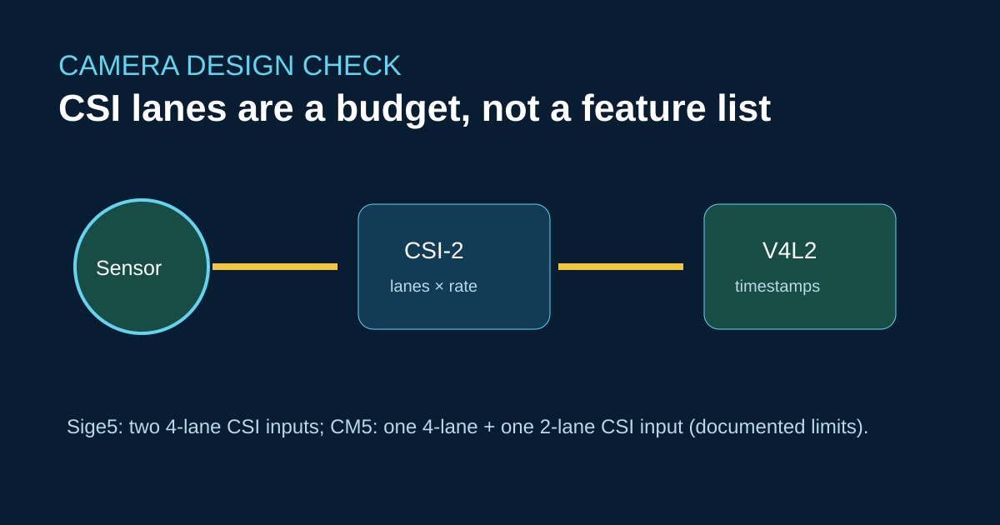

# RK3576 多摄像头同步：先验证 CSI 带宽，再讨论 AI



ArmSoM Sige5 列出了两个 4-lane MIPI CSI 输入，CM5 列出了一个 4-lane 和一个 2-lane 输入。这些是接口能力，并不保证任意两个传感器能够同步，也不保证 AI 流程可以维持满帧率。

## 调试顺序

从一个传感器和文档定义的设备树端点开始。确认媒体拓扑、像素格式和时间戳后，再加入第二个传感器。

```bash
v4l2-ctl --list-devices
media-ctl -p
v4l2-ctl -d /dev/video0 --stream-mmap --stream-count=300 \
  --stream-to=/tmp/capture.raw --verbose
```

测量丢帧和时间戳差值。如果两个传感器需要硬件同步，应在载板设计中落实触发和时钟要求；软件时间戳对齐不等同于共享同一曝光触发边沿。

## 与 Raspberry Pi 和 Jetson Nano 的差异

摄像头库、ISP 调校文件和 GStreamer 元素与平台相关。Raspberry Pi 的 libcamera 流程或 Jetson Argus 应用无法不经适配就运行在 RK3576 上。应规划 V4L2/media-controller 配置、Rockchip ISP 支持，以及应用层的同步测试。

## 参考链接

- [Sige5 官方规格与文档](https://docs.armsom.org/armsom-sige5)
- [CM5 官方规格与文档](https://docs.armsom.org/armsom-cm5)
- [ArmSoM 开发者中心](https://docs.armsom.org/)

## 发布前核对

- [ ] 记录传感器模式、通道数、链路频率和像素格式。
- [ ] 提供时间戳和丢帧的测试证据。
- [ ] 未实测负载时，不宣称多摄像头 AI 吞吐量。
