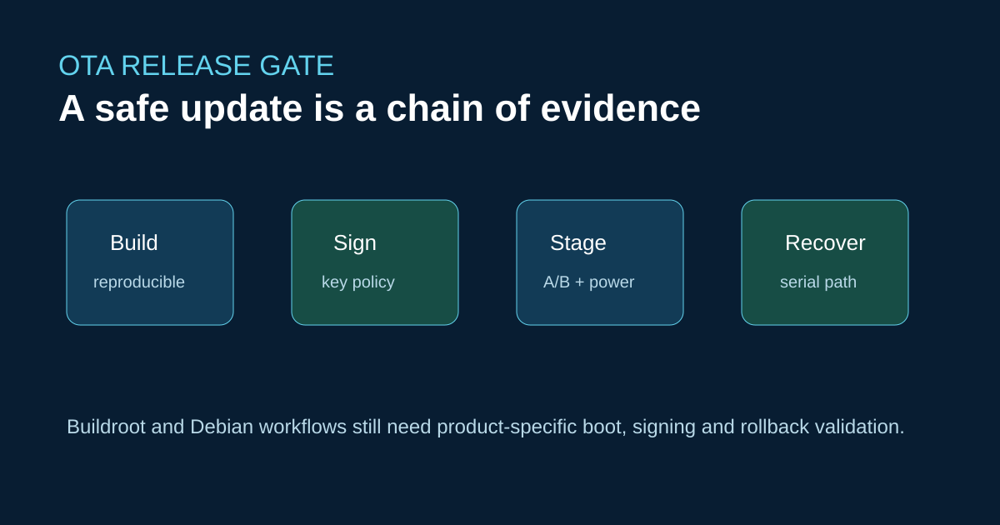

# ArmSoM OTA 更新：Buildroot 与 Debian 需要不同的恢复方案



更新系统是一项产品能力，不只是一个 shell 脚本。ArmSoM 为 Sige 系列提供 Debian、Android 和 Buildroot 支持信息，Forge1 则以 Buildroot 为主。因此，镜像格式、引导程序和回滚机制必须按具体产品定义。

## 最小发布约定

统一管理内核、设备树、根文件系统、引导程序配置和应用的版本。在 CI 中签名发布产物，安装前验证，并保留已知可用的启动槽位或外部恢复路径。保存启动失败时的串口日志。

```bash
sha256sum Image *.dtb rootfs.squashfs
printf '%s  %s\n' "$VERSION" "$(git rev-parse HEAD)" > release.manifest
```

这些命令用于生成核对证据，并不构成完整的安全启动实现。密钥存储、熔丝状态、Boot ROM 行为和现场恢复策略需要按板卡审查。

## 兼容性边界

Raspberry Pi OTA 工具经常假定特定的启动分区布局，Jetson 更新流程则依赖 NVIDIA 的启动组件。在明确 ArmSoM 的介质、引导程序和恢复机制之前，不应直接复用这些流程。

## 参考链接

- [ArmSoM 开发者中心](https://docs.armsom.org/)
- [Forge1 官方文档](https://docs.armsom.org/zh/armsom-forge1)
- [Sige 系列入门与供电指南](https://docs.armsom.org/sige-family-started)

## 发布前核对

- [ ] 测试更新过程中断电的情况。
- [ ] 在确切 SKU 上验证回滚和出厂恢复。
- [ ] 说明密钥归属以及支持周期假设。
