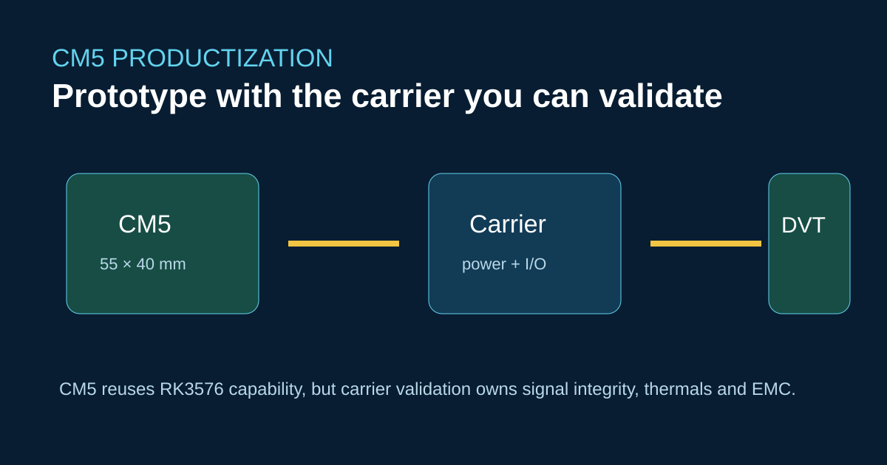
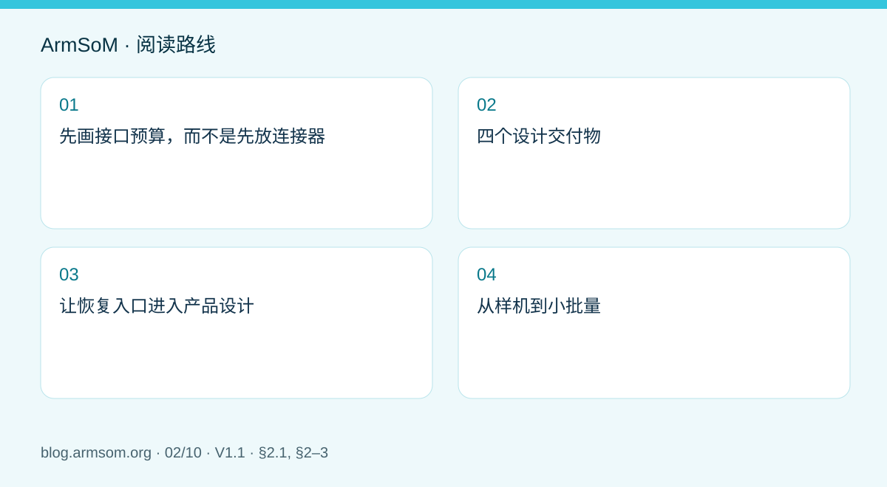
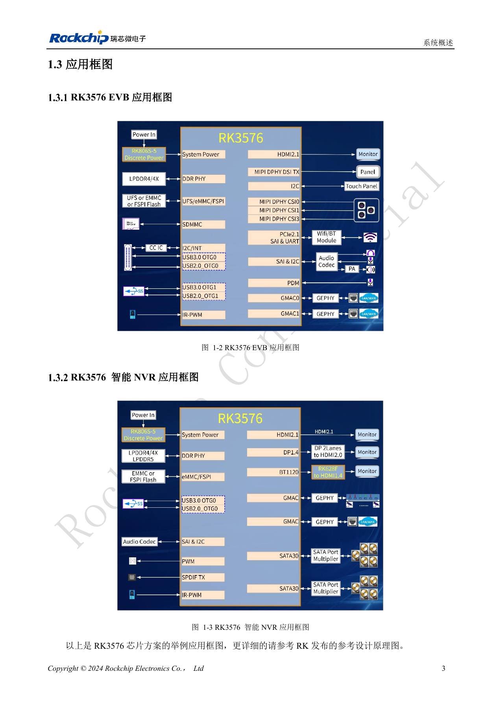

# ArmSoM CM5 载板设计：从 Raspberry Pi 原型走向产品



CM5 是一款 55 × 40 mm 的 RK3576 计算模块。它有助于缩短产品开发周期，但也将风险转移到载板：供电时序、高速布线、连接器选择、热传导和制造测试。

## 调试顺序

从电源轨和串口控制台开始。每次加入一个高速接口，再在负载下验证 USB、PCIe、摄像头、显示和以太网。对引脚映射进行版本管理，不应仅凭信号名称复制 Raspberry Pi 原理图。

```bash
uname -a
cat /proc/device-tree/model
dmesg | grep -iE 'pcie|usb|dwc3|eth|drm'
```

ArmSoM 文档指出，CM5 v1.2 的引脚 21 问题已在 v1.3 修复；生产文档应锁定模块版本，并测试受影响的网络。

## 为什么不能直接替换

该模块提供 RK3576 计算能力和文档所述 CSI/PCIe/USB 资源，但实际连接器与电气行为由定制载板决定。Jetson Nano 载板的假设、CUDA 依赖和启动工具不能直接沿用。

## 参考链接

- [CM5 官方规格与文档](https://docs.armsom.org/armsom-cm5)
- [CM5-IO 配套载板](https://docs.armsom.org/armsom-cm5-io)
- [RK3576 平台概述](https://docs.armsom.org/blog/rk3576-sbc)

## 发布前核对

- [ ] 锁定模块版本与引脚映射。
- [ ] 明确 SI、散热和 EMC 验证的责任。
- [ ] 在载板上验证恢复与工厂烧录。

<!-- hardware-design-series expansion -->



## 适用范围与资料

本篇为围绕工程问题编写的专题导读，不是整本 PDF 的逐页翻译。原文示例不代表 ArmSoM 实测；具体电压、引脚、SDK/BSP 和内核应按实际板卡版本核对。

**Rockchip:** `RK3576_Hardware_Design_Guide_V1.1_20240528_CN.pdf` · V1.1 · §2.1, §2–3

## 先画接口预算，而不是先放连接器

把每个需求写成“功能—信号—模块引脚—电源域—软件配置—验证方法”一行。例如，摄像头除了 CSI 数据线，还涉及控制总线、时钟、复位和供电；显示屏除了视频接口，还涉及触摸、背光和上电顺序。连接器外形相同并不意味着信号定义和电气行为相同。

RK3576 指南提供芯片级约束，CM5 文档提供模块级边界，载板原理图负责二者之间的实际连接。已经在模块上完成的 DDR 和核心供电设计，不应在载板重新照搬。迁移 Raspberry Pi 项目时，逐项检查引脚、供电、机械结构、外设驱动与系统镜像，不能仅凭外形宣布直接替换。

## 四个设计交付物

| 文件 | 必须回答的问题 |
| --- | --- |
| 引脚分配表 | 是否存在复用冲突、保留脚误用或电压域不匹配？ |
| 电源预算 | 模块、USB、屏幕、摄像头的峰值负载和启动过程是否覆盖？ |
| PCB 约束表 | 每组高速信号的阻抗、长度预算、参考平面和连接器如何定义？ |
| 测试矩阵 | 正常启动、恢复、热负载、接口并发和掉电如何验证？ |

原稿指南 §2–3 可作为审查结构，但具体数值必须对应所用接口、材料与连接拓扑。不能把芯片参考板的全链路长度预算全部分配给载板；模块、板对板连接器和外部线缆也占用通道预算。

## 让恢复入口进入产品设计

串口、恢复按键和工厂烧录接点应在结构冻结前确定。产品装壳后仍应能定位软件版本并进入受控的恢复流程。先用已知可用模块和 IO 板验证镜像，再把相同模块、镜像和外设迁移到新载板，可减少同时变化的因素。

首次启动通过后，分别测试 USB 热插拔、存储读写、显示切换和摄像头，再组合成真实业务负载。保留失败日志、供电条件和环境温度，而不只保存成功截图。

## 从样机到小批量

冻结模块修订号、BOM、连接器料号、PCB 叠层和系统镜像，给每台设备记录序列号与测试结果。把“能启动”“接口正常”“持续负载稳定”作为不同检查项。若替换模块版本、PMIC 相关配置或外围器件，应重新评估受影响的项目。

这套工作流的价值是利用 CM5 已集成的计算与存储部分，把开发资源集中到自己的接口、结构和业务。它不意味着任何第三方载板天然兼容，也不代表本文已完成实物验证。

## 原文配图

[](/assets/hardware-design-series/rk3576-cn.png)

中文稿原图。 参考设计，不是 ArmSoM 板卡原理图。

`RK3576_Hardware_Design_Guide_V1.1_20240528_CN.pdf` · PDF p. 23.

## 相关产品与开发资料

- **CM5** — [产品页面](https://www.armsom.org/cm5) · [开发文档](https://docs.armsom.org/armsom-cm5)

## 继续阅读本系列

- [RK3576 硬件设计入门：最小系统与首次上电检查](/zh/articles/rk3576-hardware-bringup/)
- [RK3576 高速接口设计：原理图与 PCB 如何配合检查](/zh/articles/rk3576-high-speed-interface-design/)
- [RK3588S 硬件设计指南：从芯片参考设计到 CM7s 载板](/zh/articles/rk3588s-cm7s-carrier-design/)
- [RK3588 边缘 AI 设备设计：供电、散热与扩展接口规划](/zh/articles/rk3588-edge-ai-hardware-design/)
- [RK3588 高速 PCB 设计：叠层、阻抗与布线检查](/zh/articles/rk3588-high-speed-pcb-review/)
- [RK3506 工业 HMI 硬件设计：结合 CM1 与 Forge1 选择开发路径](/zh/articles/rk3506-industrial-hmi-hardware/)
- [RK3308 系列芯片差异与兼容检查：P2 Pro 音频项目参考](/zh/articles/rk3308-hardware-variant-compatibility/)
- [RK3588S 与 RK3588S2 有什么区别？改版前需要核对什么](/zh/articles/rk3588s-rk3588s2-hardware-differences/)
- [Rockchip 设备从样机到量产：工艺要求与测试清单](/zh/articles/rockchip-hardware-production-checklist/)
