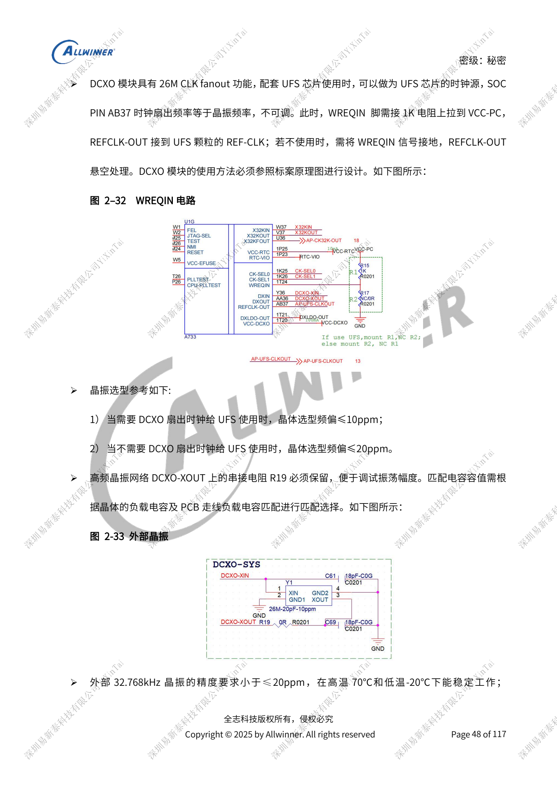
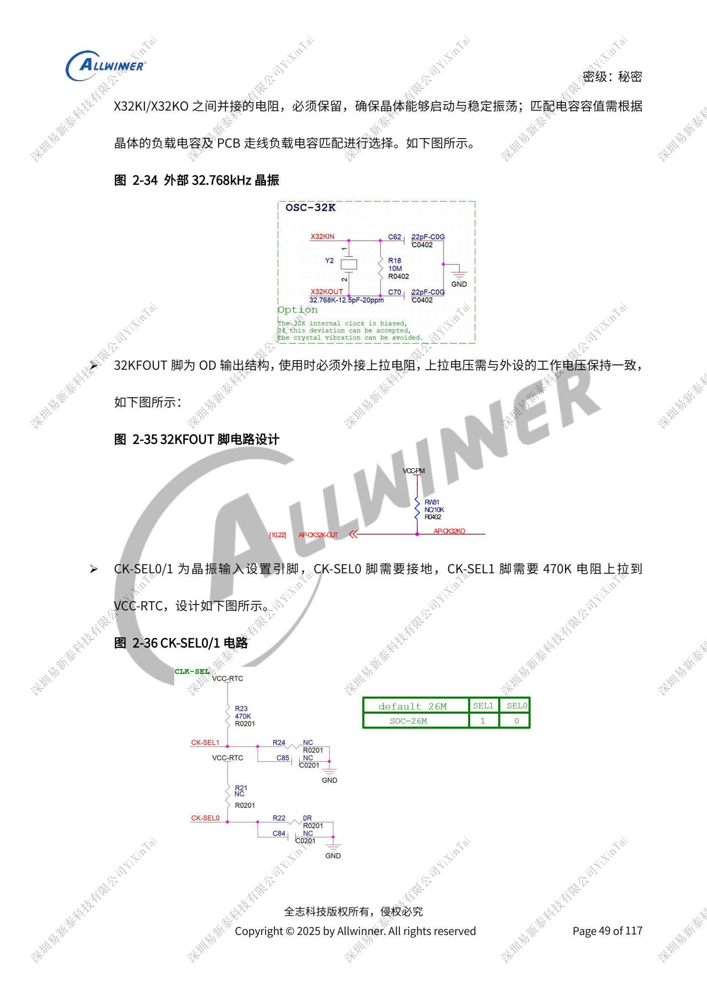
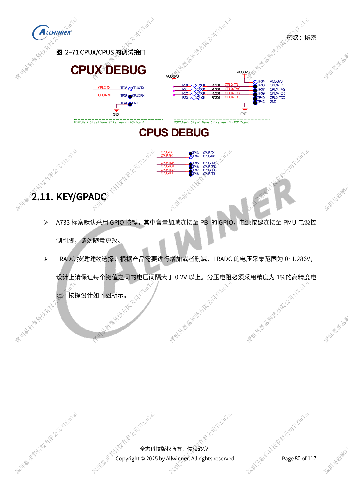

# A733 时钟与恢复：26MHz、GPIO 电源域和 FEL

本文是依据所列原稿重组的硬件设计专题，属于平台参考，未确认对应 ArmSoM 板卡。参数是原稿参考，不是 ArmSoM 实测；实施前核对芯片版本、PCB、所用 SDK/BSP、内核、固件及外设规格。

A733 来源为 V0.9 草案，参数及软件支持可能调整；不能作为最终量产承诺。

**Design draft V0.9 §2.3, §2.10–2.11; PDF 45–54, 80–83**

## 时钟不能套用 H618 的 24MHz

A733 本稿只提供 26MHz 设计，AB37 扇出与晶体同频不可调，供 UFS 时频差 ≤10ppm，否则 ≤20ppm。使用 REFCLK-OUT 时 WREQIN 经 1kΩ 上拉到 VCC-PC；不用则 WREQIN 接地、REFCLK-OUT 悬空。保留 XOUT 串阻并按晶体 CL 与 PCB 寄生选负载。CK-SEL0 接地，CK-SEL1 经 470kΩ 上拉 VCC-RTC。32KFOUT 为开漏，按外设电平上拉；需要精准唤醒时使用外部 32.768kHz 晶体，参考 ≤20ppm、-20至70°C稳定工作。

## 启动与调试引脚

JTAG-SEL 高电平允许 PF/PB 软件选择，低电平强制 PB；TEST 悬空且不拉出长支路。FEL 低电平触发烧录，FEL/GPADC 按键保留 1nF。AP-RESET/AP-NMI 也各保留 1nF，NMI 开漏上拉 VCC-RTC。至少保留 CPUX JTAG/UART 一种；PF 调试优先，PB UART0 留跳线，CPUS 的 PL/PM 调试点用于休眠问题。保留 UBOOT/FEL 或音量键加 POWER 的硬件恢复方式。LRADC 0–1.286V、键间 >0.2V、分压 1%；GPADC 另为 12-bit 分辨率/10-bit 精度、0到AVCC，不能混为同一输入范围。

## GPIO 电源域与启动副作用

PL/PM 为常供电 CPUS 域，参考 PL=3.3V、PM=1.8V；唤醒中断和上拉也必须处于正确的常供电域。PL0/1 是 PMIC、充电和 Type-C 控制总线，内部 4.7kΩ、外部参考 2.2kΩ，不能随意挂其他外设。PC/PF 启动时会发送存储探测信号，不能直接拿来控制功放、LED 或传感器。上拉电源跟随对应 IO 域，供电变化还要同步修改软件耐压配置，避免关机反灌和待机漏电。

## 参考原图

以下为中文原稿参考页截图，保留原图标注；本批未找到对应英文稿，四语共用中文原图。正文参数与步骤可复制，截图用于核对。页码均为 PDF 物理页码。

## ArmSoM 平台选择

如果项目考虑采用 ArmSoM，可从官方产品与开发文档选择平台，并重新核对处理器、接口与软件支持；本文不将 A733/H618 电路套用到其他 SoC。

- [ArmSoM](https://www.armsom.org/)
- [ArmSoM Docs](https://docs.armsom.org/)

## 系列阅读

- [A733 电源系统：AXP318W、上下电与充电路径](/zh/articles/a733-power-sequence-pmic-design/)
- [A733 存储设计：LPDDR4/4X/5、eMMC 与 UFS](/zh/articles/a733-ddr-emmc-ufs-design/)
- [A733 显示与摄像头：接口复用、供电和视频输入桥接](/zh/articles/a733-display-camera-interface-design/)
- [A733 外围设计：USB、PCIe、Wi-Fi、以太网和音频](/zh/articles/a733-usb-pcie-network-audio-design/)
- [A733 可靠性设计：ESD、EMI、浪涌与散热审查](/zh/articles/a733-esd-emi-thermal-review/)
- [A733 · 系列导航](/zh/articles/a733-hardware-design-series/)
