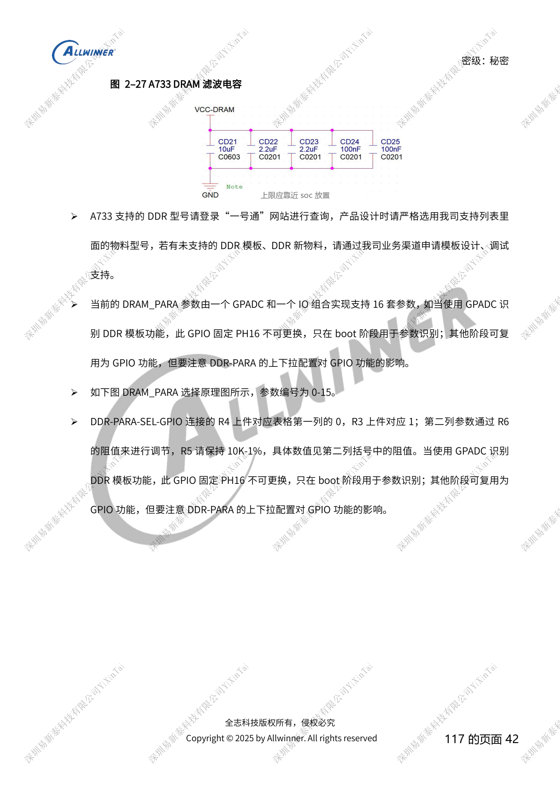
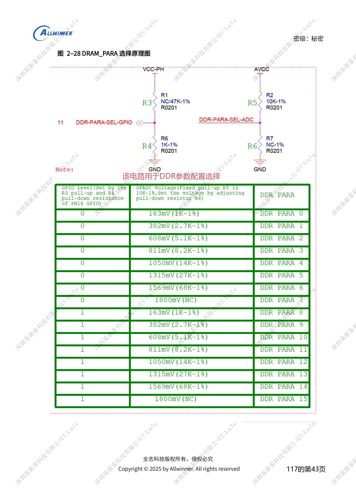
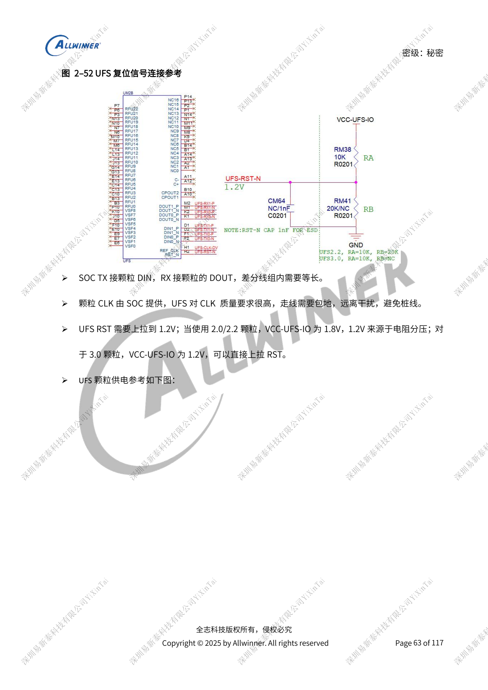

# A733 存储设计：LPDDR4/4X/5、eMMC 与 UFS

本文是依据所列原稿重组的硬件设计专题，属于平台参考，未确认对应 ArmSoM 板卡。参数是原稿参考，不是 ArmSoM 实测；实施前核对芯片版本、PCB、所用 SDK/BSP、内核、固件及外设规格。

A733 来源为 V0.9 草案，参数及软件支持可能调整；不能作为最终量产承诺。

**Design draft V0.9 §2.2, §2.4–2.6; PDF 41–44, 55–65**

## DDR 的电压相同不代表可以换电源

先确定类型、片选和位宽，再选择成套原理图与 PCB 模板，保留元件位号便于对应。差分 85Ω、单端 50Ω；SoC SZQ 用 120Ω、1% 下拉，颗粒端常规参考为 240Ω、1% 上拉到 VCC-VDDQ，但仍需按颗粒确认。DRAM_PARA 由 GPADC 加 PH16 组合选择 0–15 共 16 套参数；GPIO 不能任意替换，后续复用需考虑启动上下拉。滤波电容先保留布局与调试位置，不能在未验证前删减。

## eMMC 与 SD 的不同约束

HS200/HS400 时 VCCQ 和 PC 域用 1.8V并检查上电单调性。HS400 200MHz 建议最长 <1000mil；通用章节另给 <2000mil、相对 CLK ≤300mil，不能用通用值覆盖高速建议。CLK 在 SoC 端串 33Ω，阻抗 50Ω，NC/RFU 悬空。SD3.0 需同时提供 3.3V/1.8V，由内部切换；CLK 总并联容值 ≤15pF，SD3.0 TVS ≤5pF、SD2.0 <35pF，DET 保留 1kΩ串阻。金属卡托保留软启动，不能把供电保护简单改成 0Ω。

## UFS 先匹配代际再接电源

接口为两 lane，稿中最高 11.6Gbps/lane，UFS3.1 限存储功能。2.0/2.2 使用 VCCQ2=1.8V、VCC=3.3V；3.0/3.1 使用 VCCQ=1.2V、VCC 默认 2.5V，可选 3.3V。DC8SET 与 PMIC 输出同步配置。TX 接 DIN、RX 接 DOUT，RST 目标 1.2V：1.8V IO 方案需要分压，不能直接上拉到 1.8V。CLK 由 SoC 扇出且避免支路；电源纹波 <5%，宽度 >30mil、至少承受 600mA。未用 UFS 时信号可悬空，相关供电仍需保持，不能将“未使用”理解成所有电源断开。

## 参数速查

| 项目 | 原稿参考 |
| --- | --- |
| 电源域 | LPDDR4 / LPDDR4X / LPDDR5 |
| VCC-DRAM：DCDC7 | 1.1V / 1.1V / 1.05V |
| VCC-DRAML：DCDC6 | 0.8V / 0.6V / 0.5V |
| 颗粒 VCC-VDDQ | DCDC7 1.1V / DCDC6 0.6V / DCDC6 0.5V |
| LPDDR5 VDD2L | ELDO1 0.9V |
| 颗粒 / SoC 1.8V | CLDO1 / CLDO3 |

## 参考原图

以下为中文原稿参考页截图，保留原图标注；本批未找到对应英文稿，四语共用中文原图。正文参数与步骤可复制，截图用于核对。页码均为 PDF 物理页码。

## ArmSoM 平台选择

如果项目考虑采用 ArmSoM，可从官方产品与开发文档选择平台，并重新核对处理器、接口与软件支持；本文不将 A733/H618 电路套用到其他 SoC。

- [ArmSoM](https://www.armsom.org/)
- [ArmSoM Docs](https://docs.armsom.org/)

## 系列阅读

- [A733 电源系统：AXP318W、上下电与充电路径](/zh/articles/a733-power-sequence-pmic-design/)
- [A733 时钟与恢复：26MHz、GPIO 电源域和 FEL](/zh/articles/a733-clock-gpio-recovery-design/)
- [A733 显示与摄像头：接口复用、供电和视频输入桥接](/zh/articles/a733-display-camera-interface-design/)
- [A733 外围设计：USB、PCIe、Wi-Fi、以太网和音频](/zh/articles/a733-usb-pcie-network-audio-design/)
- [A733 可靠性设计：ESD、EMI、浪涌与散热审查](/zh/articles/a733-esd-emi-thermal-review/)
- [A733 · 系列导航](/zh/articles/a733-hardware-design-series/)
