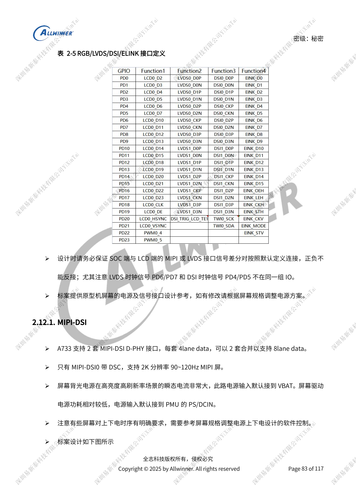
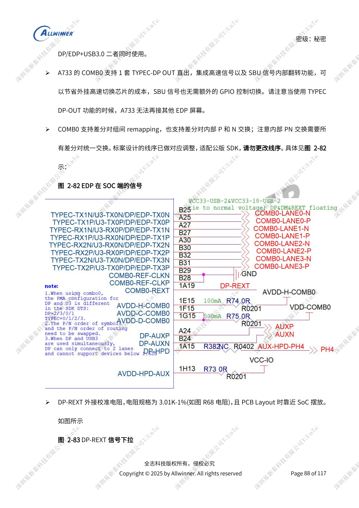
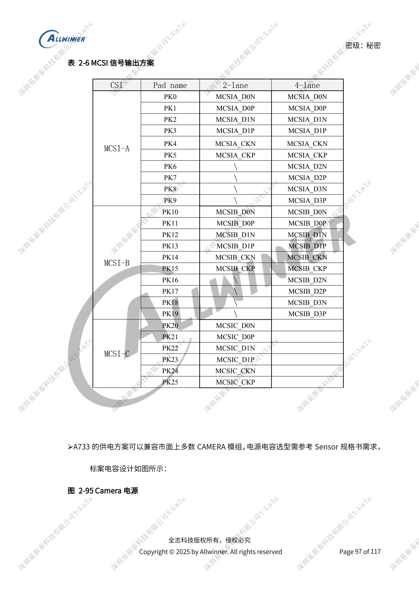

# A733 显示与摄像头：接口复用、供电和视频输入桥接

本文是依据所列原稿重组的硬件设计专题，属于平台参考，未确认对应 ArmSoM 板卡。参数是原稿参考，不是 ArmSoM 实测；实施前核对芯片版本、PCB、所用 SDK/BSP、内核、固件及外设规格。

A733 来源为 V0.9 草案，参数及软件支持可能调整；不能作为最终量产承诺。

**Design draft V0.9 §2.12–2.15, §2.18–2.19; PDF 83–100, 102–106**

## 先画显示资源分配表

两套四 lane MIPI-DSI 可合并八 lane，只有 DSI0 带 DSC；LVDS 四套各四 data lane，单链 1366×768@60Hz、双链 1920×1080@60Hz；RGB888 分布 PD/PB，D0/1/8/9/16/17 为另一电源域的 3.3V 信号。LVDS 时钟 PD6/PD7 与 DSI 时钟 PD4/PD5 不同，不能只按连接器形状套用。SPI incell 使用 SPI1，但屏厂线序及供电不统一。背光 PWM 大于 20kHz，参考 30–50kHz；高亮屏瞬态负载按电源章节评估。

## DP 与 USB 共用 COMB0

DP/eDP 只能从 COMB0 引出，四 lane 模式无 USB3，二 lane 可与 USB3 同用；Type-C DP-OUT 与另接 eDP 屏不能同时承诺。内部支持信号翻转，但 P/N 交换要求所有差分对统一，原稿线序已适配 SDK，不要局部任意交换。DP-REXT 3.01kΩ、1%，eDP 100Ω、串 100nF，Type-C 共用 USB3/DP 时参考 95Ω。未用功能仍需保持相关供电。HDMI OUT 2.0 最高 4K60，0.8V/1.8V 无论使用与否都供电，REXT 1.62kΩ、1%，差分 100Ω。

## 摄像头与外部视频输入

MCSIA/B 各四 lane，MCSIC 两 lane，最高参考 2Gbps/lane，也可复用 NCSI。更换前后摄像头分配必须改软件。MCLK 近 SoC 串 33Ω、近座子预留电容；AVDD-CSI 单独干净供电，对焦电源和数字电源能否共路取决于时序、电压与电流。摄像头 TWI 保留上拉，不与其他设备随意共用，同时工作的传感器地址不能冲突。A733 没有原生 HDMI IN，稿中通过 CSI 桥接且参考最高 HDMI1.4；DP IN 同样是外部 LT7911D 转接，不能写成 SoC 原生接收口。其文字称桥输出为 MIPI DSI，却又指向 CAMERA 章节，协议方向需按桥芯片资料核对。

## 参考原图

以下为中文原稿参考页截图，保留原图标注；本批未找到对应英文稿，四语共用中文原图。正文参数与步骤可复制，截图用于核对。页码均为 PDF 物理页码。

## ArmSoM 平台选择

如果项目考虑采用 ArmSoM，可从官方产品与开发文档选择平台，并重新核对处理器、接口与软件支持；本文不将 A733/H618 电路套用到其他 SoC。

- [ArmSoM](https://www.armsom.org/)
- [ArmSoM Docs](https://docs.armsom.org/)

## 系列阅读

- [A733 电源系统：AXP318W、上下电与充电路径](/zh/articles/a733-power-sequence-pmic-design/)
- [A733 存储设计：LPDDR4/4X/5、eMMC 与 UFS](/zh/articles/a733-ddr-emmc-ufs-design/)
- [A733 时钟与恢复：26MHz、GPIO 电源域和 FEL](/zh/articles/a733-clock-gpio-recovery-design/)
- [A733 外围设计：USB、PCIe、Wi-Fi、以太网和音频](/zh/articles/a733-usb-pcie-network-audio-design/)
- [A733 可靠性设计：ESD、EMI、浪涌与散热审查](/zh/articles/a733-esd-emi-thermal-review/)
- [A733 · 系列导航](/zh/articles/a733-hardware-design-series/)

<!-- editable-source-tables -->

## 附录：MCSI 完整引脚映射

V0.9 · Table 2-6 · PDF 98

| CSI | Pad | 2-lane | 4-lane |
| --- | --- | --- | --- |
| MCSI-A | PK0 | MCSIA_D0N | MCSIA_D0N |
| MCSI-A | PK1 | MCSIA_D0P | MCSIA_D0P |
| MCSI-A | PK2 | MCSIA_D1N | MCSIA_D1N |
| MCSI-A | PK3 | MCSIA_D1P | MCSIA_D1P |
| MCSI-A | PK4 | MCSIA_CKN | MCSIA_CKN |
| MCSI-A | PK5 | MCSIA_CKP | MCSIA_CKP |
| MCSI-A | PK6 | \ | MCSIA_D2N |
| MCSI-A | PK7 | \ | MCSIA_D2P |
| MCSI-A | PK8 | \ | MCSIA_D3N |
| MCSI-A | PK9 | \ | MCSIA_D3P |
| MCSI-B | PK10 | MCSIB_D0N | MCSIB_D0N |
| MCSI-B | PK11 | MCSIB_D0P | MCSIB_D0P |
| MCSI-B | PK12 | MCSIB_D1N | MCSIB_D1N |
| MCSI-B | PK13 | MCSIB_D1P | MCSIB_D1P |
| MCSI-B | PK14 | MCSIB_CKN | MCSIB_CKN |
| MCSI-B | PK15 | MCSIB_CKP | MCSIB_CKP |
| MCSI-B | PK16 | \ | MCSIB_D2N |
| MCSI-B | PK17 | \ | MCSIB_D2P |
| MCSI-B | PK18 | \ | MCSIB_D3N |
| MCSI-B | PK19 | \ | MCSIB_D3P |
| MCSI-C | PK20 | MCSIC_D0N | — |
| MCSI-C | PK21 | MCSIC_D0P | — |
| MCSI-C | PK22 | MCSIC_D1N | — |
| MCSI-C | PK23 | MCSIC_D1P | — |
| MCSI-C | PK24 | MCSIC_CKN | — |
| MCSI-C | PK25 | MCSIC_CKP | — |
