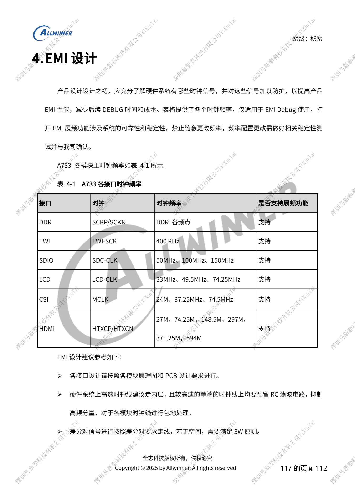
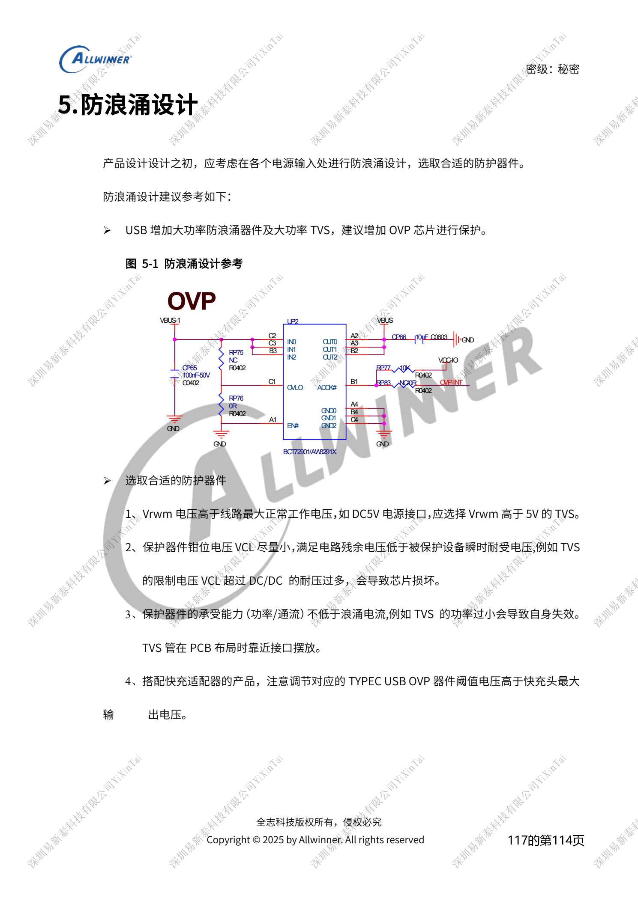

# A733 可靠性设计：ESD、EMI、浪涌与散热审查

本文是依据所列原稿重组的硬件设计专题，属于平台参考，未确认对应 ArmSoM 板卡。参数是原稿参考，不是 ArmSoM 实测；实施前核对芯片版本、PCB、所用 SDK/BSP、内核、固件及外设规格。

A733 来源为 V0.9 草案，参数及软件支持可能调整；不能作为最终量产承诺。

**Design draft V0.9 §3–6; PDF 110–116**

## ESD 不只是接口旁加 TVS

外露耳机、USB、TF、MIC、按键等都需保护；检测脚可预留串阻，SoC reset 固定 1nF不能随意改值。TEST 等敏感脚不用时不要引出长支路。副板接口的保护放副板，并通过导电泡棉连接屏幕金属面就近泄放，避免静电沿 FPC 进入主板。PCB 两面周边预留多处不少于 25mm² 的裸地铜，经地过孔连接完整平面。显示、触摸、摄像头软件复位和看门狗是故障恢复策略，不代表硬件已经通过 ESD 测试。

## EMI 从时钟清单开始

高速时钟优先内层、保留源端 RC、完整参考和包地；无空间时按原稿差分间距原则审查。排线下方减少走线及元件，长排线考虑屏蔽并给副板可靠接地，喇叭线采用双绞。原稿的时钟表是 EMI 排查参考，不应因为频谱峰值就随意改变 DDR/显示频率或开启展频；这些变更需要系统稳定性验证。USB 与 BMU 共用 DP/DM 时，BMU 分支串阻靠分叉点放置以控制支路。

## 浪涌和热设计的验收边界

TVS 的 Vrwm 高于正常最高工作电压，钳位后残余电压低于被保护器件瞬态耐受，功率/通流能力覆盖目标浪涌，器件靠近入口；快充 OVP 阈值按最高适配器输出选择。不要只比较 TVS 标称电压。散热按实际整机负载测温，记录 CPU/DDR 降频或关核及性能变化；DVFS 不能代替散热路径。A733 原稿第 3.2、6 章分别引用独立 PCB 和散热指南，未给出完整布线及热阻数据，本篇不能据此声称完成热设计或认证。

## 参数速查

| 项目 | 原稿参考 |
| --- | --- |
| 原稿 EMI 时钟参考 | TWI 400kHz; SDIO 50/100/150MHz; LCD 33/49.5/74.25MHz; CSI MCLK 24/37.25/74.5MHz; HDMI 27/74.25/148.5/297/371.25/594MHz |

## 参考原图

以下为中文原稿参考页截图，保留原图标注；本批未找到对应英文稿，四语共用中文原图。正文参数与步骤可复制，截图用于核对。页码均为 PDF 物理页码。

## ArmSoM 平台选择

如果项目考虑采用 ArmSoM，可从官方产品与开发文档选择平台，并重新核对处理器、接口与软件支持；本文不将 A733/H618 电路套用到其他 SoC。

- [ArmSoM](https://www.armsom.org/)
- [ArmSoM Docs](https://docs.armsom.org/)

## 系列阅读

- [A733 电源系统：AXP318W、上下电与充电路径](/zh/articles/a733-power-sequence-pmic-design/)
- [A733 存储设计：LPDDR4/4X/5、eMMC 与 UFS](/zh/articles/a733-ddr-emmc-ufs-design/)
- [A733 时钟与恢复：26MHz、GPIO 电源域和 FEL](/zh/articles/a733-clock-gpio-recovery-design/)
- [A733 显示与摄像头：接口复用、供电和视频输入桥接](/zh/articles/a733-display-camera-interface-design/)
- [A733 外围设计：USB、PCIe、Wi-Fi、以太网和音频](/zh/articles/a733-usb-pcie-network-audio-design/)
- [A733 · 系列导航](/zh/articles/a733-hardware-design-series/)
