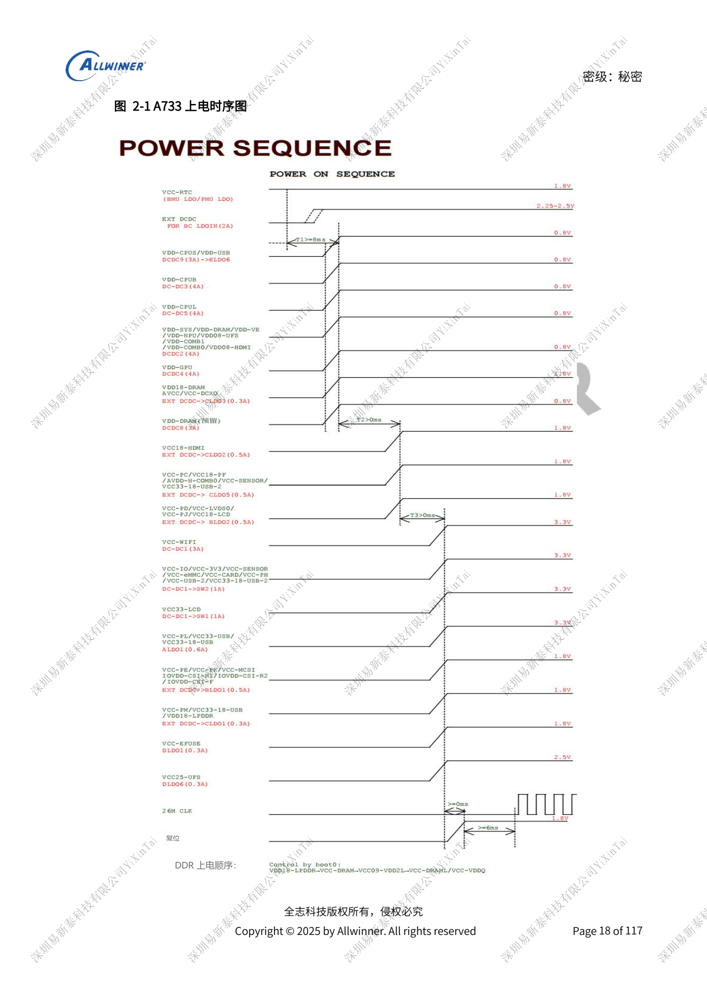
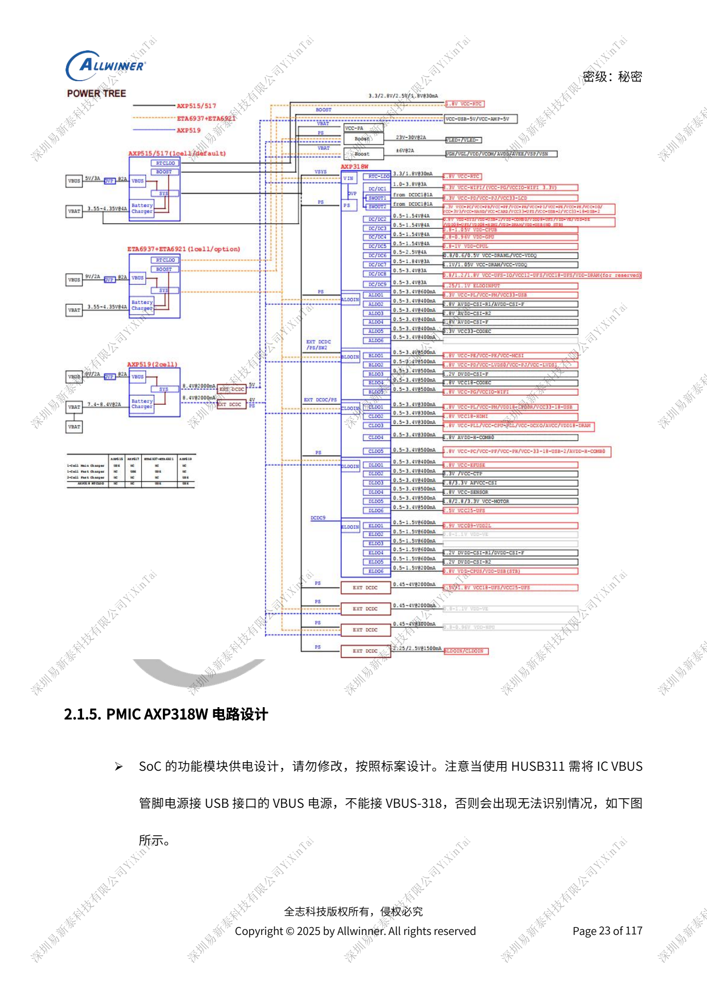
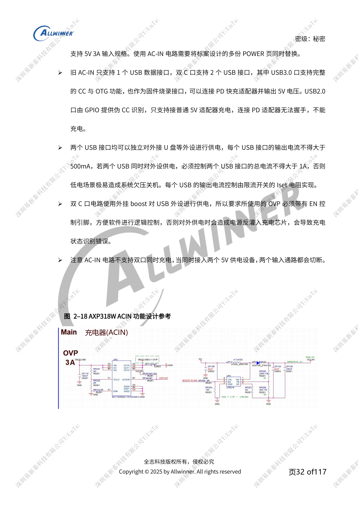

# A733 电源系统：AXP318W、上下电与充电路径

本文是依据所列原稿重组的硬件设计专题，属于平台参考，未确认对应 ArmSoM 板卡。参数是原稿参考，不是 ArmSoM 实测；实施前核对芯片版本、PCB、所用 SDK/BSP、内核、固件及外设规格。

A733 来源为 V0.9 草案，参数及软件支持可能调整；不能作为最终量产承诺。

**Design draft V0.9 §2.1; PDF 17–41**

## 先保留参考电源树

AXP318W 提供 9 路 DCDC、2 路 Switch、29 路 LDO；DCDC2–9 为 COT。红色标记的默认上电电源及烧码时序不能随意重排，已绑定的 DCXO/PLL 等供电也不能仅因电压相同就换路。VCC-RTC 最先且常供电，三步电源稳定后释放 Reset；PMU_RESET 释放 6ms 后主晶振启动。BOOT0 控制 DDR 上电并满足 VDD18-LPDDR≥VCC-DRAM≥VCC09-VDD2L≥VCC-VDDQ。软件关机先拉低 Reset，延迟一个 STEP 再关电；6s 长按或拔电池不属于该时序。

## 反馈与稳定性

DCDC2/3/4/5 的反馈分别接 SYS/CPUB/GPU/CPUL 的 SoC 反馈脚；DCDC7 从 SoC 或 DRAM 负载电容远端取样，不从 PMU 输出电容直接返回。COT 的 DCDC2–9 在 PMU 端只放一颗 22µF，其余大电容在负载端，不能因纹波问题盲目堆电容。未用 DCDC/LDO 仍保持输入供电。SW1/SW2 的 G15/H15 输入路径至少承受 2A。ALDO2/3/4 的输入来自 ALDO1，提高 PSRR；DLDO 保持 PS 输入。

## 输入、充电和瞬态负载

HUSB311 的 VBUS 接 USB 接口 VBUS，不能接 VBUS-318。只有前级已有 charger/OVP 的对应方案才允许经验证短接 DCIN–PS；无 charger 方案禁止照搬。双 C 口参考方案不支持双口同时充电，USB2.0 侧伪 CC 不与 PD 适配器握手，每口外供 ≤500mA、合计 ≤1A。AXP515 示例 5V/2A，AXP519 双节方案默认 PD 9V/2A，不能共用未经核对的 OVP 阈值。背光、功放启动的瞬态压降须在电池保护板、座子、BMU 到 PMU 整条链路测量；两节方案还需 AXP2602 电量计，其 IRQ 接 CPUS，不能直接接系统 IRQ。

## 参数速查

| 项目 | 原稿参考 |
| --- | --- |
| DCDC1/6/7/8/9 电感 | 1µH; 4A; load ≤80%; DCR <100mΩ |
| DCDC2/3/4/5 电感 | 0.33µH; 4A; load ≤80%; DCR <100mΩ |
| 无电池掉电检测默认阈值 | 2.8V; software configurable |
| AXP519 电感参考 | 2.2µH; ≥3.5A; load ≤80% saturation current; DCR <100mΩ |

## 参考原图

以下为中文原稿参考页截图，保留原图标注；本批未找到对应英文稿，四语共用中文原图。正文参数与步骤可复制，截图用于核对。页码均为 PDF 物理页码。

## ArmSoM 平台选择

如果项目考虑采用 ArmSoM，可从官方产品与开发文档选择平台，并重新核对处理器、接口与软件支持；本文不将 A733/H618 电路套用到其他 SoC。

- [ArmSoM](https://www.armsom.org/)
- [ArmSoM Docs](https://docs.armsom.org/)

## 系列阅读

- [A733 存储设计：LPDDR4/4X/5、eMMC 与 UFS](/zh/articles/a733-ddr-emmc-ufs-design/)
- [A733 时钟与恢复：26MHz、GPIO 电源域和 FEL](/zh/articles/a733-clock-gpio-recovery-design/)
- [A733 显示与摄像头：接口复用、供电和视频输入桥接](/zh/articles/a733-display-camera-interface-design/)
- [A733 外围设计：USB、PCIe、Wi-Fi、以太网和音频](/zh/articles/a733-usb-pcie-network-audio-design/)
- [A733 可靠性设计：ESD、EMI、浪涌与散热审查](/zh/articles/a733-esd-emi-thermal-review/)
- [A733 · 系列导航](/zh/articles/a733-hardware-design-series/)

<!-- editable-source-tables -->

## 附录：SoC 端去耦配置

V0.9 · PDF 53

原稿文字使用“以上”，此表保留为 ≥；电容偏压降额、封装与实际标案 BOM 仍需一起核对，不能仅用标称总容量替代逐颗配置。

| 电源 | 已列配置 | 预留 |
| --- | --- | --- |
| VDD-CPUB | 2 × ≥22µF; 1 × 10µF; 1 × 4.7µF; 3 × 2.2µF; 2 × 1µF | 1–2 × 100nF |
| VDD-CPUL | 2 × ≥22µF; 1 × 10µF; 1 × 4.7µF; 4 × 2.2µF; 4 × 1µF | — |
| VDD-GPU | 1 × ≥10µF; 4 × 2.2µF | 2–3 × 100nF |
| VDD-VE | 1 × ≥10µF; 1 × ≥4.7µF; 1 × 2.2µF; 1 × 1µF | 1–2 × 100nF |
| VDD-SYS | 2 × ≥22µF; 3 × 10µF; 2 × 4.7µF; 1 × 2.2µF; 3 × 1µF | 3–4 × 100nF |
| VCC-DRAM | 1 × ≥22µF; 1 × 10µF; 1 × 2.2µF; 4 × 1µF | 2–3 × 100nF |
