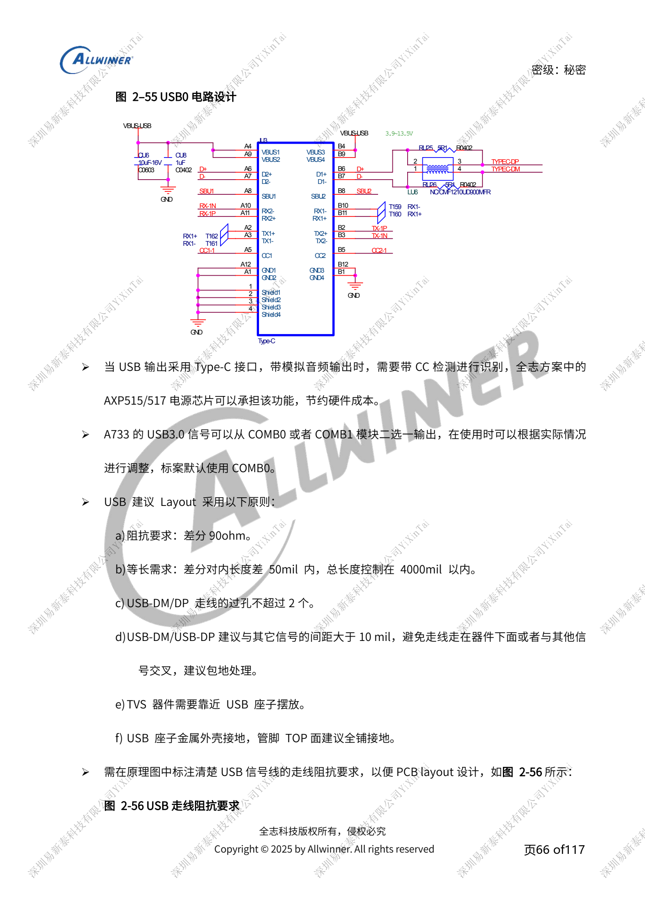
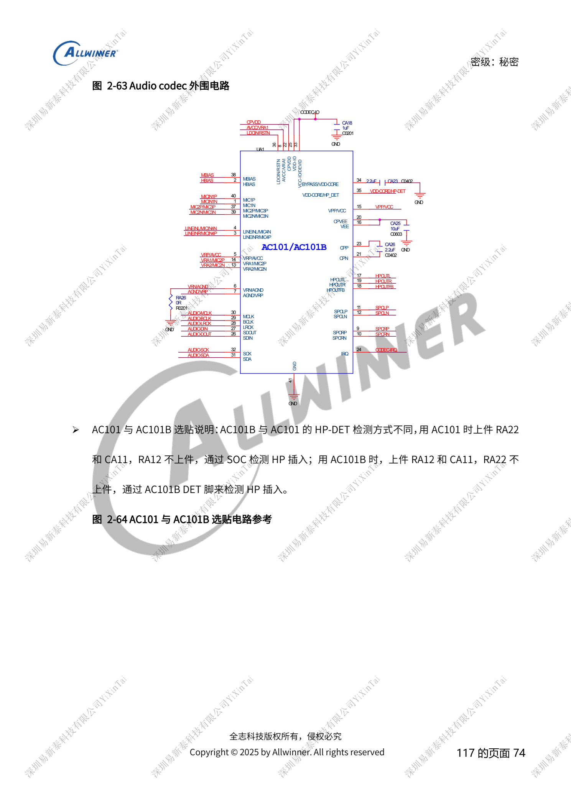
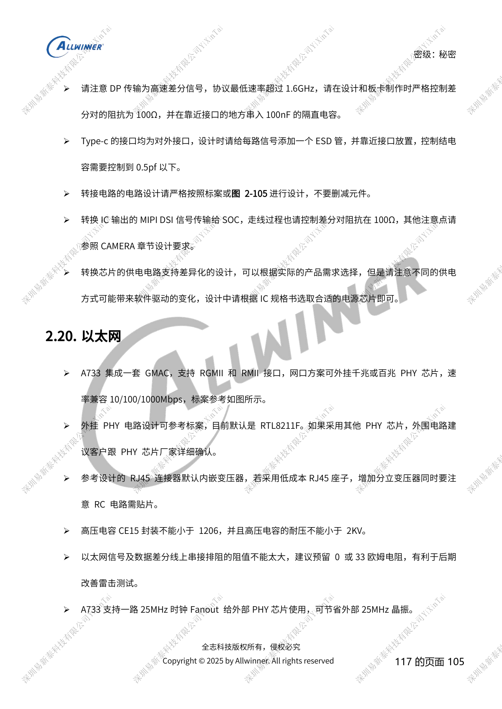
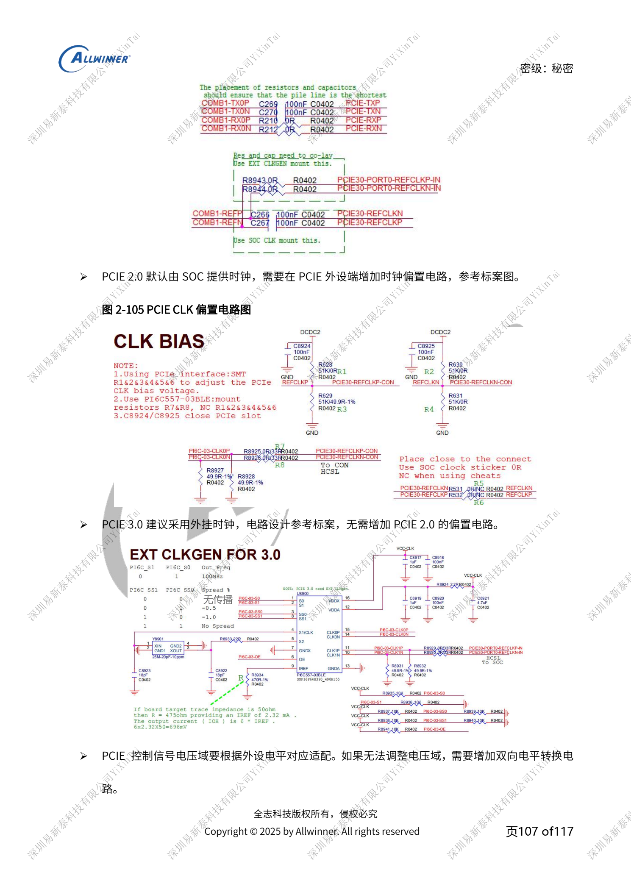

# A733 外围设计：USB、PCIe、Wi-Fi、以太网和音频

本文是依据所列原稿重组的硬件设计专题，属于平台参考，未确认对应 ArmSoM 板卡。参数是原稿参考，不是 ArmSoM 实测；实施前核对芯片版本、PCB、所用 SDK/BSP、内核、固件及外设规格。

A733 来源为 V0.9 草案，参数及软件支持可能调整；不能作为最终量产承诺。

**Design draft V0.9 §2.7–2.9, §2.14, §2.16–2.17, §2.20–2.21; PDF 65–80, 96–97, 101–108**

## USB 控制器与 PCIe 时钟

USB0/1 是 USB2.0，USB2-U3 为最高 10Gbps 的 USB3.1 路径；USB0/2 支持 OTG，USB1 仅 HOST，固件下载使用 USB0。USB0/1 支持休眠唤醒，USB2 不支持。标准 Type-C 为 USB0+USB2-U3，SuperSpeed 可选 COMB0/1，默认 COMB0。不要把 USB2 的控制器编号当成协议代际。USB2 DP/DM 防护参考 <5pF，SuperSpeed <1pF；通用 USB2 90Ω走线不能直接套到图中 95Ω 的共享高速对。PCIe 为单 lane 2.0/3.0：2.0 默认 SoC 时钟并在外设端加偏置，3.0 建议外部时钟，不套用 2.0 偏置。

## 无线、以太网和传感器

Wi-Fi SDIO 电平匹配 PG，唤醒中断匹配 PM；32KFOUT 的 1.8V 上拉不能在待机断电。PCM 的 DOUT/DIN、UART 的 TX/RX 和 RTS/CTS 交叉，时钟同步同名连接。天线预留 π 匹配，新板需做传导与匹配测试；SDIO CLK 串 33Ω，D0–D3 对 CLK <500mil。GMAC 外挂 PHY，参考 RTL8211F，25MHz 可由 SoC 扇出，RJ45 无内置变压器时需外加。传感器 VCC 与 IOVCC 分别核对，同总线地址避免冲突，待机传感器保持供电并把中断放 PL。GPS 参考模块需核对射频 50Ω、启动电流与复位防反灌，不是 SoC 内置卫星接收器。

## 音频从回流与使能开始

AC101 为两 ADC/两 DAC，AC101B 为三 ADC/两 DAC，耳机检测选件不同；AEC 参考 AC107。非 TWI 功放 EN 默认下拉防 POP，大功率功放不接 PMU PS/DCIN；使用 VBAT 时需接电量采样后级。HPOUTFB 接地点靠耳机座，耳机 L/R 不串磁珠，无耳机而外接功放时仍需保持反馈和 RC。Type-C 模拟音频 switch 默认 USB 路径保证烧录，需要待机唤醒时 switch 也必须常供电；带 DP 参考 BCT4690，不能直接用不兼容的 WAS4766C。所有这些选件与软件检测极性一起验证。

## 参考原图

以下为中文原稿参考页截图，保留原图标注；本批未找到对应英文稿，四语共用中文原图。正文参数与步骤可复制，截图用于核对。页码均为 PDF 物理页码。

## ArmSoM 平台选择

如果项目考虑采用 ArmSoM，可从官方产品与开发文档选择平台，并重新核对处理器、接口与软件支持；本文不将 A733/H618 电路套用到其他 SoC。

- [ArmSoM](https://www.armsom.org/)
- [ArmSoM Docs](https://docs.armsom.org/)

## 系列阅读

- [A733 电源系统：AXP318W、上下电与充电路径](/zh/articles/a733-power-sequence-pmic-design/)
- [A733 存储设计：LPDDR4/4X/5、eMMC 与 UFS](/zh/articles/a733-ddr-emmc-ufs-design/)
- [A733 时钟与恢复：26MHz、GPIO 电源域和 FEL](/zh/articles/a733-clock-gpio-recovery-design/)
- [A733 显示与摄像头：接口复用、供电和视频输入桥接](/zh/articles/a733-display-camera-interface-design/)
- [A733 可靠性设计：ESD、EMI、浪涌与散热审查](/zh/articles/a733-esd-emi-thermal-review/)
- [A733 · 系列导航](/zh/articles/a733-hardware-design-series/)
