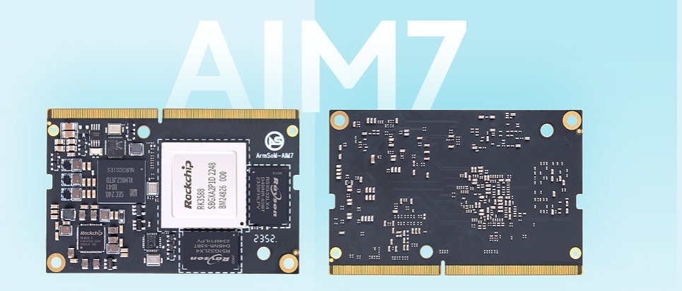

如果项目原本采用 Jetson Nano 或某个 Jetson Orin 模块，ArmSoM AIM7 可以作为重新评估平台的一种选择。它使用 RK3588，把通用 CPU、图形与 NPU 分开承担任务。是否适合替代，应由模型、外设、软件依赖与整机指标共同决定。

## Nano 与 Orin 不能混成一种兼容性

AIM7 官方文档介绍 260-pin SO-DIMM 形态及 Jetson Nano 相关兼容路径，同时要求按具体载板核对引脚、供电和外设。**相同连接器不是所有底板直接兼容的证明。**

“Orin”包含 Orin Nano、Orin NX、AGX Orin 等不同产品。本文没有将 AIM7 宣称为这些模块的通用插拔替代品；应先明确型号，再核对载板。对没有确认的组合，推荐使用已验证的 AIM7 配套底板完成软件评估。

## 哪些项目值得评估 AIM7

适合优先验证的是：业务逻辑主要运行在 Linux CPU 上，AI 模型可导出并转换，摄像头与显示方案有替换空间，且目标性能可以通过真实样本验收的终端。视觉分类、目标检测、信息终端和视频事件分析都可作为评估方向。

若核心功能强依赖自定义 CUDA 算子、TensorRT 插件或特定 NVIDIA 软件链路，迁移工作会显著增加。不能只比较模块价格而忽略重新开发、测试与维护成本，也不应承诺 AIM7 与任意 Orin 型号性能等价。

## 从 TensorRT 到 RKNN，要迁移什么

| 原项目部分 | AIM7 评估路径 |
|---|---|
| Python/C++ 业务逻辑 | 在目标 Linux 环境重新构建和测试依赖 |
| 原始训练模型 | 使用支持的模型格式导出，再用 RKNN-Toolkit2 转换 |
| TensorRT engine / CUDA 算子 | 不能直接当 RKNN 模型使用；重做后端与算子适配 |
| 相机、显示、视频管线 | 核对 Rockchip 驱动和相应硬件加速接口 |
| 容器部署 | 重建匹配架构、库和设备访问方式的镜像 |

RKNN 官方流程是在开发机转换模型，再在目标板通过 C/C++ 或 Python 接口执行。转换成功只是第一步，还需要检查不支持的算子、量化精度、预处理一致性和后处理结果。

## 用同一份测试集决定是否迁移

1. 固定原 Jetson 型号、软件版本和实际业务输入。
2. 记录原系统准确率、P50/P95 延迟、吞吐、内存与整机功耗。
3. 在 AIM7 上使用相同输入和判定标准，先比较输出，再比较速度。
4. 加入相机、网络、保存和显示，测完整链路而非单次推理。
5. 验证长时间负载、异常恢复、升级和回滚。

这里没有提供虚构的替代性能比，也没有把不同精度、稀疏条件或功耗档位下的 TOPS 相除作为结论。AIM7 的价值要通过项目可接受的结果体现。

## 下一步

先提交模型结构、输入尺寸、外设清单、现有 Jetson 型号和关键性能目标，再选择 AIM7 与匹配底板开展验证。如果目标仍在变化，可用 Sige7 做 RK3588 软件原型；如果最终需要焊接式核心板集成，再评估 LM7。

## 系列文章与产品入口

- [RK3588 芯片详解：八核 CPU、6 TOPS NPU 与高速扩展如何落地](/zh/articles/rk3588-chip-guide/)
- [Sige7 与 LM7：从 RK3588 应用原型到定制产品的六种方案](/zh/articles/sige7-lm7-rk3588-applications/)
- [RK3588 Datasheet V1.4 下载与解读：框图、封装与电气设计](/zh/articles/rk3588-datasheet-v14/)
- [ArmSoM AIM7](https://docs.armsom.org/armsom-aim7) · [Sige7](https://docs.armsom.org/armsom-sige7) · [LM7](https://docs.armsom.org/armsom-lm7)

## 参考资料

- [Rockchip RK3588](https://www.rock-chips.com/a/en/products/RK35_Series/2022/0926/1660.html)
- [ArmSoM AIM7](https://docs.armsom.org/armsom-aim7)
- [ArmSoM Sige7](https://docs.armsom.org/armsom-sige7)
- [ArmSoM LM7](https://docs.armsom.org/armsom-lm7)
- [NVIDIA Jetson modules](https://developer.nvidia.com/embedded/jetson-modules)
- [RKNN-Toolkit2](https://github.com/airockchip/rknn-toolkit2)
