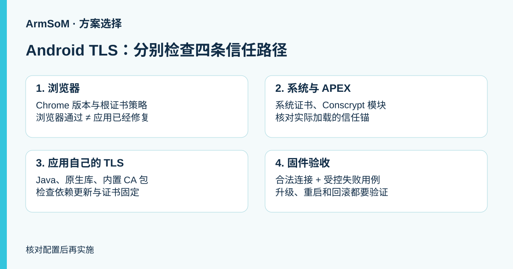

**Android 证书维护的关键，不是找到两个文件后删除，而是确认每条业务连接使用哪套信任库，并把修复交付到设备。** 同一台 ArmSoM Android 设备上的 Chrome、系统 TLS 和带独立证书包的应用，可能采用不同的更新路径。

本文面向维护定制 Android 固件的团队。命令用于授权设备与 SDK 的核查，不代表已经在某款 ArmSoM 镜像上完成安全验证。用户提供的文章是问题线索，具体处置应以厂商公告、目标分支及应用依赖为准。



## 1. 事件事实与处置边界

Google 的公告确认 eMudhra 中间 CA 密钥问题，并说明 Chrome 与 Android 分别通过相应机制阻断受影响密钥。其范围不能等同于“所有 Android 应用都已经更新”。公告后续仍有策略更新，发布固件前应重新核对。[Google 安全公告](https://blog.google/security/protecting-chrome-and-android-users-from-compromised-emudhra-intermediate-ca-certificates/)

这里必须区分四种对象：根证书、中间证书、证书公钥以及最终站点证书。交叉签名可能让同一公钥出现在不同证书链中；按 SPKI 阻断与删除某个根证书，影响范围也不同。

原截图建议删除 `b74d2bd5.0` 和 `75680d2e.0`，分别指向其环境里的 emSign ECC Root CA - G3 与 AAA Certificate Services。**不能把这两个文件名当作适用于所有镜像的通用删除清单。** 尤其 AAA 根还可能服务于其他合法链，应由 BSP 维护者评审有效阻断方式及兼容性影响。

## 2. 先建立设备与业务清单

```bash
adb devices
adb shell getprop ro.build.fingerprint
adb shell getprop ro.build.version.release
adb shell getprop ro.build.version.security_patch
adb shell pm list packages com.google.android.gms
adb shell ls -ld /system/etc/security/cacerts
adb shell ls -ld /apex/com.android.conscrypt/cacerts
```

记录执行错误，不能把“无权限读取”或“路径不存在”当成安全结论。Android 版本与安全补丁日期只是识别线索，实际模块和供应商回补可能不同。Android 14 起还需要关注可更新的 Conscrypt 根证书存储，不能只检查 `/system`。[AOSP Conscrypt](https://source.android.com/docs/core/ota/modular-system/conscrypt)

| 连接类型 | 核查对象 | 验收方式 |
| --- | --- | --- |
| Chrome 打开的网页 | 浏览器版本、根证书策略与阻断更新 | 在目标浏览器验证 |
| Java/Kotlin 系统 TLS | 系统安全提供者、APEX、应用网络配置 | 用实际应用发起请求 |
| 原生或跨平台组件 | 内置 TLS 库、CA bundle、依赖版本 | 用同一库执行正反用例 |
| 企业私有服务 | 私有 CA、证书固定、轮换机制 | 验证正常服务与备用证书 |

安装了 `com.google.android.gms` 只能说明包存在，不证明更新已送达，也不覆盖所有自带 TLS 的应用。Firebase 对受影响组件的说明也要求检查应用依赖，而不只看操作系统更新。[Firebase 处置说明](https://firebase.google.com/support/guides/compromised-emudhra-intermediate-ca)

## 3. 用指纹和公钥识别证书

在工作站上检查从目标 SDK 或系统公共证书目录取得的候选证书。下面的 `candidate.pem` 是待核对文件，不是下载某张新根并安装的操作。

```bash
openssl x509 -in candidate.pem -noout \
  -subject -issuer -serial -dates -fingerprint -sha256
openssl x509 -in candidate.pem -noout -subject_hash_old
openssl x509 -in candidate.pem -pubkey -noout |
  openssl pkey -pubin -outform DER |
  openssl dgst -sha256
```

第一条输出证书 SHA-256 指纹；第三条输出公钥 SPKI 的 SHA-256。两者不能混用。将结果与公告或维护者提供的准确列表比对。文件名中的 subject hash 不是唯一身份：同主体证书、哈希碰撞和编号后缀都需要考虑。[OpenSSL x509 文档](https://docs.openssl.org/3.0/man1/openssl-x509/)

对 SDK 先查文件位置，再逐个解析，不要只搜索文件名里的 `emudhra`：

```bash
export SDK_ROOT=/path/to/android-sdk
find "$SDK_ROOT/system/ca-certificates" \
  "$SDK_ROOT/external/conscrypt" \
  -type f \( -name '*.0' -o -name '*.pem' -o -name '*.crt' \) -print
```

不同分支目录可能不同；缺失目录需要调整到真实源码位置。仅检查源码也不够，还要核对最终镜像和实际运行模块，避免修改了未参与构建的证书副本。

## 4. 把修复做进可维护的更新链

1. 固定固件版本与受影响业务清单，保存原始公共证书指纹和构建记录。
2. 优先采用匹配分支的供应商补丁或安全组件更新，明确是根信任调整、中间证书阻断还是应用依赖升级。
3. 检查 system、APEX 与应用独立 bundle 的覆盖范围，确认签名、AVB 与 OTA 路径。
4. 在测试机先回归业务，再分批部署；保留失败恢复方案和版本追踪。

不把关闭证书验证、TrustAll、忽略主机名校验当作兼容性修复。应用级证书固定也需要轮换、备用密钥和故障处理设计，不能简单“固定一张证书就永久安全”。应用信任锚可通过 [Android Network Security Configuration](https://developer.android.com/privacy-and-security/security-config)配置，但这不自动修复其他进程。

## 5. 文件检查之后，还要验证实际连接

可以先在工作站观察自己的服务器发送的链：

```bash
openssl s_client -connect your-server.example:443 \
  -servername your-server.example -showcerts \
  -verify_hostname your-server.example -verify_return_error </dev/null
```

将占位域名替换为自己管理的服务。服务器通常不发送根证书；显示的链顺序或最后一项 issuer 不能单独证明设备最终选择的信任路径。工作站结果也不能替代 Android 应用结果。

| 检查 | 应记录的证据 |
| --- | --- |
| 合法 HTTPS 连接 | 应用、TLS 库、域名、时间与结果 |
| 受控无效链/错误主机名 | 实验环境中必须拒绝，不能依赖文件消失判断 |
| 升级与重启 | 更新组件仍有效，未回退旧信任库 |
| 恢复与业务兼容性 | 恢复出厂、备用证书、OTA 服务和时间同步 |

无需攻击公共站点来验证。没有现成受影响站点，也不意味着只能做文件检查：维护者可以在受控实验环境构造策略测试，并用实际业务应用验证失败处理。离线设备同样需要记录未来联网、维修和更新通道的信任维护方式。

本文根据[提供的 Android CA 文章](https://mp.weixin.qq.com/s/URwEId_RlZYRRrHSUy5Jig)重新组织，并以官方资料修正通用删除、GMS 覆盖和验证范围的结论。这里没有执行设备证书删除或宣称某款固件已修复。

## 适用产品与继续阅读

ArmSoM 项目可从 [Sige7](https://www.armsom.org/sige7)、[AIM7](https://www.armsom.org/aim7)、[LM7](https://www.armsom.org/lm7) 的 RK3588 平台，或 [CM5](https://www.armsom.org/cm5)、[Sige5](https://www.armsom.org/sige5) 的 RK3576 平台开始评估。接口与系统支持请分别查阅 [Sige7 文档](https://docs.armsom.org/armsom-sige7)、[CM5 文档](https://docs.armsom.org/armsom-cm5)、[Sige5 文档](https://docs.armsom.org/armsom-sige5)。产品链接用于选型，不代表这些板卡已验证本文全部 SDK 组合。
