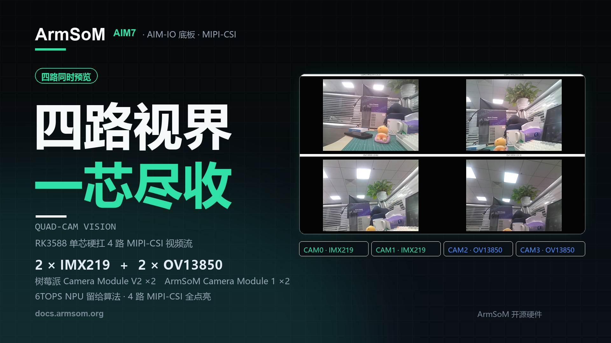
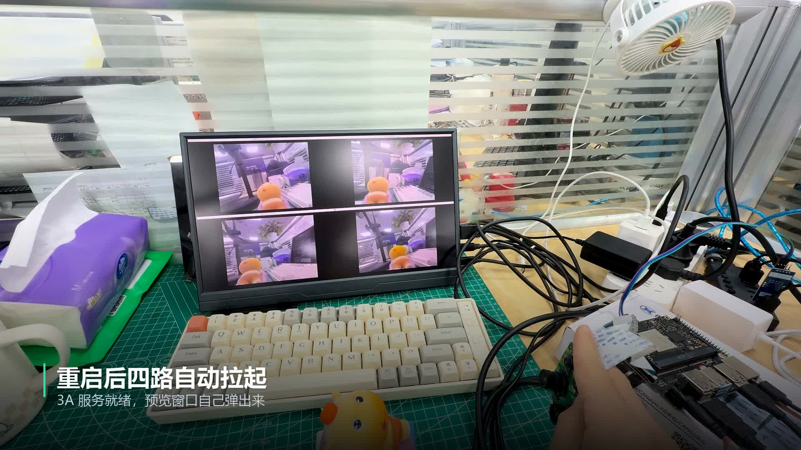

四颗摄像头、四个视角，同时出现在一块屏幕上。ArmSoM 这次用 **AIM7 核心板 + AIM-IO 底板**，接入两颗 IMX219 和两颗 OV13850，让四路 MIPI-CSI 图像在同一套 RK3588 平台上同时预览。

对机器人、工业视觉和多机位原型开发来说，这是一项实用的起点：先把多个视角接入、看清、调好，再接入自己的采集、分析与控制程序。



## 先看演示：从配置到四个预览窗口

<video controls playsinline preload="metadata" width="1920" height="1080" poster="/assets/armsom-aim7-four-camera-preview/cover.jpg" style="display:block;width:100%;height:auto;aspect-ratio:16/9;margin:1.5rem auto;background:#101820" aria-label="AIM7 四路摄像头同时预览：用 RK3588 搭建多视角视觉原型">
  <source src="/assets/armsom-aim7-four-camera-preview/demo.mp4" type="video/mp4">
  <a href="/assets/armsom-aim7-four-camera-preview/demo.mp4">下载或播放原始演示视频</a>
</video>

*约 34 秒的 ArmSoM 原始演示视频，保留中文画面标注。视频依次展示官方文档、启动预览程序和四路现场画面。*

画面中，上排两个窗口来自 IMX219，下排两个窗口来自 OV13850。移动镜头前的玩偶，可以观察同一物体在不同机位下的位置、大小与遮挡变化。它适合用来检查镜头布局和视野覆盖，而不只是确认某一颗摄像头“能出图”。

## 这套四路摄像头方案由什么组成？

| 部分 | 本次演示配置 | 作用 |
| --- | --- | --- |
| 计算平台 | ArmSoM AIM7，Rockchip RK3588 | 运行摄像头驱动、图像处理与预览程序 |
| 底板 | AIM-IO | 引出摄像头、显示及其他接口 |
| 上排摄像头 | 2 × Raspberry Pi Camera Module V2，IMX219 | 提供两路观察视角 |
| 下排摄像头 | 2 × ArmSoM Camera Module 1，OV13850 | 提供另外两路观察视角 |
| 显示 | 1920 × 1080 屏幕，四个等大窗口 | 保持各路画面比例并排查看 |
| 预览输出 | 每路 ISP 输出缩放至 640 × 480 | 用于本示例的多窗口预览 |

AIM7 的 RK3588 集成四核 Cortex-A76、四核 Cortex-A55，以及最高 6 TOPS（INT8）NPU。具体接口由底板引出；这里讨论的是 **AIM7 与 AIM-IO 的演示组合**，不能把摄像头接线和系统配置直接套用到任意底板。[AIM7 产品与规格](https://www.armsom.org/aim7)

[](/assets/armsom-aim7-four-camera-preview/demo-still.png)

*原始素材中的实物搭建与四路预览画面，保留现场接线及屏幕内容。*

## 同时预览的参数，应当怎样理解？

本次配置中，官方文档记录 **IMX219 约 15 FPS、OV13850 约 25 FPS**。这些数字对应演示使用的图像模式、软件和显示方式，不是四路满分辨率录像的性能承诺，也不是 AI 模型推理帧率。[四路预览官方说明](https://docs.armsom.org/zh/armsom-aim7#aim-io-四路摄像头同时预览)

同时在屏幕上显示多个画面，并不等于四颗传感器实现了硬件级帧同步。双目测量、快速运动分析、拼接或融合类项目，还需要单独评估时间戳、曝光、触发机制、标定与端到端延迟。

本视频展示了摄像头接入和预览，没有展示 AI 识别结果、长时间稳定性测试或多路录制吞吐。项目进入下一阶段时，应在自己的分辨率、帧率、散热和算法负载下验证这些指标。

## 复现路线：先确认节点，再运行预览

1. 准备 AIM7、AIM-IO、对应摄像头模组、匹配的排线、显示器和电源；连接摄像头排线前断电。
2. 按 AIM7 文档选择匹配镜像。在 `/boot/uEnv/uEnvarmsom-aim7-io.txt` 中按官方接线说明启用四路摄像头 overlay，重启后确认识别结果。
3. 检查 IMX219 模组名称与 `imx219_rpi-camera-v2_default.json` 配置是否匹配，并确认 3A 服务正常。
4. 从官方文档下载四窗口脚本，在板端的**图形桌面终端**进入脚本目录，按文档运行。这个 GTK 多窗口示例需要图形会话，纯 TTY 登录本身不会提供桌面窗口。

以下为官方预览说明中的启动命令；安装依赖需要可用的软件源：

```bash
sudo apt-get install -y python3-gi gir1.2-gtk-3.0 gir1.2-gstreamer-1.0 gir1.2-gst-plugins-base-1.0
sudo systemctl restart rkaiq_3A.service
python3 aim7-four-camera-preview.py
```

用 `Ctrl+C` 结束预览。官方示例中的 `/dev/video53`、`/dev/video62`、`/dev/video44`、`/dev/video71` 是该次配置的节点，不能假定所有镜像都相同。先用 `v4l2-ctl --list-devices` 查看设备，再用 `media-ctl -p` 或指定对应 media 设备检查拓扑，按实际 ISP 输出调整脚本。官方说明也明确表示，这个四路示例尚未在 AIM5 上验证。

## 从四个视角出发，可以做哪些项目？

### 机器人与移动设备：先验证看得见什么

把摄像头放在不同方向，检查机身结构是否遮挡视野、目标经过不同区域时能否持续被观察。多窗口预览可以帮助团队调整安装位置，再决定后续是否需要识别、跟踪或多传感器融合。

### 工业视觉原型：观察同一物体的不同表面

将不同机位对准工件的正面、侧面或装配区域，先验证照明、焦距与摆放方式。实际缺陷检测仍需要样本采集、算法验证和触发设计，视频本身没有给出检测精度或产线节拍。

### 教学与研发：理解从传感器到应用的链路

两种传感器同平台接入，适合围绕设备树、V4L2 节点、ISP、3A 与 GStreamer 开展实验。可以逐步比较单路和多路运行状态，再加入保存图片、录像或其他应用功能。

### 边缘 AI：在采集验证后接入推理

采集稳定后，可参考 [ArmSoM RKNN 开发指南](https://docs.armsom.org/advanced-manual/rknn-sdk)部署受支持的模型。建议先验证单路模型的正确性和延迟，再增加路数，记录完整链路的处理速度。6 TOPS 是硬件算力指标，具体模型仍取决于算子、量化方式、输入尺寸和资源调度。

## 从演示走向你的视觉项目

如果你的项目需要多个观察角度，可以先用这套演示检查相机布局和软件链路，再按实际需求设计采集与算法流程。

- [了解 ArmSoM AIM7 产品](https://www.armsom.org/aim7)
- [查看 AIM7、AIM-IO 接口与四路摄像头教程](https://docs.armsom.org/zh/armsom-aim7#aim-io-四路摄像头同时预览)
- [查看 RKNN 模型部署指南](https://docs.armsom.org/advanced-manual/rknn-sdk)
- [了解 Server 镜像的本地终端使用方法](/zh/articles/armsom-server-hdmi-tty-console/)

选型或项目合作可联系 [sales@armsom.org](mailto:sales@armsom.org)，并说明摄像头数量、目标分辨率、是否需要同步以及后续算法需求，便于围绕完整系统评估方案。
