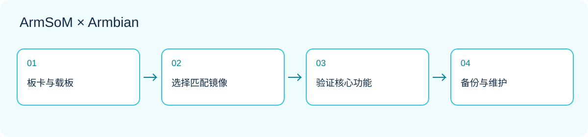

*开发流程示意：先匹配硬件和镜像，再验证应用与维护。*

一块开发板的价值，不只在处理器和接口，也在于你能多快把它变成可重复运行的项目。ArmSoM 提供板卡与硬件资料，Armbian 为多个具体平台提供 Linux 镜像和构建配置。对习惯 Debian 或 Ubuntu 的开发者，这是一条值得尝试的开发路线。

本系列面向首次使用 ArmSoM 的开发者，以及准备搭建桌面、家用服务或嵌入式原型的团队。以下操作是开发建议，未在本文中做硬件实测；选择镜像时应以目标板卡页面当日的信息为准。

## 1. 先认识这套组合

可以把系统拆成三层：ArmSoM 板卡提供计算、供电和连接；启动程序、内核与设备树负责让硬件工作；Linux 用户空间承载应用、包管理和服务。Armbian 把其中多个环节组织成可下载或自行构建的系统。它不是让所有 ARM 板通用的一份镜像，同芯片也不代表不同载板可以直接互刷。

熟悉的 Linux 工具让学习可以积累：先通过 SSH 管理一块板，再为它增加数据采集、网页面板或后台服务。应用配置与业务代码可以版本化，但硬件适配仍需按具体型号处理。

## 2. 哪些 ArmSoM 平台有入口

截至本次核对，Armbian 厂商目录列出 Sige1、Sige3、Sige5、Sige7、AIM7 IO、CM5 IO、CM5 CM4 IO、CM7s IO、W3 和 Forge1。这是平台/载板条目，不是十种互相通用的镜像。[查看当前目录](https://armbian.com/vendors/armsom)。

这些条目标注 Community。按 Armbian 的支持规则，社区镜像不具有 Standard 级别的测试和维护承诺；项目方不保证对社区板卡问题提供修复。下载存在、系统能够启动、全部外设可用，是三个不同结论。[支持等级说明](https://docs.armbian.com/contribute/board-support-rules/)。

## 3. 按任务选镜像，而不是只看版本号

| 先回答的问题 | 对选择的影响 |
|---|---|
| 要接屏幕操作吗？ | 桌面镜像便于交互；无屏服务可从命令行开始 |
| 哪个应用不可缺少？ | 先核对软件架构、依赖和目标发行版 |
| 需要摄像头、NPU或视频加速吗？ | 单独确认驱动、运行库和应用接口 |
| 是否长期运行？ | 需要更新策略、备份和恢复方法 |
| 载板与硬件版本是什么？ | 决定应选择哪个板级镜像 |

Armbian 区分 vendor、current、edge 等内核分支；它们反映不同维护路线，不是从低到高的性能排名。Minimal 与 Desktop 又是另一维度。官方将 edge 与 rolling 定位为测试用途，不应直接用于生产环境。具体选择参考[镜像说明](https://docs.armbian.com/getting-started/choosing-an-image/)，并保留下载时的完整文件名与分支。

## 4. 从下载到首次启动

先准备符合板卡要求的电源、可靠的存储介质和恢复方案。通过对应板卡页面取得镜像与校验信息，使用 Armbian Imager 或官方说明中的工具写入。写入会覆盖目标介质，确认设备容量与名称，先备份原有数据。不要把复制镜像文件到普通分区当作烧录完成。

首次启动先保持连接简单：电源、启动介质、有线网络，必要时加屏幕或正确电平的串口。按照当前镜像的首次登录流程创建账户，不沿用网上旧教程中的固定密码。先确认基础启动，再连接摄像头、USB集线器等外设。[官方入门流程](https://docs.armbian.com/getting-started/)。

## 5. 给系统留一份基线记录

下面的命令用于只读检查。它们不会测试全部外设，也不代表性能成绩。记录输出时注意删除主机名、地址等不需要公开的信息。

```sh
cat /etc/os-release
uname -r
uname -m
free -h
lsblk -o NAME,SIZE,TYPE,FSTYPE,MOUNTPOINTS
ip -br address
systemctl --failed
```

把结果与板卡版本、供电、存储型号、镜像文件名一起保存。以后发生故障，先问“与上一次正常运行相比改变了什么”，比直接重装更容易定位原因。某条命令不存在时，核对该镜像的软件包和初始化系统，不据此判定硬件损坏。

## 6. 用一个小项目完成闭环

建议先搭建一个只在局域网访问的设备状态页：读取温度或业务状态，显示更新时间，记录服务重启。第一阶段只用模拟数据验证页面和日志；第二阶段再接入实际传感器，确认接口电平和驱动；第三阶段处理断网、异常值与重启恢复。

这样可以把硬件问题、应用问题和网络问题分开。完成后再扩展为 MQTT 数据节点、自动化控制台或文件服务。先设定一个可衡量的目标，例如断网恢复后不重复提交同一条记录，而不是同时装入许多服务。

## 7. 把能启动推进到能维护

应用数据与系统镜像分开备份，限制日志容量，并记录依赖版本。更新前先在备用介质或测试机验证启动、网络和核心外设；有恢复路径再更新长期运行的设备。不要为了保持版本不变而永久忽略安全更新，而应安排可验证的维护窗口。

如果出现黑屏，先区分“没有桌面”与“没有启动”，检查网络或串口。反复重启先排查供电与介质；只有特定设备失败时，再检查其日志、设备树和软件栈。向社区反馈应提供可复现步骤、硬件版本与精简日志，避免只写“不工作”。

## 8. 选择下一步的平台

希望快速连接屏幕、网络和存储，可以从 [Sige5](https://www.armsom.org/sige5) 或 [Sige7](https://www.armsom.org/sige7) 开始；需要把计算模块嵌入自己的载板，则查看 [CM5](https://www.armsom.org/cm5)。产品选择与镜像选择一起完成，先验证关键接口，再增加复杂功能。

## 继续阅读本系列

- [Sige5 / Sige7 + Armbian：六种值得动手的 Linux 应用方案](/zh/articles/sige5-sige7-armbian-projects/)
- [CM5 + Armbian：从计算模块原型到定制 Linux 设备](/zh/articles/cm5-armbian-custom-device/)
