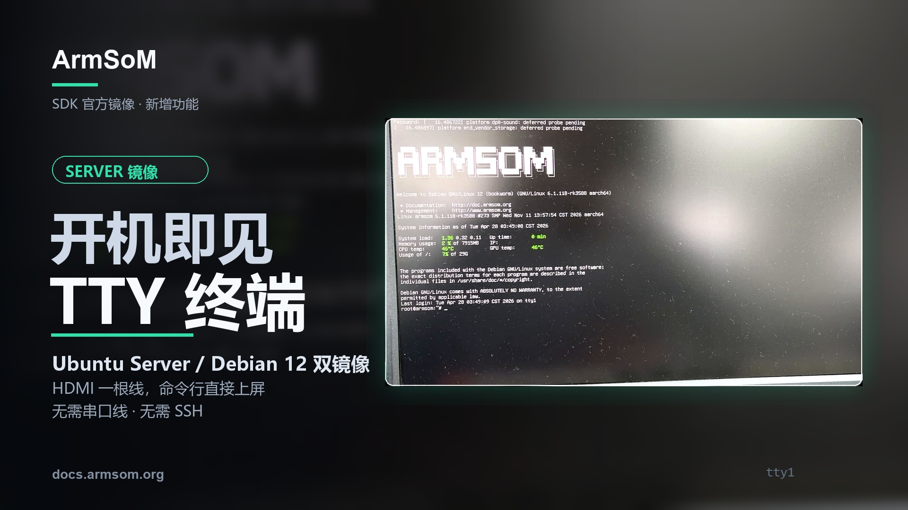
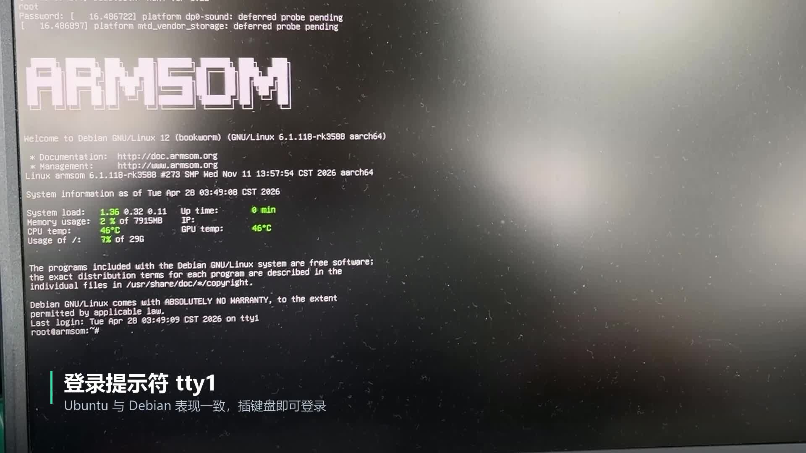

刚把 Server 镜像烧进开发板，还不知道 IP，网络也没有配置好，怎样完成第一次登录？ArmSoM 这套演示提供了一个直观的入口：**HDMI 接显示器，USB 接键盘，在本地 TTY 登录后直接操作 Linux。**

本篇依据 ArmSoM 提供的 Server 宣传稿与实拍视频，介绍 Ubuntu Server / Debian 12 镜像的本地终端使用方式。视频中的终端画面明确显示 Debian 12；素材说明也涵盖 Ubuntu Server。具体支持机型、镜像版本和默认账户请以对应产品下载说明为准。



## 从通电到命令行，视频里看到了什么？

<video controls playsinline preload="metadata" width="1920" height="1080" poster="/assets/armsom-server-hdmi-tty-console/cover.jpg" style="display:block;width:100%;height:auto;aspect-ratio:16/9;margin:1.5rem auto;background:#101820" aria-label="ArmSoM Server 本地终端：HDMI 接屏，USB 键盘直接登录 Linux">
  <source src="/assets/armsom-server-hdmi-tty-console/demo.mp4" type="video/mp4">
  <a href="/assets/armsom-server-hdmi-tty-console/demo.mp4">下载或播放原始演示视频</a>
</video>

*约 20 秒的原始演示视频，保留中文画面标注。它展示 HDMI 启动信息、系统服务启动过程，以及 Debian 12 登录后的 Shell 提示符。*

启动时，屏幕上的文字让你看到系统正在推进到哪个阶段；到达登录提示后，使用键盘输入账户和密码即可进入本地 Shell。拍摄画面中还能看到 ArmSoM 标识、系统版本与状态信息。

这对首次上手很有帮助：不用先把 SSH 连通，也能检查系统、查看网络地址和进行初始配置。视频经过剪辑，其 20 秒片长不是设备冷启动耗时测试；画面中的负载、温度和时间也只是当时显示的状态。

## TTY、SSH 和桌面分别适合什么？

TTY 在本例中是本地文本控制台，登录后可以执行 Linux 命令。`tty1` 表示这套演示使用的虚拟控制台；具体镜像也可能采用其他控制台配置。

| 方式 | 使用条件 | 适合的任务 |
| --- | --- | --- |
| HDMI + USB 键盘的本地 TTY | 镜像支持显示输出与本地登录，板卡有可用接口 | 初次登录、检查网络、现场查看日志 |
| SSH | 网络可达，SSH 服务可用，账户有效 | 远程维护、部署和日常管理 |
| 图形桌面 | 安装并启用了对应桌面与显示驱动 | 窗口程序、图形工具、桌面交互 |

没有桌面并不妨碍本地执行命令，但 TTY 也不会自动提供浏览器或图形窗口。需要运行图形摄像头预览等程序时，应选择支持相应图形环境的镜像。

[](/assets/armsom-server-hdmi-tty-console/demo-still.png)

*实拍中的 Debian 12 本地终端。屏幕显示的是该次演示环境，不代表所有板卡和镜像都采用同一内核、账户或状态数值。*

## 第一次使用，准备这几样东西

- 与板卡型号匹配、支持 HDMI 本地控制台的 ArmSoM 官方 Server 镜像。
- 已按产品说明写入系统的启动介质。
- HDMI 显示器和匹配的线缆；使用具有显示输出能力的接口。
- 接到 USB Host 口的键盘，以及符合板卡要求的电源。

先确认显示器输入源和线缆，再给板卡通电。登录时使用该镜像的账户说明；输入密码时没有可见字符通常是 Linux 终端的正常行为。首次登录后，按项目要求修改默认凭据。

下载入口与烧录方式可以从 [ArmSoM 镜像资源说明](https://docs.armsom.org/getting-start/cloud-disk)和[系统启动与登录文档](https://docs.armsom.org/getting-start/startup)继续查看。不要仅根据文件名里有 Ubuntu 或 Debian 就认为镜像适用于所有产品。

## 登录后，先做一轮只读检查

下面是通用 Linux 检查示例，不是视频中的测试输出。请在开发板终端逐条执行；命令是否可用取决于镜像安装的工具。`systemctl` 适用于使用 systemd 的系统。

```bash
cat /etc/os-release
uname -r
tty
ip -br address
df -h
free -h
systemctl --failed --no-pager
```

| 检查项 | 可以了解到什么 |
| --- | --- |
| 系统与内核 | 实际发行版、版本和内核，便于匹配文档 |
| 当前终端 | 当前会话是否处于本地 TTY |
| 网络地址 | 是否拿到可用于后续远程连接的地址 |
| 磁盘与内存 | 基本空间和资源状态 |
| 失败的服务 | 是否有需要进一步查看日志的启动问题 |

有了实际网络地址，再按官方文档配置远程访问。这样可以先在设备旁完成初始化，随后切换到远程维护，不必把“能否登录”与“网络是否已经配置正确”绑在一起。

## 三种值得用起来的场景

**开发台上的首次启动。** 接上显示器观察系统过程，核对版本、存储与网络，再开始部署应用。教学时也可以把终端投到大屏，边操作边解释每一步。

**项目现场的初始配置。** 新设备尚未加入目标网络时，先通过本地键盘检查配置与状态。涉及网络切换时，本地操作入口也能帮助避免失去远程连接后无法继续配置。

**服务异常时的现场排查。** 在系统仍能启动且本地控制台可用的情况下，直接登录查看服务和日志。若故障发生在显示驱动初始化之前，或者系统没有进入可登录状态，仍可能需要串口调试；HDMI TTY 并不替代所有底层排障工具。

## 看不到登录提示时，按层检查

先检查供电、显示器输入和 HDMI 接口方向，再核对板卡型号、镜像和启动介质。如果已经有系统信息，但没有可用登录提示，应检查该镜像的控制台配置；如果键盘无法输入，确认连接的是 USB Host 接口。

Server 与桌面镜像的表现可能不同，不能据此认定板卡故障。向技术支持反馈时，附上机型、镜像文件名、显示器连接方式和可见报错，会比只描述“黑屏”更容易定位。

## 把本地终端接入你的开发流程

本地 TTY 的价值在于让第一次登录和现场操作更直接。选择平台时，可以同时评估显示、USB、网络和后续应用接口，再选匹配的系统镜像。

- [浏览 ArmSoM 产品与开发平台](https://www.armsom.org/)
- [了解 AIM7 与 AIM-IO 开发组合](https://www.armsom.org/aim7)——购买或部署前核对所需 Server 镜像与底板支持
- [镜像资源与下载说明](https://docs.armsom.org/getting-start/cloud-disk)
- [启动、登录与远程访问说明](https://docs.armsom.org/getting-start/startup)
- [从终端走向视觉开发：AIM7 四路摄像头案例](/zh/articles/armsom-aim7-four-camera-preview/)

如果需要为项目选择镜像或开发平台，可以联系 [sales@armsom.org](mailto:sales@armsom.org)，说明设备型号、是否需要图形界面和现场操作方式。
