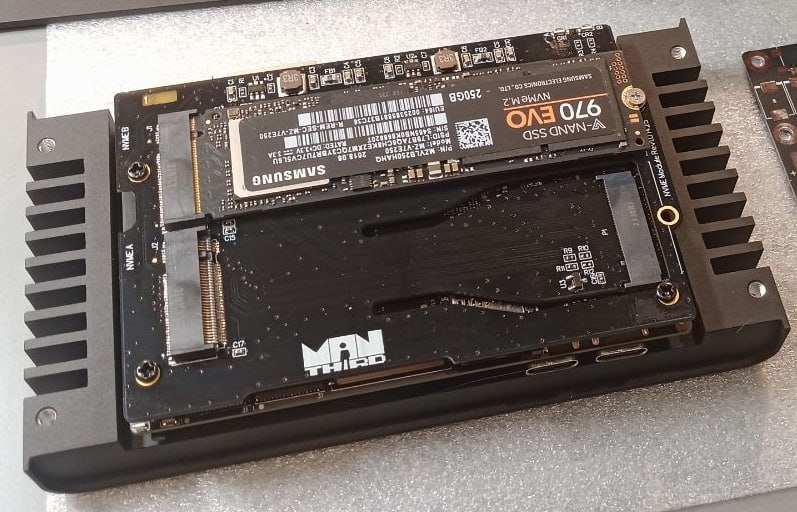
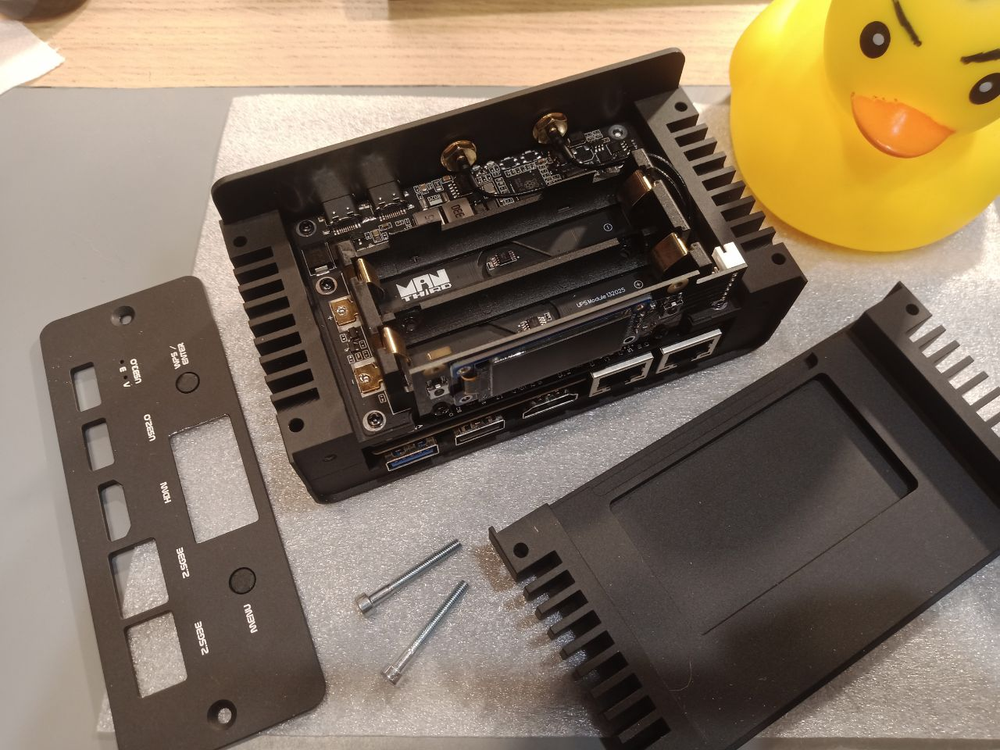
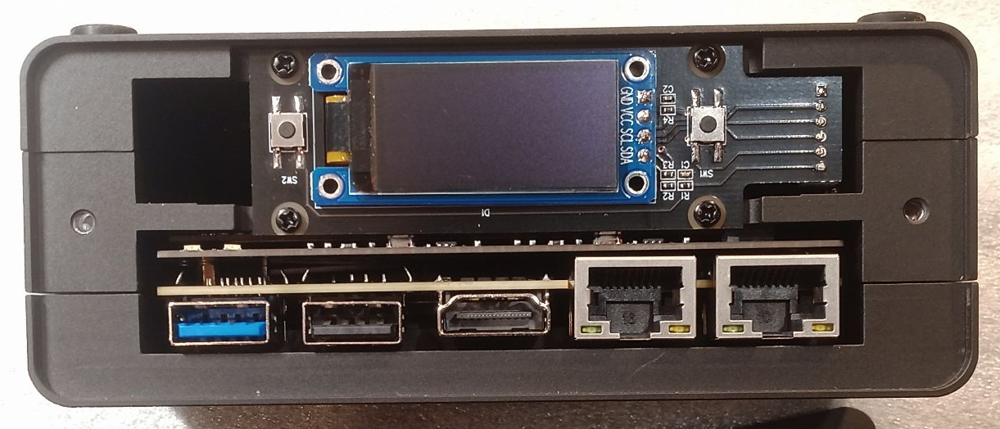
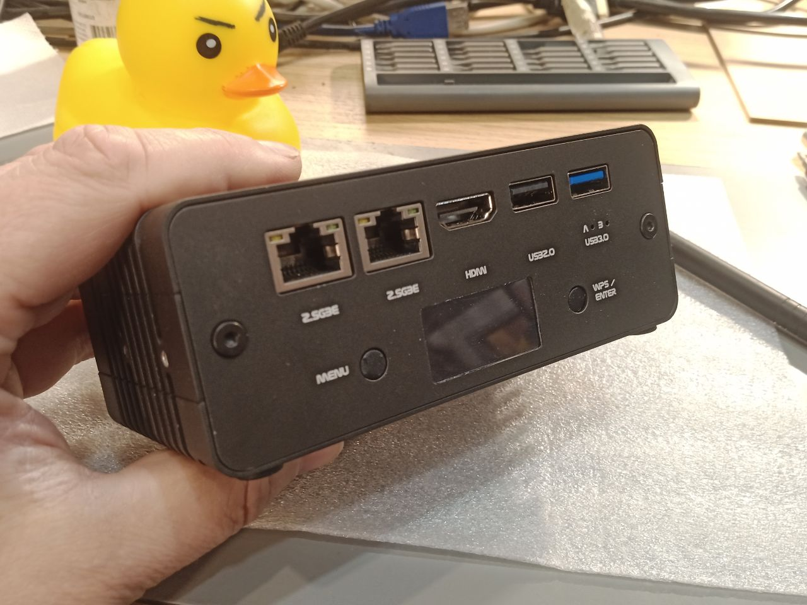
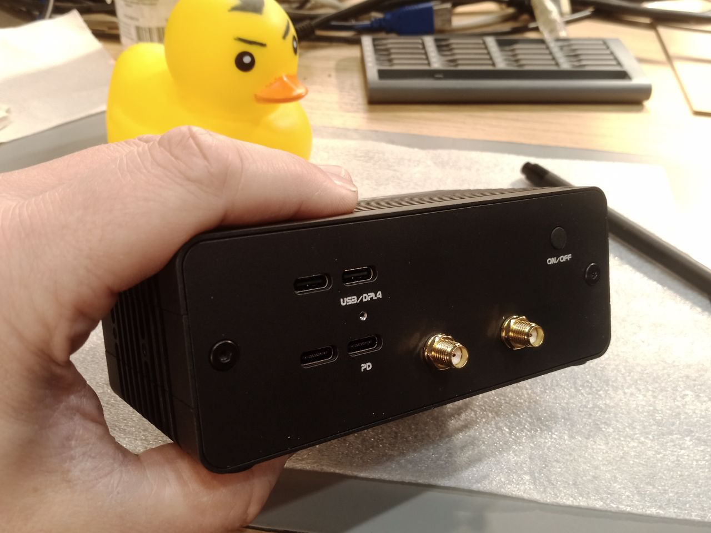
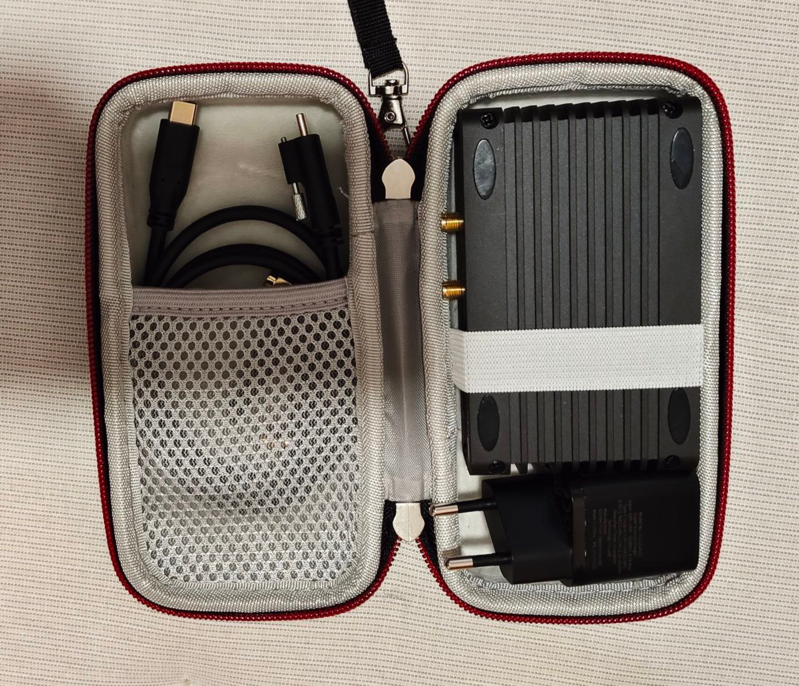
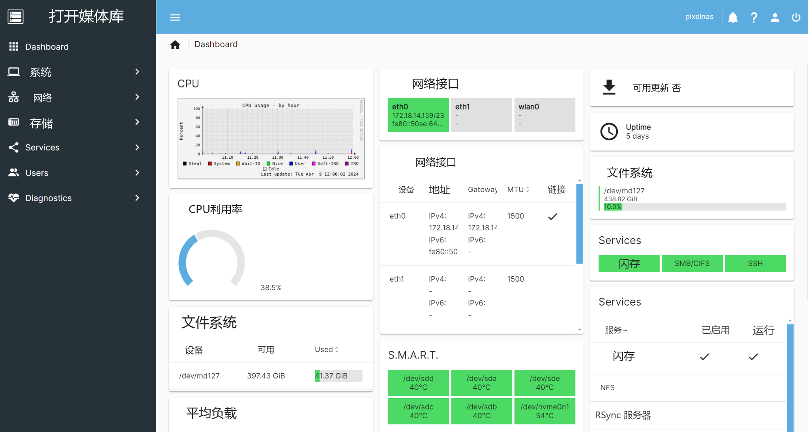

移动存储不一定只能是一块接在电脑上的硬盘。UberNAS 社区的开发者希望做一台可以随身携带、通过网络共享文件，并按需求增加电池与显示模块的小型 NAS。他们选择 ArmSoM Sige7 作为计算平台，将双 NVMe 扩展、UPS 和 OLED 组合成了一套模块化原型。

本文依据用户提供的案例材料整理，将项目统一称为 **ArmSoMNAS**，重点介绍其中基于 Sige7 的方案。模块和整机照片来自原项目，展示的是用户设计，并非 Sige7 默认随附的配件。

*用户提供的紧凑型原型与桌面使用场景。*

## 从五盘 SATA 方案走向更紧凑的 NVMe NAS

团队此前开发过基于 RK3568、带五个 M.2 SATA 存储位的移动 NAS。新一轮设计希望缩小体积，同时采用 NVMe 存储和 2.5GbE 网络。Sige7 的双 2.5GbE 接口，以及位于主板背面的 M.2 PCIe 3.0 x4 接口，成为他们选择平台的关键。

这样一来，项目可以围绕一块小型单板计算机组织存储、供电和外壳，而不必重新设计整套处理器主板。团队把精力放在双盘扩展、移动使用方式与模块装配上。

## Sige7 提供计算和连接基础

[Sige7 官方文档](https://docs.armsom.org/armsom-sige7)确认其采用 RK3588，并提供双 2.5GbE 与 M.2 PCIe 3.0 x4。对这个案例来说，关键是将计算、网络和存储接口集中在一个紧凑平台上。

| 部分 | 本案例中的角色 |
| --- | --- |
| Sige7 主板 | 运行 Linux 和网络存储服务 |
| 双 2.5GbE | 为有线共享和网络连接设计提供基础 |
| M.2 PCIe 3.0 x4 | 连接项目自行设计的 Twin NVMe 模块 |
| 模块化外壳 | 根据是否需要 UPS、显示屏选择组合 |

接口规格并不等于文件复制实测。资料没有给出持续读写、双盘并发或网络聚合的基准结果，实际吞吐仍需在完整配置下测试。

## Twin NVMe：把双盘做成独立扩展模块

Twin NVMe 是一块带两个 M.2 NVMe 插槽的扩展 PCB，可连接到 Sige7 背面的 M.2 接口。它使存储扩展成为单独的模块，便于围绕 SSD、结构高度与散热继续优化。

*Twin NVMe 扩展板原型；图中安装了一块 SSD，另一个插槽可见。*

原稿介绍了 RAID 0 和 RAID 1 的使用方向，但没有公布扩展板的 PCIe 拓扑、每盘链路宽度及完整兼容清单，不能把它理解成两个独立的 PCIe x4 接口。复现时应确认模块版本、驱动、SSD 和系统镜像，再决定存储布局。

RAID 0 偏向容量与条带化使用，但不提供单盘故障冗余；RAID 1 通过镜像提高单盘故障时的可用性。两者都不能替代独立备份，重要文件仍应保留另一份可恢复副本。

## UPS：让存储设备具备移动使用能力

UPS 模块使用两节 18650 外形的 LiFePO4 电芯，并通过基于 RP2040 的智能电池控制器支持 USB HID 通信。原文写作“RPi 2040”，此处按常见芯片名称规范书写，具体硬件仍以模块资料为准。

*UPS 模块与电池座原型，来自用户案例素材。*

案例作者报告，该模块可在存储和网络活动不受限制的情况下支持最长约 1.5 小时运行。原稿没有给出电池容量、SSD 型号、负载曲线或截止条件，因此这是作者对其原型的续航描述，不是 ArmSoM 的统一续航承诺。

对下一版产品，值得重点验证的是电源切换、剩余电量上报和低电量关机之间的配合。USB HID 通信能力本身并不能证明整个安全关机流程已经完成。

## OLED 和双按键：让设备状态一目了然

显示模块把一块 OLED 与两个可由软件定义功能的按键集成在一起。对于没有常驻显示器的 NAS，这给本地状态显示和简短操作提供了入口。

*OLED 屏幕与双按键模块，位于网络和 USB 接口上方。*

例如，后续界面可以围绕网络地址、电池状态或存储状态设计；这些是可继续开发的方向，原材料没有列出已实现的全部屏幕页面和按键功能。

## 两种组合：紧凑存储与完整移动设备

仅使用 Sige7 与 Twin NVMe 模块，可以形成更精简的桌面存储原型。增加 UPS、OLED 和按键后，则得到功能更完整的移动组合。用户可以按使用场景选择模块，不必始终携带全部配置。

*完整模块版的网络、USB 与显示面板。*

*完整模块版的另一侧接口与外壳。*

原型采用带散热鳍片的铝制外壳。案例介绍了被动散热方案，也提到可按配置选择主动散热。是否需要风扇仍取决于 SSD、持续负载、环境温度和机壳设计；资料没有提供覆盖这些条件的温升测试。

*原型与线缆放入收纳包，展示便携形态。*

这种形态适合继续探索差旅资料共享、拍摄素材归档、现场演示和小型 homelab。以上是基于形态的应用建议，不能等同于已经完成现场部署。

## Armbian 与 OpenMediaVault 组成软件基础

案例选择 Armbian 作为 Linux 基础，使用 OpenMediaVault 管理网络存储。当前 [Armbian Sige7 页面](https://armbian.com/boards/armsom-sige7)仍提供该平台的镜像，并标记为 Community 支持。原型使用的具体发行版、内核及 OpenMediaVault 版本未在材料中注明，复现时应记录版本并按对应文档配置。

[OpenMediaVault](https://www.openmediavault.org/)提供基于 Web 的存储与共享管理。它把磁盘、共享服务和状态信息集中到管理界面中，适合将一台 Linux 板卡组织成可维护的 NAS。具体 RAID、UPS 联动及附加功能仍取决于版本和配置。

*原稿提供的 OpenMediaVault 参考界面；其中多盘、容量、温度和运行时间不作为本文双盘原型的实测结果。*

## 与社区一起把原型做完善

原作者介绍，围绕移动 NAS 的分享吸引了更多爱好者参与 UberNAS News 与 UberNAS Community。硬件连接、软件配置与 homelab 经验在社区内交流，让开发者能够从使用者反馈中继续迭代。

这个案例展示了 ArmSoM 平台的一条实际应用路径：由 Sige7 承担计算与连接基础，由用户围绕存储、电源和交互开发自己的模块，再借助 Linux 软件与社区形成完整体验。

## 开始自己的 ArmSoMNAS 项目

先明确需要几块盘、是否离线移动使用、怎样备份，再选择主板、存储扩展、供电和外壳。随后验证单盘与双盘识别、持续拷贝、温度、电源切换和恢复流程。本文是用户案例，不包含扩展板的完整原理图、BOM 或可直接复现的安装脚本。

- [了解 ArmSoM Sige7 产品](https://www.armsom.org/sige7)
- [查阅 Sige7 接口与开发资料](https://docs.armsom.org/armsom-sige7)
- [获取 Sige7 的 Armbian 镜像](https://armbian.com/boards/armsom-sige7)
- [了解 OpenMediaVault](https://www.openmediavault.org/)
- [访问案例资料列出的 UberNAS Community](https://t.me/UberNasCommunity)

案例与照片来自用户提供的 UberNAS 社区材料；原型外壳标识和管理界面保持原样。本文没有新增 ArmSoM 硬件测试，也不将整套原型描述为已上架的标准套装。
