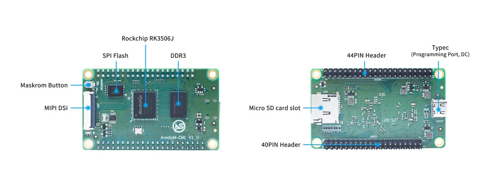

将产品做成独立设备时，核心板可以把处理器与基础存储部分集中起来，让团队把精力投入接口、结构和应用。ArmSoM CM1 基于 RK3506J，面向工业终端、显示控制和设备联网；建议先用 CM1-IO 验证，再设计自己的载板。

## 核心板和开发套件要分开看

| 项目 | CM1 核心板 | CM1-IO 扩展后的套件 |
|---|---|---|
| 处理器 | RK3506J | 使用 CM1 |
| 内存/存储 | 256/512MB DDR3L、256/512MB NAND 配置 | 以装配的核心板为准 |
| 尺寸 | 70×42mm | 载板 100×70mm |
| 显示 | MIPI DSI | 配合实际屏幕与驱动验证 |
| 网络 | 通过扩展信号实现 | 双 10/100M 网口，Wi-Fi 5/BT 4.2 |
| USB | Type-C 电源与烧录 | 两个 USB2.0 Host |

双网口、无线和两个 USB Host 属于载板套件资源，不应描述为 CM1 裸核心板自带的连接器。文档标注工作温度 −40～85°C；整机仍需按电源、屏幕、存储器件与外壳条件验证。

## 场景一：为设备设计专用面板

小型包装机、环境监测箱或仪表终端往往需要专用连接器与外壳。以 CM1 运行界面、参数管理和通信服务，将现场信号调理与保护放在载板上。屏幕尺寸、背光供电、触摸接口应在原理图阶段一起确定。

## 场景二：设备联网模块

以串口或 CAN 接入原有控制器，Linux 端完成数据整理、缓存与上传。明确谁拥有设备状态、通信超时如何处理、断网后保留多少记录。不要让日志无限增长，也不要把设备紧急停机逻辑依赖于网络服务。

## 场景三：产品系列共用计算核心

一个产品系列可以围绕同一核心板开发不同载板，例如墙装控制面板、桌面仪表和导轨网关。应用层可复用，但连接器分配、设备树、散热和产测仍按型号分别维护。复用收益来自统一软件与验证流程，而不是跳过电气设计。

## 从开发套件走向样机

1. 固定 CM1 配置、板卡版本和 Buildroot 镜像。
2. 验证屏幕、触控、存储、网络和现场协议。
3. 列出每个信号的复用、电压、上拉、启动状态与保护需求。
4. 检查掉电恢复、升级失败回退、看门狗和日志容量。
5. 用最终电源、外壳与线缆做温升、稳定性和接口测试。

40-PIN/44-PIN 连接不能仅按针数判断兼容性，也不能把载板部分兼容树莓派 40-pin 的说明扩大为核心板可直接替换其他模组。

## 为什么选择 CM1

适合需要自定义外形与接口，又希望沿用 ArmSoM 文档、参考设计和软件资源的团队。若目标只是尽快运行一个完整板级原型，Forge1 也值得评估。上述流程是开发建议，不代表已完成认证或量产验证。

## 系列文章与官方资料

- [RK3506J 芯片详解：从三核处理器到工业 HMI 与设备联网](/zh/articles/rk3506j-chip-guide/)
- [ArmSoM Forge1：工业网关、HMI 与设备采集的开发起点](/zh/articles/forge1-industrial-hmi-gateway/)
- [RK3506B Datasheet V1.0：下载、架构、引脚与电气设计导读](/zh/articles/rk3506b-datasheet-v10/)
- [Rockchip RK3506](https://www.rock-chips.com/a/cn/product/RK35xilie/2025/1208/2125.html)
- [ArmSoM CM1](https://docs.armsom.org/armsom-cm1)
- [ArmSoM Forge1](https://docs.armsom.org/armsom-forge1)
- [ArmSoM](https://www.armsom.org/)
