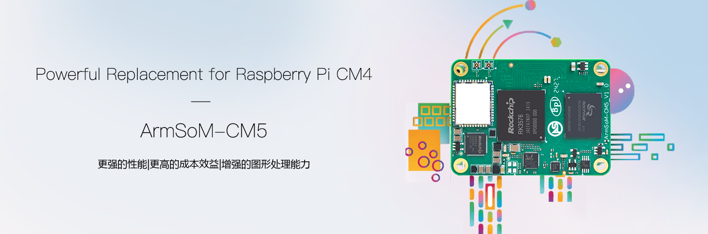
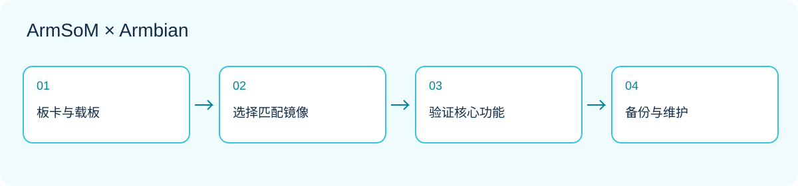

*ArmSoM 官方产品图；图中芯片功能不代表当前 Armbian 镜像已支持全部硬件加速。*

当一个原型需要装进指定外壳、连接特定接口或使用自定义供电时，计算模块开始体现价值。ArmSoM CM5 把计算部分集中在模块上，让载板围绕产品需求设计。Armbian 的板级镜像与构建配置可以作为软件评估起点，但定制载板仍需要自己的验证。

本文讨论如何从参考平台走向可维护的 Linux 设备。它不是量产认证，也不表示所有外设已在某个镜像中通过测试。建议先阅读本系列的镜像选择篇，再推进模块项目。

## 1. 模块、载板和镜像要一起选

CM5 使用 RK3576。模块提供计算基础，载板决定电源、连接器和实际引出的接口。两个模块处理器相同，不代表它们插入不同载板后会以相同方式启动。[CM5 产品资料](https://www.armsom.org/cm5)。

开始前记录模块版本、载板版本、内存和存储配置，以及显示、摄像头和外接设备型号。建立一张连接表，比只写“使用CM5”更有用：每个接口写明用途、供电来源、信号电平、驱动依赖和验收方法。

## 2. CM5 IO 与 CM5 CM4 IO 是不同目标

| Armbian 条目 | 构建目标标识 | 使用原则 |
|---|---|---|
| CM5 IO | `armsom-cm5-io` | 对应页面描述的CM5 IO参考平台 |
| CM5 CM4 IO | `armsom-cm5-rpi-cm4-io` | 对应CM4 IO载板配置 |

两种名称并不是只换了下载标签。检查[CM5 IO](https://armbian.com/boards/armsom-cm5-io)与[CM5 CM4 IO](https://armbian.com/boards/armsom-cm5-rpi-cm4-io)页面，选择匹配实际组合的目标。上述两项当前列为社区支持。不要把一块参考载板的配置推广为所有第三方载板均可用。

## 3. 兼容评估从引脚开始

机械尺寸或连接器吻合，只是评估的第一步。逐项检查电源轨、复位和启动信号、显示通道、USB角色、PCIe、网口以及未使用引脚的处理。CM5官方文档明确列出与CM4的接口差异，例如显示通道数量；不能把“可使用某类载板”理解为全部功能等价。

先对照原理图、模块引脚表和载板设计，再决定要启用哪些功能。摄像头和屏幕还涉及连接顺序、供电和软件驱动。参考[CM5硬件文档](https://docs.armsom.org/armsom-cm5)，避免直接沿用另一种模块的镜像或外设配置。

## 4. 三种适合评估的产品原型

**设备状态终端：** 载板连接显示和输入，应用展示设备状态。先实现只读页面与断网提示，再增加控制动作。确认触摸映射、屏幕方向和异常重启后状态恢复；不要把普通Linux界面当作实时安全控制器。

**数据采集网关：** 载板适配现场接口，Linux负责数据整理、队列和上传。把设备驱动与业务协议分开，设置缓存上限、记录时间戳，并处理重复数据。工业电平、隔离与浪涌保护属于载板设计，不会由系统镜像自动补齐。

**边缘视觉节点：** 将采集、推理和网络输出分开验证。先用固定文件输入比较模型结果，再接入摄像头并评估散热。NPU和视频加速需要匹配的软件栈；CPU参考实现可以帮助区别模型错误与驱动问题。




## 5. 分阶段点亮自己的载板

| 阶段 | 只增加一类变量 | 通过条件示例 |
|---|---|---|
| A | 电源、启动介质、调试通道 | 冷启动与重启均可观察 |
| B | 存储与有线网络 | 数据持久化，重启后路径稳定 |
| C | 显示、USB或单个传感器 | 设备枚举、业务输入输出正确 |
| D | 全部关键接口同时工作 | 无资源冲突，错误可定位 |
| E | 外壳与最终供电 | 温度、重启和恢复符合项目目标 |

如果B阶段稳定、C阶段失败，先定位新引入的接口，而不是同时更新内核、替换存储和修改应用。每一步保留已知可启动的镜像与配置，才能做有意义的对照。

## 6. 让软件配置可以重建

把镜像来源、Armbian构建版本、板级目标、内核分支、设备树修改和应用依赖写进同一份记录。不要只保存一张已经手工修改许多次的存储卡。配置改动应有原因、对应硬件和恢复方式。

下面是只读记录命令，不会替你编译或更换启动文件：

```sh
cat /etc/armbian-release
uname -a
cat /proc/device-tree/model
lsblk -o NAME,SIZE,TYPE,FSTYPE,MOUNTPOINTS
systemctl --failed
```

`/proc/device-tree/model`可能不带换行；文件不存在时先核对镜像和运行环境。自行构建应从对应板卡页面进入当前构建说明，固定所用代码版本，再验证输出镜像。不要把不同发行版、分支和载板的命令随意拼接。

## 7. 安装与升级需要恢复路径

把系统迁移到内置存储前，确认镜像支持的启动流程与目标介质。备份数据，保留能重新进入调试或恢复模式的方法。不要假设任意eMMC、NVMe或SPI组合都能用同一套步骤。

测试更新时不仅检查版本号，还要检查启动、网络、应用数据、外设和服务权限。把可恢复性作为验收项：如果应用更新失败，应能恢复上一版；如果系统介质损坏，应能通过文档重建。安全更新应持续评估，不因“冻结版本”而永久停用维护。

## 8. 从一台样机扩展到多个设备

配置模板与每台设备的身份信息分开管理。首次配置设备时生成或分配独立凭据，不复制一张含共享私钥和固定网络身份的镜像到所有设备。定义现场可读取的版本信息，便于支持人员确认硬件和软件组合。

记录至少包括：模块和载板版本、镜像哈希、构建来源、应用版本、关键外设、验收结果和回退步骤。社区支持镜像是评估入口，不是量产服务协议；长期交付需要项目方明确维护责任和升级验证资源。

## 9. 从参考平台开始，按需求定制

[查看 CM5 产品与配置](https://www.armsom.org/cm5)，并结合[CM5-IO文档](https://docs.armsom.org/armsom-cm5-io)评估参考平台。先在已知组合上跑通核心应用，再逐项改变载板和外设，有助于把定制风险限制在可定位的范围内。

ArmSoM模块的意义是让你把精力集中到真正不同的接口与产品体验；Armbian为Linux评估提供现成入口。两者结合的关键不是跳过验证，而是用清晰的基线让每一步更容易验证。

## 继续阅读本系列

- [ArmSoM × Armbian：从镜像选择到第一个 Linux 项目](/zh/articles/armsom-armbian-getting-started/)
- [Sige5 / Sige7 + Armbian：六种值得动手的 Linux 应用方案](/zh/articles/sige5-sige7-armbian-projects/)
