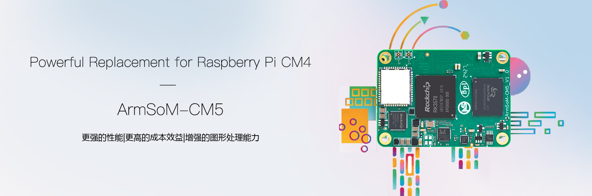

对于原本计划使用 Raspberry Pi CM4 或 CM5 的项目，ArmSoM CM5 提供了另一条基于 RK3576 的开发路线：在紧凑计算模块中使用八核 CPU 和 NPU，再通过载板连接业务外设。它适合需要边缘推理或重新评估系统架构的团队，但替代应从具体项目出发。

## 先区分两种“替代”

**项目选型替代**是重新选择计算平台、系统和外设；**底板兼容替换**则要求电气、引脚、接口和软件逐项匹配。官方 CM5 文档明确提供 Raspberry Pi CM4 底板使用路径，并提示 HDMI/DSI 数量不同。它不是对所有第三方 CM4 底板的无条件保证，也不能自动推导为兼容 Raspberry Pi CM5 IO Board。

| 现有项目 | 推荐处理方式 |
|---|---|
| 使用 Raspberry Pi CM4 IO Board | 按 ArmSoM 对应镜像和文档验证实际外设 |
| 第三方 CM4 载板 | 对照原理图、引脚表、供电和接口逐项审核 |
| 使用 Raspberry Pi CM5 及专用载板 | 作为平台迁移评估，不能按名称直接替换 |
| 全新边缘 AI 设备 | CM5 + 匹配载板进行样机验证，再决定定制 |

## 为什么考虑 ArmSoM CM5

RK3576 的 NPU 给本地视觉分类、目标检测等项目提供了专用推理路径；CPU 可继续执行协议和业务逻辑。模型必须经过 RKNN 转换和精度验证，6 TOPS INT8 采用稀疏口径，并不等于任意模型的实际速度。

模块化也让载板可以围绕产品安排电源、连接器和结构。对于已有机械与载板投入的项目，价值在于评估可复用部分，而不是假设所有硬件和软件都无需改动。

## 与树莓派 CM5 比较时，不只看核心数量

Raspberry Pi CM5 官方规格为四核 Cortex-A76，ArmSoM CM5 使用四核 A72 加四核 A53。不同微架构的八核与四核不能直接按数量判胜负。应对真实程序测试响应延迟、吞吐、内存占用和能耗，并计入驱动、维护与迁移成本。

原 Raspberry Pi OS 镜像也不是 RK3576 镜像。Python 或容器中的业务逻辑可能易于移植，但 GPIO 编号、相机栈、硬件视频、设备树和启动链路要单独处理。相同 ARM 指令集不代表设备驱动兼容。

## 五步迁移计划

1. **盘点依赖**：记录摄像头、显示屏、USB、PCIe、无线和 GPIO 用法。
2. **核对硬件**：确认模块修订、连接器、引脚和电源时序。官方提示早期 CM5 v1.2 的 Pin 21 问题在 v1.3 修复，应按实物版本核查。
3. **建立软件基线**：使用匹配模块与载板的镜像，记录内核和驱动版本。
4. **迁移应用**：先跑通业务，再逐项替换硬件加速和外设访问部分。
5. **整机验收**：覆盖冷启动、掉电、网络断连、温升和持续负载。

## 什么时候先选 Sige5

若还没有确定载板，先用 Sige5 验证功能通常更直接；若已有明确尺寸、端口位置与量产要求，再以 CM5 推进定制。这里给出的是工程选型路线，没有提供未经测试的性能或成本优势承诺。

## 系列文章与产品入口

- [RK3576 芯片详解：从八核 CPU 到 ArmSoM 边缘 AI 产品](/zh/articles/rk3576-chip-guide/)
- [Sige5 能做什么？六种 RK3576 边缘计算应用方案](/zh/articles/sige5-rk3576-applications/)
- [RK3576 Datasheet V1.0 下载与解读：规格、封装、电气与散热](/zh/articles/rk3576-datasheet-v10/)
- [ArmSoM CM5](https://www.armsom.org/cm5) · [ArmSoM Sige5](https://docs.armsom.org/armsom-sige5)

## 参考资料

- [Rockchip RK3576](https://www.rock-chips.com/a/en/products/RK35_Series/2024/1212/2033.html)
- [RK3576 Brief V1.2 (2025-08-28)](https://www.rock-chips.com/uploads/pdf/2024.3.18/191/RK3576%20Brief%20Datasheet%20V1.2-20250828.pdf)
- [ArmSoM CM5](https://docs.armsom.org/armsom-cm5)
- [ArmSoM Sige5](https://docs.armsom.org/armsom-sige5)
- [Raspberry Pi CM5](https://www.raspberrypi.com/products/compute-module-5/)
