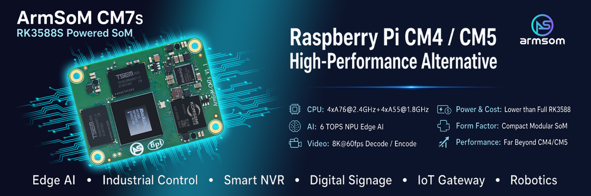
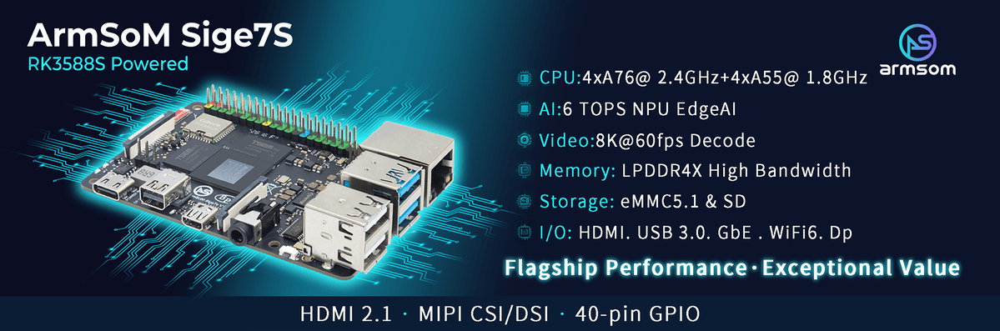

选择 RK3588S 产品时，真正需要先回答的是：你需要一块能直接连接外设的单板计算机，还是一个嵌入自己设备的计算模块？**Sige7S 面向快速搭建，CM7S 面向载板定制**。两者不是算力高低的简单排序。

## 先选产品形态

| 开发需求 | 建议起点 | 需要承担的工作 |
|---|---|---|
| 快速搭建 Linux 应用或演示设备 | Sige7S | 镜像、散热、外设与应用验证 |
| 特殊尺寸、专用连接器、定制接口 | CM7S + 自定义载板 | 原理图、供电、信号完整性、设备树与整机验证 |
| 核心板项目早期软件开发 | CM7S + CM7S-IO | 使用匹配的开发底板，后续迁移到定制载板 |

CM7S 文档标注 55 × 40 × 1.6 mm、三组 100-pin 板对板连接器。它的价值是将计算、内存等复杂部分模块化，让载板围绕应用安排接口。相近尺寸不代表能插入 Raspberry Pi CM4/CM5 载板：必须逐项核对连接器、引脚和供电，不能宣传为直接兼容替换。

## Sige7S：把精力先放在应用上

Sige7S 官方文档列有千兆以太网、Wi-Fi 6、HDMI、USB 和扩展排针，适合先做边缘推理终端、显示控制或 Linux 应用原型。端口已经固定，选相机、屏幕和外设时要从板级连接器与支持列表出发，而不是从芯片最大规格倒推。

例如，文档中的 Sige7S DP 输出为两条通道、最高 4K60；这与芯片资料中四通道 DP 的最高规格不是同一条件。相机与 DSI 也要确认通道数、排线和驱动。

## CM7S：围绕产品设计载板

CM7S 适合需要专用结构、接口位置和外设组合的项目。开发流程可以先用 CM7S-IO 完成应用验证，再设计自己的载板；迁移时保留已验证的软件版本，但重新验证设备树、供电时序和外设。

核心板与底板供电必须分开理解：CM7S 文档写 5V 输入，CM7S-IO 写 12V DC 输入，不能把后者直接接到模块电源引脚。官方文档还提示 CM7S v1.1 的 CN2 第 2、4 脚存在限制，选板前应确认实际版本和修订说明。

## 下单前确认的五件事

1. CPU、内存、eMMC 与交付 SKU 是否一致。
2. 显示、相机、网络和扩展接口是否真的引出。
3. 系统镜像、内核、NPU runtime 与外设驱动是否匹配。
4. 电源峰值、散热器、外壳和环境温度是否验证。
5. 量产镜像、恢复流程和硬件版本能否追溯。

Sige7S 官方页面存在不同尺寸描述，因此本文不把其中任一值作为结构设计依据。请使用对应硬件版本的机械文件确认尺寸。本文是选型建议，不是两块板的性能对比实测。

## 继续阅读与产品资料

- [RK3588S 芯片详解：从八核 CPU、6 TOPS NPU 到 ArmSoM 产品落地](/zh/articles/rk3588s-chip-guide/)
- [用 RK3588S 做边缘 AI 与多媒体设备：CM7S、Sige7S 应用规划](/zh/articles/rk3588s-edge-ai-multimedia/)
- [RK3588S Datasheet V1.3：下载、框图、封装与电气参数阅读指南](/zh/articles/rk3588s-datasheet-v13/)

### 产品与开发资料

- [CM7S](https://www.armsom.org/cm7s) · [CM7S Docs](https://docs.armsom.org/armsom-cm7s)
- [Sige7S](https://www.armsom.org/sige7s) · [Sige7S Docs](https://docs.armsom.org/armsom-sige7s)
- [Rockchip RKNN-Toolkit2](https://github.com/airockchip/rknn-toolkit2) · [RKNN-LLM](https://github.com/airockchip/rknn-llm)
